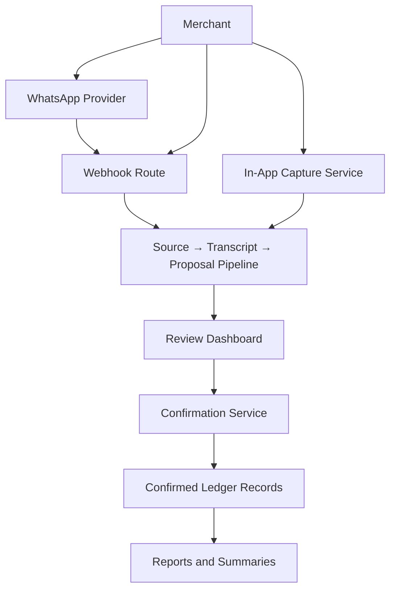
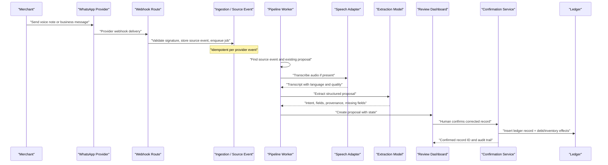
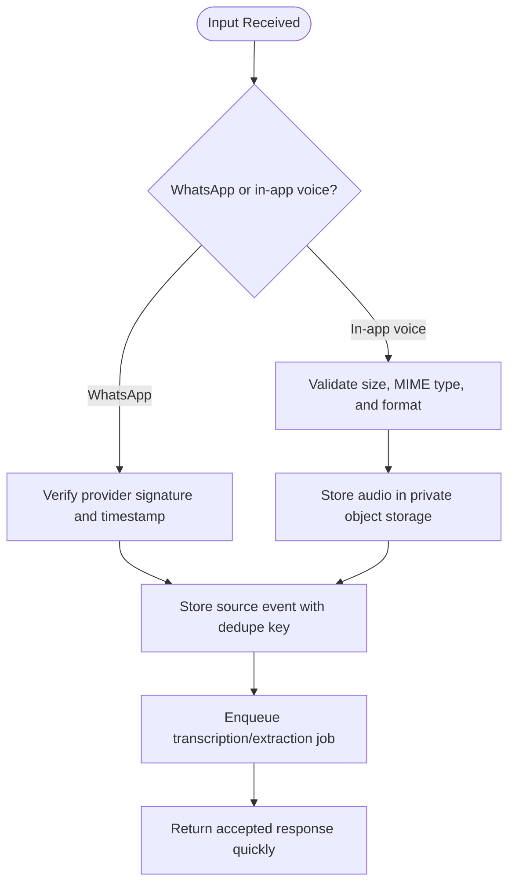
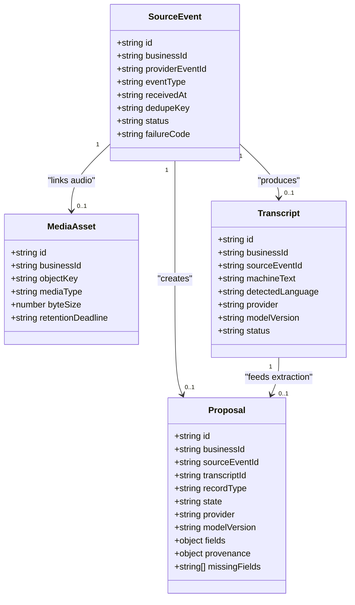
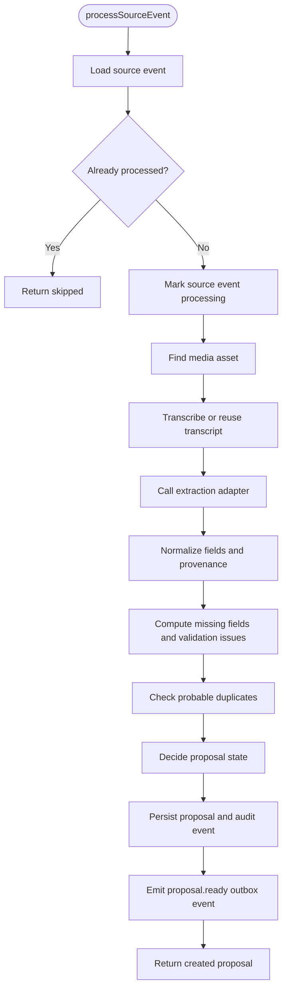
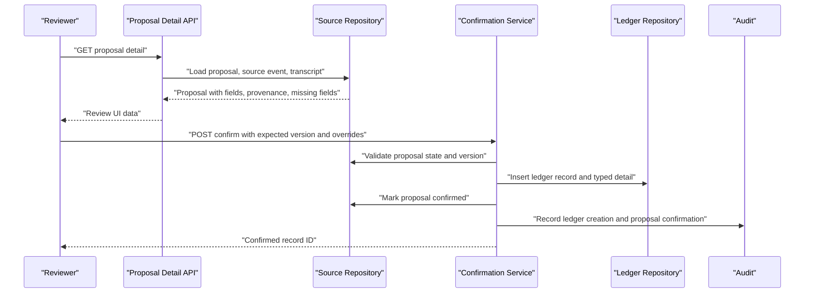
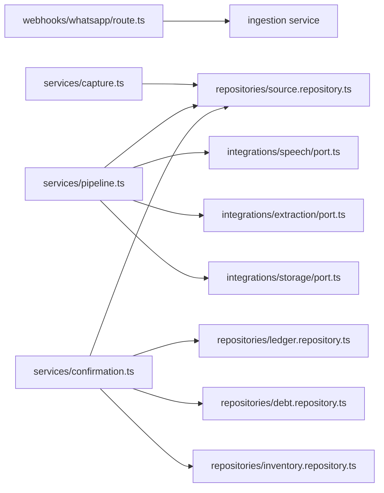

# Project Overview

<cite>
**Referenced Files in This Document**
- [PRD.md](file://PRD.md)
- [architecture.md](file://architecture.md)
- [# Daftari Bookkeeping Algorithm.md](file://"# Daftari Bookkeeping Algorithm.md")
- [src/app/api/v1/webhooks/whatsapp/route.ts](file://src/app/api/v1/webhooks/whatsapp/route.ts)
- [src/server/services/capture.ts](file://src/server/services/capture.ts)
- [src/server/services/pipeline.ts](file://src/server/services/pipeline.ts)
- [src/server/services/confirmation.ts](file://src/server/services/confirmation.ts)
- [src/server/repositories/source.repository.ts](file://src/server/repositories/source.repository.ts)
</cite>

## Table of Contents
1. [Introduction](#introduction)
2. [Project Structure](#project-structure)
3. [Core Components](#core-components)
4. [Architecture Overview](#architecture-overview)
5. [Detailed Component Analysis](#detailed-component-analysis)
6. [Dependency Analysis](#dependency-analysis)
7. [Performance Considerations](#performance-considerations)
8. [Troubleshooting Guide](#troubleshooting-guide)
9. [Conclusion](#conclusion)

## Introduction
Daftari is a voice-first, WhatsApp-native AI bookkeeping dashboard for Tanzanian small businesses. Its purpose is to let merchants record business activity through the messaging channel they already use, while keeping final control over financial records in a simple web dashboard.

The product promise is: **You speak. Daftari remembers. You stay in control.**

This means:
- A merchant speaks or sends a supported message through WhatsApp.
- Daftari stores the original source and creates a transcript.
- An extraction model proposes structured business records.
- A human reviews, corrects, confirms, or rejects each proposal.
- Only confirmed proposals become ledger entries that drive reports, deni balances, inventory movements, and summaries.

Conventional accounting software often asks users to type transactions into forms, choose categories manually, and understand accounting terminology. Daftari reverses that flow: recording happens naturally through voice or WhatsApp messages, and the dashboard becomes a review and control surface rather than the primary data-entry tool.

**Section sources**
- [PRD.md:10-20](file://PRD.md#L10-L20)
- [PRD.md:22-37](file://PRD.md#L22-L37)
- [architecture.md:9-36](file://architecture.md#L9-L36)

## Project Structure
At a high level, the project combines:
- A Next.js dashboard with pages for overview, review, records, deni, inventory, reports, and settings.
- API routes under `/api/v1` for ingestion, proposals, records, debts, exports, sessions, and health.
- Backend services for capture, transcription, extraction, validation, confirmation, reporting, jobs, and audit.
- Repositories for source events, transcripts, proposals, ledger records, debts, inventory, and platform operations.
- Integrations behind adapters for WhatsApp, speech-to-text, extraction models, and storage.

**Diagram sources**
- [src/app/api/v1/webhooks/whatsapp/route.ts:1-69](file://src/app/api/v1/webhooks/whatsapp/route.ts#L1-L69)
- [src/server/services/capture.ts:1-147](file://src/server/services/capture.ts#L1-L147)
- [src/server/services/pipeline.ts:1-506](file://src/server/services/pipeline.ts#L1-L506)
- [src/server/services/confirmation.ts:1-522](file://src/server/services/confirmation.ts#L1-L522)

**Section sources**
- [PRD.md:102-117](file://PRD.md#L102-L117)
- [architecture.md:496-558](file://architecture.md#L496-L558)

## Core Components
Daftari’s core workflow revolves around five stages:

| Stage | What it does | Key code concepts |
|---|---|---|
| Input capture | Accepts WhatsApp webhook deliveries or in-app voice recordings | `source_events`, media assets, deduplication |
| Transcription | Converts audio to text with language and quality metadata | `transcripts`, detected language, provider/model version |
| Extraction | Turns transcript into a typed proposal with field provenance | `proposals`, record types, missing fields, ambiguities |
| Human review | Lets authorized users inspect source, edit fields, and decide | `needs_review`, `needs_details`, `duplicate`, confirm/reject |
| Confirmed records | Posts only reviewed decisions into the ledger | `ledger_records`, debt obligations, inventory movements, audit events |

### Target Audience
- **Merchants / owner-operators:** Record sales, expenses, payments, and stock changes without stopping work to type. They own the final decision on money records.
- **Bookkeepers / managers:** Review proposals, correct categories and customer details, follow up on missing information, and prepare routine summaries.
- **Staff members:** May record activity or view limited operational information but do not get owner-level financial access by default.

### Key Features
- **Voice processing:** In-app voice capture and WhatsApp voice notes are stored as private media, transcribed asynchronously, and linked to source events.
- **Proposal review system:** Every AI-generated record starts as a proposal. The dashboard shows source evidence, proposed fields, missing fields, ambiguity notes, duplicate candidates, and reviewer actions.
- **Ledger management:** Confirmed records form the durable business record. Corrections and reversals preserve history instead of silently editing posted entries.
- **Debt tracking (deni):** Sales that leave unpaid amounts create obligations; debt payments are applied predictably to open obligations, with unapplied amounts visible as customer credit.
- **Inventory management:** Stock movements can be recorded when enabled, with item resolution, quantity units, movement type, and audit linkage.
- **Reporting:** Period summaries show sales, expenses, net cash movement, outstanding deni, and category activity based on confirmed records only.

**Section sources**
- [PRD.md:75-117](file://PRD.md#L75-L117)
- [PRD.md:158-233](file://PRD.md#L158-L233)
- [architecture.md:109-173](file://architecture.md#L109-L173)

## Architecture Overview
The system follows a strict separation between AI-assisted interpretation and human-controlled posting:

**Diagram sources**
- [src/app/api/v1/webhooks/whatsapp/route.ts:33-68](file://src/app/api/v1/webhooks/whatsapp/route.ts#L33-L68)
- [src/server/services/capture.ts:67-145](file://src/server/services/capture.ts#L67-L145)
- [src/server/services/pipeline.ts:354-503](file://src/server/services/pipeline.ts#L354-L503)
- [src/server/services/confirmation.ts:318-455](file://src/server/services/confirmation.ts#L318-L455)

The architecture enforces several non-negotiable rules:
- AI never commits a financial ledger record directly.
- Source identity and lineage are preserved from webhook to transcript, proposal, decision, and ledger record.
- Every request is tenant-scoped to one business.
- Webhook retries and job retries cannot duplicate side effects.
- Financial history is auditable and immutable after posting.
- External providers are replaceable behind adapters.

**Section sources**
- [architecture.md:9-36](file://architecture.md#L9-L36)
- [architecture.md:53-79](file://architecture.md#L53-L79)
- [architecture.md:314-393](file://architecture.md#L314-L393)

## Detailed Component Analysis

### Voice and Message Input
Daftari supports two main input paths:
1. **WhatsApp webhook:** A public endpoint verifies provider signatures, accepts the delivery quickly, persists a source event, and queues background processing.
2. **In-app voice capture:** A signed-in user uploads audio bytes, which are validated, stored in private storage, recorded as a source event, and queued for transcription.

Both paths avoid slow inline processing so the HTTP response remains fast and provider failures cannot cause lost recordings.

**Diagram sources**
- [src/app/api/v1/webhooks/whatsapp/route.ts:33-68](file://src/app/api/v1/webhooks/whatsapp/route.ts#L33-L68)
- [src/server/services/capture.ts:67-145](file://src/server/services/capture.ts#L67-L145)

**Section sources**
- [src/app/api/v1/webhooks/whatsapp/route.ts:1-69](file://src/app/api/v1/webhooks/whatsapp/route.ts#L1-L69)
- [src/server/services/capture.ts:1-147](file://src/server/services/capture.ts#L1-L147)

### Source Events, Transcripts, and Proposals
A `source_event` is the canonical record of an inbound delivery. It includes business scope, integration reference, provider event identifier, sender reference, timestamps, deduplication key, redacted payload, status, and failure code.

A `transcript` stores machine text, detected language, provider/model version, quality metadata, and correction state. Corrected text is kept separately from the original machine transcript.

A `proposal` is the AI’s structured guess about what business event occurred. It includes record type, state, schema version, provider/model version, normalized fields, field provenance, missing fields, validation issues, duplicate candidates, and ambiguity notes.

**Diagram sources**
- [src/server/repositories/source.repository.ts:26-106](file://src/server/repositories/source.repository.ts#L26-L106)
- [src/server/repositories/source.repository.ts:127-166](file://src/server/repositories/source.repository.ts#L127-L166)
- [src/server/repositories/source.repository.ts:324-361](file://src/server/repositories/source.repository.ts#L324-L361)
- [src/server/repositories/source.repository.ts:446-498](file://src/server/repositories/source.repository.ts#L446-L498)

**Section sources**
- [src/server/repositories/source.repository.ts:1-106](file://src/server/repositories/source.repository.ts#L1-L106)
- [src/server/repositories/source.repository.ts:108-186](file://src/server/repositories/source.repository.ts#L108-L186)
- [src/server/repositories/source.repository.ts:309-443](file://src/server/repositories/source.repository.ts#L309-L443)
- [src/server/repositories/source.repository.ts:444-771](file://src/server/repositories/source.repository.ts#L444-L771)

### Processing Pipeline
The pipeline turns a source event into a proposal without writing any ledger record. It:
1. Loads the source event and checks whether it has already been processed.
2. Marks the source event as processing.
3. Finds associated media and retrieves the transcript if already available.
4. Calls the speech adapter to transcribe audio when needed.
5. Calls the extraction adapter with transcript, business context, customers, items, and feature flags.
6. Normalizes extracted fields into proposal fields with provenance.
7. Computes missing fields, validation issues, and duplicate candidates.
8. Decides proposal state: `needs_review`, `needs_details`, `duplicate`, or `failed`.
9. Persists the proposal and updates source event status.
10. Emits an outbox event such as `proposal.ready`.

**Diagram sources**
- [src/server/services/pipeline.ts:354-503](file://src/server/services/pipeline.ts#L354-L503)

**Section sources**
- [src/server/services/pipeline.ts:1-506](file://src/server/services/pipeline.ts#L1-L506)

### Proposal Review and Human Decision
The review system is the control point where AI assistance meets human judgment. A reviewer sees:
- Source event metadata.
- Transcript text and language.
- Proposed fields with provenance.
- Missing fields and ambiguity notes.
- Duplicate candidates.
- Actions to confirm, reject, or save changes.

Rejection never touches the ledger and always stores a reason. Confirmation is the only path to a ledger record.

**Diagram sources**
- [src/app/api/v1/review/proposals/[proposalId]/route.ts:26-81](file://src/app/api/v1/review/proposals/[proposalId]/route.ts#L26-L81)
- [src/server/services/confirmation.ts:318-455](file://src/server/services/confirmation.ts#L318-L455)

**Section sources**
- [src/app/api/v1/review/proposals/[proposalId]/route.ts:1-81](file://src/app/api/v1/review/proposals/[proposalId]/route.ts#L1-L81)
- [src/server/services/confirmation.ts:1-522](file://src/server/services/confirmation.ts#L1-L522)

### Ledger, Deni, Inventory, and Reporting
When a proposal is confirmed:
- A `ledger_record` is inserted with record type, occurrence time, currency, amount, description, customer/payee, origin, source lineage, and typed detail.
- For sales, payment status and method are persisted.
- For expenses, category and vendor/payee are persisted.
- For debt-related records, obligations and payments are created or applied.
- For stock movements, inventory movements are recorded when inventory is enabled.
- Audit events and outbox events are emitted.

Deni tracks customer obligations and payments. Inventory tracks items and movements. Reports derive totals only from confirmed records, not from pending or rejected proposals.

**Section sources**
- [src/server/services/confirmation.ts:124-316](file://src/server/services/confirmation.ts#L124-L316)
- [src/server/services/confirmation.ts:318-455](file://src/server/services/confirmation.ts#L318-L455)
- [PRD.md:195-233](file://PRD.md#L195-L233)
- [architecture.md:130-173](file://architecture.md#L130-L173)

## Dependency Analysis
The main runtime dependencies are:

**Diagram sources**
- [src/app/api/v1/webhooks/whatsapp/route.ts:10-15](file://src/app/api/v1/webhooks/whatsapp/route.ts#L10-L15)
- [src/server/services/capture.ts:13-25](file://src/server/services/capture.ts#L13-L25)
- [src/server/services/pipeline.ts:12-50](file://src/server/services/pipeline.ts#L12-L50)
- [src/server/services/confirmation.ts:15-54](file://src/server/services/confirmation.ts#L15-L54)

Key relationships:
- The webhook route delegates ingestion and avoids inline transcription.
- The capture service writes source events and media assets, then enqueues transcription.
- The pipeline depends on speech, extraction, and storage adapters but keeps domain logic separate from provider SDKs.
- The confirmation service is the single boundary between proposals and ledger records.
- Repositories encapsulate database access for source lineage, ledger, debts, and inventory.

**Section sources**
- [src/app/api/v1/webhooks/whatsapp/route.ts:1-69](file://src/app/api/v1/webhooks/whatsapp/route.ts#L1-L69)
- [src/server/services/capture.ts:1-147](file://src/server/services/capture.ts#L1-L147)
- [src/server/services/pipeline.ts:1-506](file://src/server/services/pipeline.ts#L1-L506)
- [src/server/services/confirmation.ts:1-522](file://src/server/services/confirmation.ts#L1-L522)

## Performance Considerations
- **Fast webhook responses:** The webhook returns after durable acceptance, not after transcription or extraction completes.
- **Asynchronous processing:** Transcription, extraction, and proposal creation run in workers/jobs so slow providers cannot block the client.
- **Idempotency:** Source events, proposals, confirmations, and exports must survive retries without duplicating side effects.
- **Lazy media loading:** Audio playback and downloads should be requested explicitly rather than downloaded by default.
- **Cursor pagination:** Proposal lists and record lists use stable cursors to support large datasets.
- **Tenant-scoped queries:** All database access is scoped to the active business to prevent cross-tenant leakage and improve index usage.

[No sources needed since this section provides general guidance]

## Troubleshooting Guide
Common situations and their intended behavior:

| Situation | Expected behavior |
|---|---|
| Duplicate WhatsApp delivery | Source event is deduplicated; no second proposal or ledger record is created. |
| Transcription fails temporarily | Source event and transcript record a failure code; job retry may recover. |
| Unsupported or too-large audio | User-visible failure explains the reason; source metadata is retained. |
| Extraction is uncertain | Proposal goes to `needs_details`; reviewer is asked to check details. |
| Another user edits a proposal while reviewing | Optimistic version conflict prevents silent overwrite; reviewer reloads. |
| Rejected proposal is reconfirmed | Rejected proposals cannot be confirmed; the action is blocked. |
| WhatsApp connection drops | Dashboard shows last successful event and reconnection steps. |

Operational safeguards include:
- Signature verification at webhook ingress.
- Redacted payloads in logs and analytics.
- Audit events for source receipt, proposal creation, confirmation, rejection, and corrections.
- Outbox events for reliable downstream processing.
- Bounded retries, dead-letter handling, and operator replay workflows.

**Section sources**
- [architecture.md:394-425](file://architecture.md#L394-L425)
- [architecture.md:606-627](file://architecture.md#L606-L627)
- [src/server/services/confirmation.ts:485-521](file://src/server/services/confirmation.ts#L485-L521)

## Conclusion
Daftari transforms WhatsApp voice notes and messages into trustworthy business records by separating AI interpretation from human confirmation. Merchants speak through the channel they already use; Daftari remembers the source, proposes structured records, and lets owners, bookkeepers, or staff stay in control.

The system’s strength is its clear lifecycle:
1. **Source event** captures the original input.
2. **Transcript** preserves machine understanding and language context.
3. **Proposal** represents an AI suggestion with provenance and uncertainty.
4. **Human decision** makes the record defensible.
5. **Confirmed record** becomes part of the ledger, deni, inventory, and reports.

This differs from conventional accounting software by making WhatsApp the natural recording surface and the dashboard the review and control center. The result is a practical bookkeeping workflow for Tanzanian small businesses that reduces typing, clarifies uncertainty, and keeps financial authority with the merchant.

[No sources needed since this section summarizes without analyzing specific files]