# Component Interaction Patterns

<cite>
**Referenced Files in This Document**
- [route.ts](file://src/app/api/v1/deni/Customers/route.ts)
- [route.ts](file://src/server/http/route.ts)
- [resolve.ts](file://src/server/business-context/resolve.ts)
- [context.ts](file://src/server/business-context/context.ts)
- [debt.repository.ts](file://src/server/repositories/debt.repository.ts)
- [client.ts](file://src/server/db/client.ts)
- [index.ts](file://src/server/integrations/index.ts)
- [port.ts](file://src/server/integrations/storage/port.ts)
- [s3-storage-adapter.ts](file://src/server/integrations/storage/s3-storage-adapter.ts)
- [env.ts](file://src/server/config/env.ts)
- [errors.ts](file://src/lib/errors.ts)
- [context-builder.ts](file://src/server/services/context-builder.ts)
</cite>

## Table of Contents
1. [Introduction](#introduction)
2. [Project Structure](#project-structure)
3. [Core Components](#core-components)
4. [Architecture Overview](#architecture-overview)
5. [Detailed Component Analysis](#detailed-component-analysis)
6. [Dependency Analysis](#dependency-analysis)
7. [Performance Considerations](#performance-considerations)
8. [Troubleshooting Guide](#troubleshooting-guide)
9. [Conclusion](#conclusion)

## Introduction
This document explains how Daftari’s components interact end to end: from React pages and API routes, through HTTP boundaries, business context resolution, services, repositories, and the database or external adapters. It focuses on:

- How frontend requests reach Next.js API routes.
- How route handlers validate input, enforce authentication and permissions, and delegate to domain logic.
- How tenant scoping is resolved once per request and propagated safely to repositories.
- How repositories perform data access without leaking cross-tenant data.
- How external integrations are selected by environment configuration using an adapter pattern.
- How errors are normalized so clients receive consistent responses while logs retain diagnostic detail.

The goal is to make complex interactions understandable for both developers and reviewers who need to trace a request from UI to storage or database.

## Project Structure
Daftari follows a layered server architecture inside a Next.js application:

- `src/app/api/v1/**` contains public API routes.
- `src/server/http` provides the HTTP boundary wrapper, response helpers, and query/body utilities.
- `src/server/business-context` resolves authenticated users, active businesses, roles, permissions, and tenant-scoped context.
- `src/server/services` holds higher-level business workflows that may orchestrate multiple repositories and integrations.
- `src/server/repositories` encapsulate SQL queries and enforce tenant scoping.
- `src/server/db` abstracts PostgreSQL and SQLite with transaction support.
- `src/server/integrations` selects provider implementations based on environment configuration.
- `src/lib/errors` defines the application error contract used across layers.

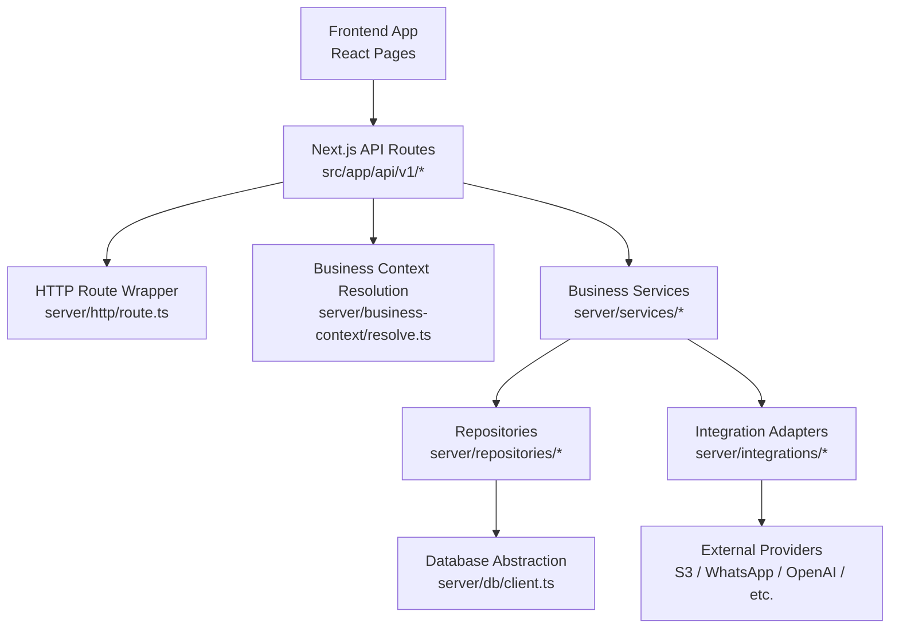

**Diagram sources**
- [route.ts:14-38](file://src/app/api/v1/deni/Customers/route.ts#L14-L38)
- [route.ts:59-95](file://src/server/http/route.ts#L59-L95)
- [resolve.ts:123-137](file://src/server/business-context/resolve.ts#L123-L137)
- [debt.repository.ts:289-335](file://src/server/repositories/debt.repository.ts#L289-L335)
- [client.ts:155-181](file://src/server/db/client.ts#L155-L181)
- [index.ts:41-70](file://src/server/integrations/index.ts#L41-L70)

**Section sources**
- [route.ts:14-38](file://src/app/api/v1/deni/Customers/route.ts#L14-L38)
- [route.ts:59-95](file://src/server/http/route.ts#L59-L95)
- [resolve.ts:123-137](file://src/server/business-context/resolve.ts#L123-L137)
- [debt.repository.ts:289-335](file://src/server/repositories/debt.repository.ts#L289-L335)
- [client.ts:155-181](file://src/server/db/client.ts#L155-L181)
- [index.ts:41-70](file://src/server/integrations/index.ts#L41-L70)

## Core Components
This section summarizes the main interaction points used throughout the codebase.

### HTTP Route Abstraction Layer
The HTTP layer wraps every API route handler to guarantee:

- A stable request ID is attached to the response header and log lines.
- Domain errors become documented status codes.
- Unexpected errors never leak stack traces or internal messages.
- Zod validation failures return structured field errors.
- Response helpers like `ok`, `created`, and `noContent` normalize success payloads.

Key responsibilities:

| Responsibility | Implementation Detail |
|---|---|
| Request ID propagation | Extracted from headers or generated; attached to response headers. |
| Error normalization | Converts `AppError`, `ZodError`, and generic errors into a uniform JSON error body. |
| Body parsing | Parses JSON safely and reports malformed bodies as validation failures. |
| Query helpers | Provides typed helpers for integers, lists, enums, and optional parameters. |

**Section sources**
- [route.ts:59-95](file://src/server/http/route.ts#L59-L95)
- [route.ts:97-160](file://src/server/http/route.ts#L97-L160)
- [errors.ts:8-50](file://src/lib/errors.ts#L8-L50)

### Business Context Resolution Pattern
Tenant scoping is central to Daftari’s security model. The resolver:

- Requires an authenticated session.
- Lists accessible businesses for the user.
- Selects the active business from a trusted header, session default, or first available business.
- Verifies membership and business availability.
- Produces a `BusinessContext` containing user identity, role, permissions, locale, timezone, currency, feature flags, and retention settings.
- Exposes `tenantScope(context)` so repositories receive only the minimal verified tenant identifier.

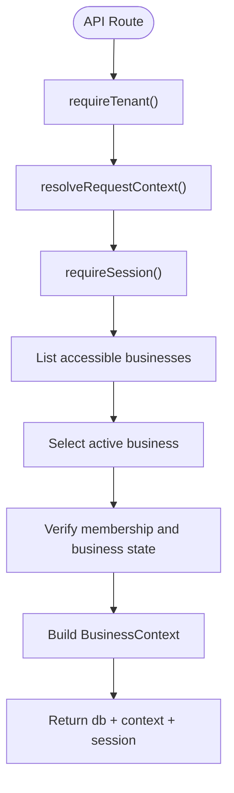

**Diagram sources**
- [resolve.ts:73-108](file://src/server/business-context/resolve.ts#L73-L108)
- [resolve.ts:123-137](file://src/server/business-context/resolve.ts#L123-L137)
- [context.ts:27-50](file://src/server/business-context/context.ts#L27-L50)

**Section sources**
- [resolve.ts:1-24](file://src/server/business-context/resolve.ts#L1-L24)
- [resolve.ts:73-108](file://src/server/business-context/resolve.ts#L73-L108)
- [resolve.ts:123-137](file://src/server/business-context/resolve.ts#L123-L137)
- [context.ts:27-50](file://src/server/business-context/context.ts#L27-L50)

### Repository Data Access Pattern
Repositories encapsulate all database operations and require a `Db` handle plus a `TenantScope`. This design ensures:

- Every query is explicitly scoped to `businessId`.
- Cross-tenant data leaks cannot happen silently; missing scope is a type-level constraint.
- SQL is portable between SQLite and PostgreSQL through parameter normalization and placeholder translation.
- Transactions use savepoints for nested operations in PostgreSQL.

Example responsibilities:

| Repository Area | Purpose |
|---|---|
| Customers | Create, list, and find customers within a business. |
| Obligations | Track debt obligations linked to ledger records. |
| Payments | Record payments against obligations and customers. |
| Balances | Derive open balances from confirmed obligations and posted payments. |

**Section sources**
- [debt.repository.ts:50-90](file://src/server/repositories/debt.repository.ts#L50-L90)
- [debt.repository.ts:94-177](file://src/server/repositories/debt.repository.ts#L94-L177)
- [debt.repository.ts:226-335](file://src/server/repositories/debt.repository.ts#L226-L335)
- [client.ts:155-181](file://src/server/db/client.ts#L155-L181)
- [client.ts:288-333](file://src/server/db/client.ts#L288-L333)

### Adapter Pattern for External Integrations
External providers are selected centrally:

- `createIntegrations()` chooses storage, speech, extraction, and WhatsApp adapters based on environment variables.
- Each integration exposes a port interface, such as `MediaStorageAdapter`.
- Implementations include local, S3-compatible, Vercel Blob, Twilio, OpenAI, and mock adapters.
- Tests can override cached integrations to exercise failure paths.

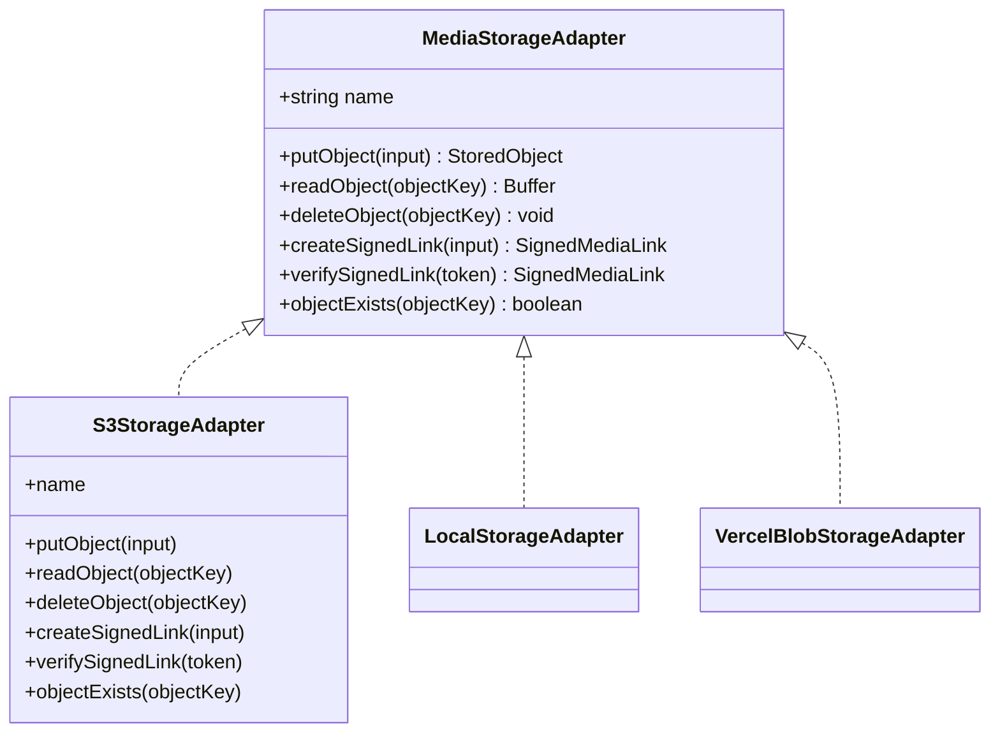

**Diagram sources**
- [port.ts:9-34](file://src/server/integrations/storage/port.ts#L9-L34)
- [s3-storage-adapter.ts:19-99](file://src/server/integrations/storage/s3-storage-adapter.ts#L19-L99)
- [index.ts:41-70](file://src/server/integrations/index.ts#L41-L70)

**Section sources**
- [index.ts:1-18](file://src/server/integrations/index.ts#L1-L18)
- [index.ts:41-70](file://src/server/integrations/index.ts#L41-L70)
- [index.ts:73-93](file://src/server/integrations/index.ts#L73-L93)
- [port.ts:9-34](file://src/server/integrations/storage/port.ts#L9-L34)
- [s3-storage-adapter.ts:19-99](file://src/server/integrations/storage/s3-storage-adapter.ts#L19-L99)
- [env.ts:46-132](file://src/server/config/env.ts#L46-L132)

## Architecture Overview
The following sequence diagram shows a concrete request flow from the frontend to the database for listing customers with outstanding balances.

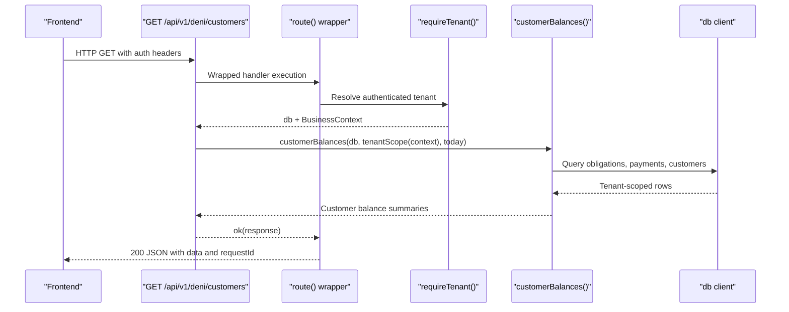

**Diagram sources**
- [route.ts:14-38](file://src/app/api/v1/deni/Customers/route.ts#L14-L38)
- [route.ts:59-95](file://src/server/http/route.ts#L59-L95)
- [resolve.ts:123-137](file://src/server/business-context/resolve.ts#L123-L137)
- [debt.repository.ts:289-335](file://src/server/repositories/debt.repository.ts#L289-L335)
- [client.ts:155-181](file://src/server/db/client.ts#L155-L181)

## Detailed Component Analysis

### API Route Handler: Deni Customers
The deni customers route demonstrates the standard request lifecycle:

1. Wrap the handler with `route`.
2. Resolve the authenticated tenant via `requireTenant`.
3. Enforce permissions with `assertCan`.
4. Parse query parameters with `queryInt`.
5. Delegate data loading to the repository with `tenantScope(context)`.
6. Transform repository results into a stable API response using `ok`.

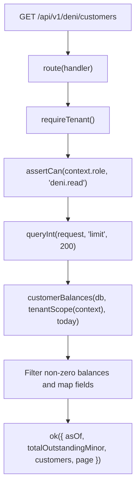

**Diagram sources**
- [route.ts:14-38](file://src/app/api/v1/deni/Customers/route.ts#L14-L38)

**Section sources**
- [route.ts:14-38](file://src/app/api/v1/deni/Customers/route.ts#L14-L38)

### HTTP Route Wrapper: Validation, Authentication, and Error Handling
The wrapper enforces a consistent contract:

- Success responses are wrapped with `{ data }`.
- `AppError` instances map to documented status codes and error codes.
- Zod validation errors produce field-level details.
- Unhandled errors log diagnostics but return a safe generic message.
- The request ID is always present in both logs and response headers.

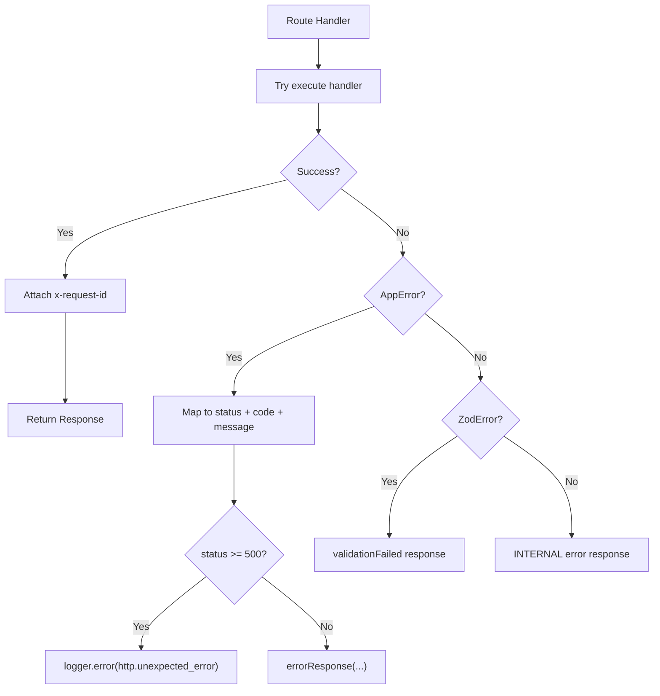

**Diagram sources**
- [route.ts:59-95](file://src/server/http/route.ts#L59-L95)
- [errors.ts:38-50](file://src/lib/errors.ts#L38-L50)

**Section sources**
- [route.ts:59-95](file://src/server/http/route.ts#L59-L95)
- [route.ts:97-160](file://src/server/http/route.ts#L97-L160)
- [errors.ts:8-50](file://src/lib/errors.ts#L8-L50)

### Business Context Resolution: Tenant Scoping
The resolver guarantees that:

- The active business is not trusted blindly from headers; it is validated against session membership.
- Missing or inactive businesses result in clear permission-style errors.
- The same database connection used during authentication is reused for the request.
- `tenantScope(context)` returns only the minimum required tenant identifier.

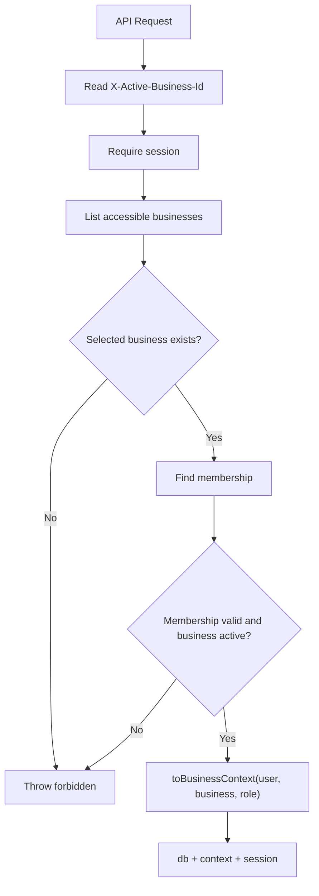

**Diagram sources**
- [resolve.ts:73-108](file://src/server/business-context/resolve.ts#L73-L108)
- [resolve.ts:123-137](file://src/server/business-context/resolve.ts#L123-L137)
- [context.ts:66-86](file://src/server/business-context/context.ts#L66-L86)

**Section sources**
- [resolve.ts:73-108](file://src/server/business-context/resolve.ts#L73-L108)
- [resolve.ts:123-137](file://src/server/business-context/resolve.ts#L123-L137)
- [context.ts:27-50](file://src/server/business-context/context.ts#L27-L50)
- [context.ts:66-86](file://src/server/business-context/context.ts#L66-L86)

### Repository Data Access: Debt and Customer Balances
The debt repository implements a balance derivation strategy rather than storing mutable running totals. For example, `customerBalances`:

- Joins obligations, customers, and ledger records.
- Subtracts posted payments from obligation amounts.
- Filters out voided obligations and unposted ledger records.
- Computes overdue status based on due dates and a provided reference date.
- Returns a shape suitable for UI pagination and summary calculations.

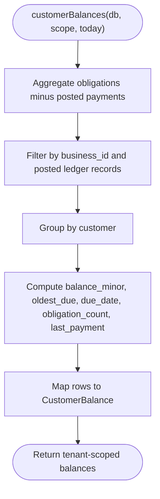

**Diagram sources**
- [debt.repository.ts:289-335](file://src/server/repositories/debt.repository.ts#L289-L335)

**Section sources**
- [debt.repository.ts:289-335](file://src/server/repositories/debt.repository.ts#L289-L335)

### Database Abstraction: Portable Queries and Transactions
The database client supports two backends:

- PostgreSQL via Neon with a connection pool.
- SQLite for local development and tests.

It normalizes parameters, translates `?` placeholders to `$n` for PostgreSQL, and provides:

- `run`, `get`, `all`, `scalar`, `exec`.
- `withTransaction` with savepoint nesting for PostgreSQL.
- Transaction-aware query routing through `AsyncLocalStorage`.

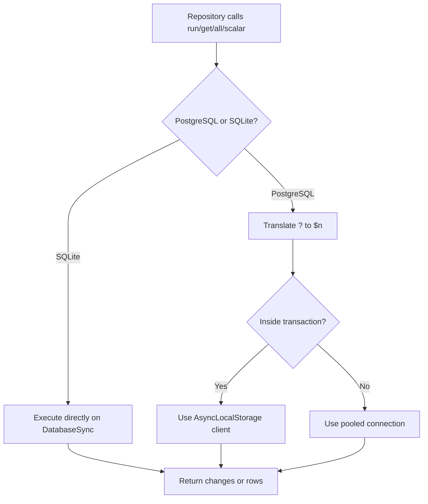

**Diagram sources**
- [client.ts:56-89](file://src/server/db/client.ts#L56-L89)
- [client.ts:155-181](file://src/server/db/client.ts#L155-L181)
- [client.ts:288-333](file://src/server/db/client.ts#L288-L333)

**Section sources**
- [client.ts:56-89](file://src/server/db/client.ts#L56-L89)
- [client.ts:155-181](file://src/server/db/client.ts#L155-L181)
- [client.ts:288-333](file://src/server/db/client.ts#L288-L333)

### Integration Provider Selection: Environment-Based Adapters
Provider selection is centralized and explicit:

- Storage can be local, S3, or Vercel Blob.
- Speech can be mock or OpenAI.
- Extraction can be off, mock, or OpenAI.
- WhatsApp can be local or Twilio.
- Missing credentials fail fast with descriptive configuration errors.
- Tests can swap providers through `overrideIntegrations`.

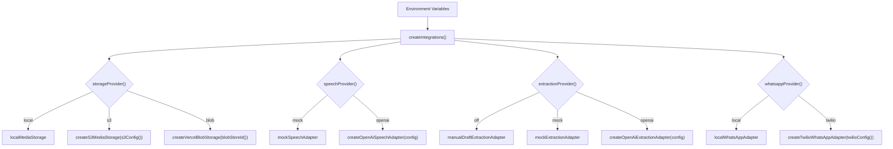

**Diagram sources**
- [index.ts:41-70](file://src/server/integrations/index.ts#L41-L70)
- [env.ts:46-132](file://src/server/config/env.ts#L46-L132)

**Section sources**
- [index.ts:41-70](file://src/server/integrations/index.ts#L41-L70)
- [index.ts:73-93](file://src/server/integrations/index.ts#L73-L93)
- [env.ts:46-132](file://src/server/config/env.ts#L46-L132)

### Background Job Context Builder
Background jobs do not have a signed-in user, so they build a system-scoped business context:

- They require a business ID.
- They fetch the business record and validate its existence.
- They construct a context with system user identity, owner-like permissions, and tenant-specific locale, timezone, currency, features, and retention settings.

This allows background work to reuse the same business context shape as authenticated requests.

**Section sources**
- [context-builder.ts:1-44](file://src/server/services/context-builder.ts#L1-L44)

## Dependency Analysis
The following diagram maps the primary runtime dependencies for a typical tenant-scoped API request.

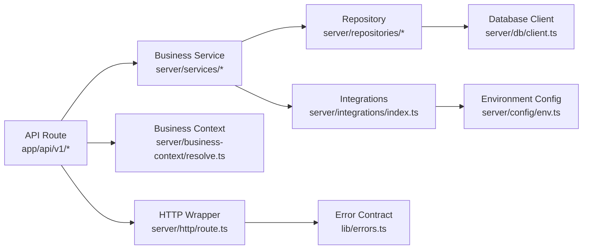

**Diagram sources**
- [route.ts:14-38](file://src/app/api/v1/deni/Customers/route.ts#L14-L38)
- [route.ts:59-95](file://src/server/http/route.ts#L59-L95)
- [resolve.ts:123-137](file://src/server/business-context/resolve.ts#L123-L137)
- [debt.repository.ts:289-335](file://src/server/repositories/debt.repository.ts#L289-L335)
- [client.ts:155-181](file://src/server/db/client.ts#L155-L181)
- [index.ts:41-70](file://src/server/integrations/index.ts#L41-L70)
- [env.ts:46-132](file://src/server/config/env.ts#L46-L132)
- [errors.ts:8-50](file://src/lib/errors.ts#L8-L50)

**Section sources**
- [route.ts:14-38](file://src/app/api/v1/deni/Customers/route.ts#L14-L38)
- [route.ts:59-95](file://src/server/http/route.ts#L59-L95)
- [resolve.ts:123-137](file://src/server/business-context/resolve.ts#L123-L137)
- [debt.repository.ts:289-335](file://src/server/repositories/debt.repository.ts#L289-L335)
- [client.ts:155-181](file://src/server/db/client.ts#L155-L181)
- [index.ts:41-70](file://src/server/integrations/index.ts#L41-L70)
- [env.ts:46-132](file://src/server/config/env.ts#L46-L132)
- [errors.ts:8-50](file://src/lib/errors.ts#L8-L50)

## Performance Considerations
- **Connection reuse**: The database client caches PostgreSQL pools and SQLite connections per process, reducing startup overhead.
- **Parameter normalization**: Converting JavaScript values to database-safe types avoids repeated conversion logic in repositories.
- **Placeholder translation**: Translating `?` to `$n` keeps repositories driver-agnostic while preserving performance.
- **Lazy external SDK imports**: S3 and OpenAI SDKs are imported lazily so unused providers do not increase cold start cost.
- **Caching integrations**: `integrations()` caches the selected adapters for the process lifetime.
- **Pagination limits**: Query helpers cap maximum limits to prevent excessive data transfer.
- **Transaction savepoints**: Nested transactions use savepoints instead of creating new connections, improving throughput for multi-step operations.

[No sources needed since this section provides general guidance]

## Troubleshooting Guide

### Tracing a Failed Request
When debugging an API failure:

1. Inspect the response body for the standardized error structure, including `code`, `message`, `details`, and `requestId`.
2. Use the `x-request-id` header to correlate the request with server logs.
3. Check whether the error originated from:
   - Authentication or session resolution.
   - Business context resolution or membership verification.
   - Permission checks.
   - Input validation.
   - Repository queries.
   - External integration calls.

Common error categories:

| Symptom | Likely Cause | Action |
|---|---|---|
| 401 UNAUTHENTICATED | Missing or invalid session | Verify login flow and session cookies. |
| 403 FORBIDDEN | Missing role, disabled feature, or cross-tenant access | Check `BusinessContext.role`, permissions, and active business. |
| 422 VALIDATION_FAILED | Malformed JSON or Zod schema violation | Inspect `details.fields` and request payload. |
| 404 NOT_FOUND | Resource absent or cross-tenant lookup | Confirm tenant scope and resource ownership. |
| 500 INTERNAL | Unexpected exception | Search logs for `http.unhandled_error` and inspect stack before sanitization. |

**Section sources**
- [route.ts:59-95](file://src/server/http/route.ts#L59-L95)
- [errors.ts:8-50](file://src/lib/errors.ts#L8-L50)

### Debugging Tenant Scoping Issues
If data appears missing or cross-tenant:

- Confirm `requireTenant()` succeeded and returned a valid `BusinessContext`.
- Verify the active business was selected intentionally and matches the expected tenant.
- Ensure repositories received `tenantScope(context)` and did not bypass it.
- Check that repository queries filter by `business_id`.

**Section sources**
- [resolve.ts:73-108](file://src/server/business-context/resolve.ts#L73-L108)
- [debt.repository.ts:50-70](file://src/server/repositories/debt.repository.ts#L50-L70)

### Debugging External Integration Failures
If storage, speech, extraction, or WhatsApp calls fail:

- Validate environment selectors: `DAFTARI_STORAGE_PROVIDER`, `DAFTARI_SPEECH_PROVIDER`, `DAFTARI_EXTRACTION_PROVIDER`, `DAFTARI_WHATSAPP_PROVIDER`.
- Confirm required credentials exist and match the selected provider.
- Use `overrideIntegrations` in tests to simulate provider errors.
- For S3, verify bucket, region, endpoint, prefix, and signing secret configuration.

**Section sources**
- [index.ts:41-70](file://src/server/integrations/index.ts#L41-L70)
- [env.ts:46-132](file://src/server/config/env.ts#L46-L132)

### Debugging Database Issues
If queries behave differently locally versus production:

- Confirm whether SQLite or PostgreSQL is active.
- Check whether a transaction is active when nested repository calls occur.
- Review parameter normalization for booleans, dates, and nulls.
- Inspect migration scripts and statement splitting if DDL fails.

**Section sources**
- [client.ts:56-89](file://src/server/db/client.ts#L56-L89)
- [client.ts:155-181](file://src/server/db/client.ts#L155-L181)
- [client.ts:288-333](file://src/server/db/client.ts#L288-L333)

## Conclusion
Daftari’s component interaction patterns emphasize safety, clarity, and testability:

- API routes are thin orchestrators that validate, authorize, and delegate.
- The HTTP wrapper standardizes error handling and observability.
- Business context resolution enforces tenant scoping at the boundary and propagates verified context downstream.
- Repositories encapsulate data access and require explicit tenant scope.
- External integrations are selected centrally and exposed through stable ports.
- Errors are normalized for clients while retaining diagnostic information for operators.

These patterns make it straightforward to trace requests from the frontend to the database or external providers, reason about security boundaries, and extend the system with new integrations or endpoints without compromising consistency.