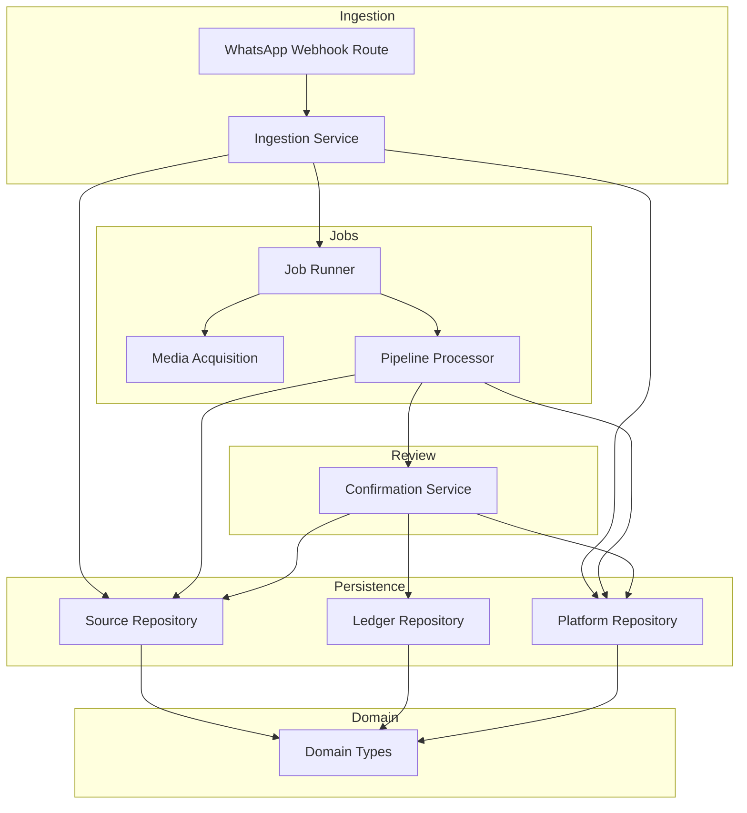
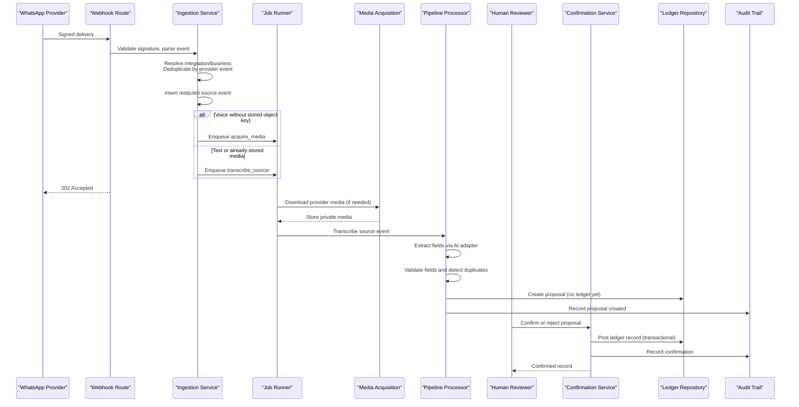
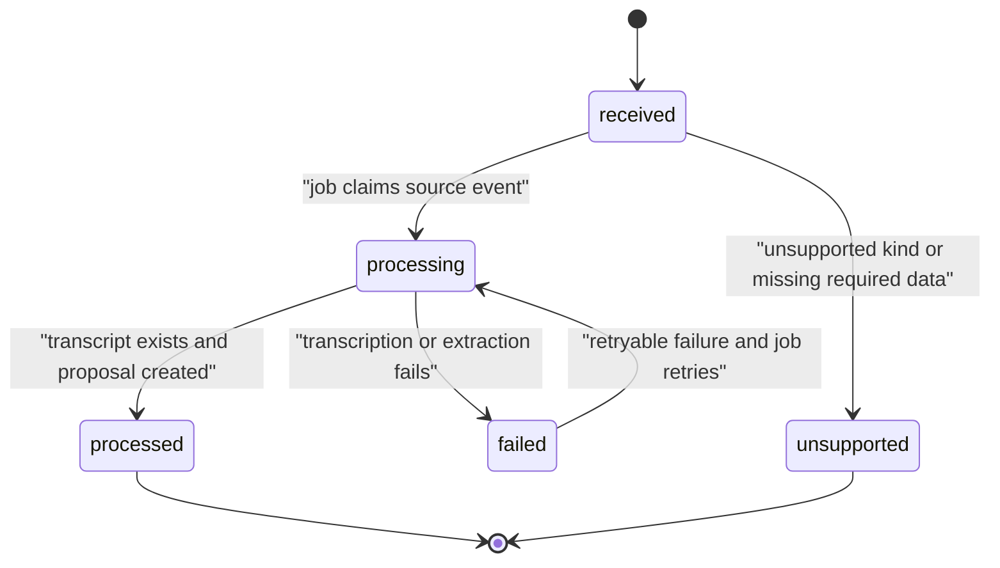
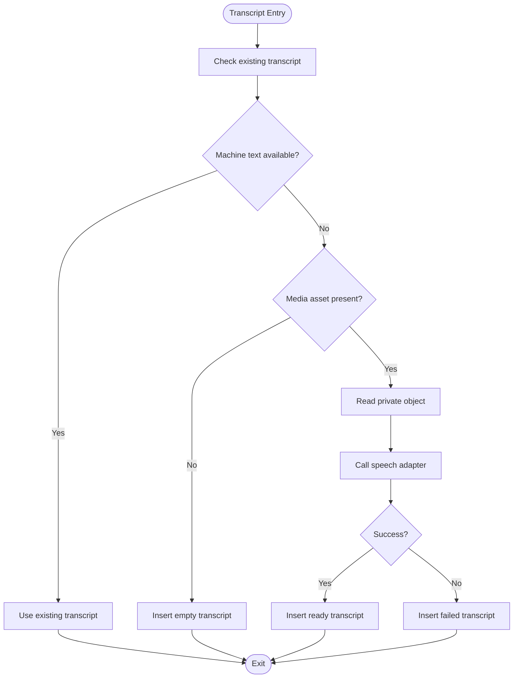
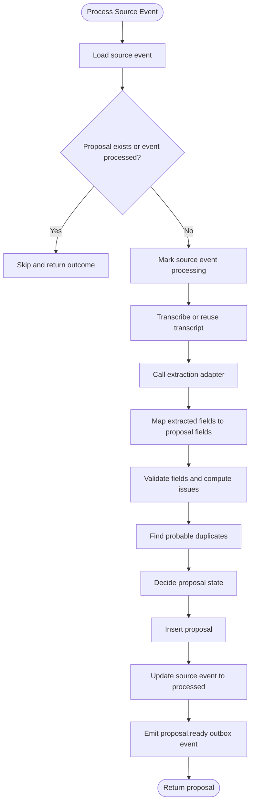
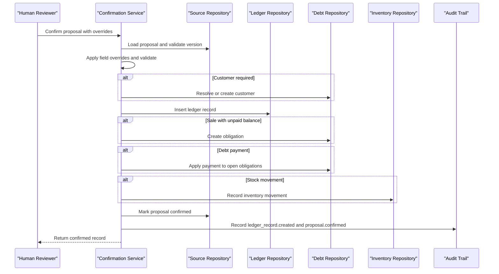
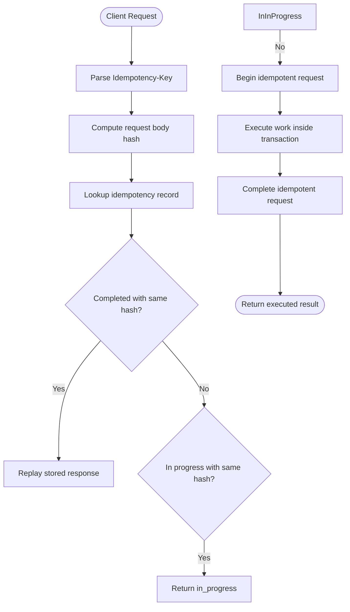
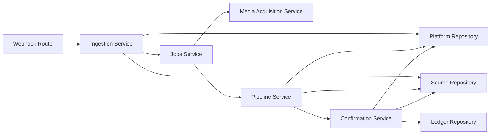

# Data Flow Architecture

<cite>
**Referenced Files in This Document**
- [whatsapp route](file://src/app/api/v1/webhooks/whatsapp/route.ts)
- [ingestion service](file://src/server/services/ingestion.ts)
- [jobs service](file://src/server/services/jobs.ts)
- [pipeline service](file://src/server/services/pipeline.ts)
- [media acquisition service](file://src/server/services/media-acquisition.ts)
- [confirmation service](file://src/server/services/confirmation.ts)
- [source repository](file://src/server/repositories/source.repository.ts)
- [ledger repository](file://src/server/repositories/ledger.repository.ts)
- [platform repository](file://src/server/repositories/platform.repository.ts)
- [idempotency service](file://src/server/services/idempotency.ts)
- [audit service](file://src/server/services/audit.ts)
- [domain types](file://src/server/domain/types.ts)
</cite>

## Table of Contents
1. [Introduction](#introduction)
2. [Project Structure](#project-structure)
3. [Core Components](#core-components)
4. [Architecture Overview](#architecture-overview)
5. [Detailed Component Analysis](#detailed-component-analysis)
6. [Dependency Analysis](#dependency-analysis)
7. [Performance Considerations](#performance-considerations)
8. [Troubleshooting Guide](#troubleshooting-guide)
9. [Conclusion](#conclusion)

## Introduction
This document explains the complete data flow architecture for Daftari’s WhatsApp-driven bookkeeping pipeline. It traces a message from WhatsApp ingestion through durable job processing, transcript creation, AI extraction, proposal generation, human review, and finally confirmed ledger records. It also documents idempotent processing mechanisms, state transitions, validation checkpoints, audit trail maintenance, error handling, retry behavior, and monitoring guidance.

The system is intentionally layered:
- The webhook accepts and deduplicates provider deliveries quickly.
- Background jobs perform transcription, media acquisition, AI extraction, and proposal creation.
- A human reviewer confirms or rejects proposals before any ledger record is posted.
- Confirmation is transactional and auditable, with optimistic concurrency protection.

## Project Structure
The data flow spans API routes, services, repositories, and domain types:

**Diagram sources**
- [whatsapp route:1-69](file://src/app/api/v1/webhooks/whatsapp/route.ts#L1-L69)
- [ingestion service:1-217](file://src/server/services/ingestion.ts#L1-L217)
- [jobs service:1-241](file://src/server/services/jobs.ts#L1-L241)
- [pipeline service:1-506](file://src/server/services/pipeline.ts#L1-L506)
- [media acquisition service:1-102](file://src/server/services/media-acquisition.ts#L1-L102)
- [confirmation service:1-522](file://src/server/services/confirmation.ts#L1-L522)
- [source repository:1-771](file://src/server/repositories/source.repository.ts#L1-L771)
- [ledger repository:1-696](file://src/server/repositories/ledger.repository.ts#L1-L696)
- [platform repository:1-491](file://src/server/repositories/platform.repository.ts#L1-L491)
- [domain types:1-217](file://src/server/domain/types.ts#L1-L217)

**Section sources**
- [whatsapp route:1-69](file://src/app/api/v1/webhooks/whatsapp/route.ts#L1-L69)
- [ingestion service:1-217](file://src/server/services/ingestion.ts#L1-L217)
- [jobs service:1-241](file://src/server/services/jobs.ts#L1-L241)
- [pipeline service:1-506](file://src/server/services/pipeline.ts#L1-L506)
- [media acquisition service:1-102](file://src/server/services/media-acquisition.ts#L1-L102)
- [confirmation service:1-522](file://src/server/services/confirmation.ts#L1-L522)
- [source repository:1-771](file://src/server/repositories/source.repository.ts#L1-L771)
- [ledger repository:1-696](file://src/server/repositories/ledger.repository.ts#L1-L696)
- [platform repository:1-491](file://src/server/repositories/platform.repository.ts#L1-L491)
- [domain types:1-217](file://src/server/domain/types.ts#L1-L217)

## Core Components
- WhatsApp webhook route: authenticates provider signatures, validates configuration, and delegates to ingestion.
- Ingestion service: verifies signature, resolves integration and business, deduplicates by provider event, persists a redacted source event, stores or links private media, enqueues media acquisition or transcription, and records an audit event.
- Job runner: claims durable jobs atomically, executes handlers, records runs, applies exponential backoff, and dead-letters exhausted or non-retryable failures.
- Media acquisition service: downloads provider-hosted media into private storage, records a media asset row, and returns idempotent outcomes per source event.
- Pipeline processor: transcribes audio, calls the extraction adapter, maps extracted fields to normalized proposal fields, validates them, detects probable duplicates, creates a proposal, updates source event status, emits an outbox event, and audits the result.
- Confirmation service: applies field overrides, validates against typed schemas, resolves customers, posts ledger records, applies debt and inventory effects, marks proposals confirmed, and emits outbox events.
- Repositories: persist source events, transcripts, proposals, ledger records, versions, jobs, audit events, and idempotency keys.
- Domain types: define stable enums for record types, statuses, states, payment methods, movement types, job types, and audit actions.

**Section sources**
- [whatsapp route:1-69](file://src/app/api/v1/webhooks/whatsapp/route.ts#L1-L69)
- [ingestion service:1-217](file://src/server/services/ingestion.ts#L1-L217)
- [jobs service:1-241](file://src/server/services/jobs.ts#L1-L241)
- [media acquisition service:1-102](file://src/server/services/media-acquisition.ts#L1-L102)
- [pipeline service:1-506](file://src/server/services/pipeline.ts#L1-L506)
- [confirmation service:1-522](file://src/server/services/confirmation.ts#L1-L522)
- [source repository:1-771](file://src/server/repositories/source.repository.ts#L1-L771)
- [ledger repository:1-696](file://src/server/repositories/ledger.repository.ts#L1-L696)
- [platform repository:1-491](file://src/server/repositories/platform.repository.ts#L1-L491)
- [domain types:1-217](file://src/server/domain/types.ts#L1-L217)

## Architecture Overview
The end-to-end pathway is:

1. Provider delivers a signed WhatsApp message to the webhook route.
2. Ingestion validates the signature, resolves the connected WhatsApp account and business, deduplicates by provider event ID, inserts a redacted source event, and enqueues either media acquisition or transcription.
3. The job runner acquires media if needed, then transcribes the source event.
4. The pipeline extracts structured fields from the transcript using the extraction adapter, validates them, checks for probable duplicates, and creates a proposal.
5. A human reviews the proposal in the dashboard. They may edit fields, resolve ambiguity, or reject it.
6. On confirmation, the confirmation service posts a ledger record, applies debt and inventory side effects, marks the proposal confirmed, and emits an outbox event.

**Diagram sources**
- [whatsapp route:33-68](file://src/app/api/v1/webhooks/whatsapp/route.ts#L33-L68)
- [ingestion service:66-207](file://src/server/services/ingestion.ts#L66-L207)
- [jobs service:51-94](file://src/server/services/jobs.ts#L51-L94)
- [media acquisition service:42-100](file://src/server/services/media-acquisition.ts#L42-L100)
- [pipeline service:354-502](file://src/server/services/pipeline.ts#L354-L502)
- [confirmation service:318-455](file://src/server/services/confirmation.ts#L318-L455)
- [ledger repository:96-137](file://src/server/repositories/ledger.repository.ts#L96-L137)
- [audit service:31-66](file://src/server/services/audit.ts#L31-L66)

## Detailed Component Analysis

### Source Event Lifecycle
A source event represents one inbound provider delivery. Its lifecycle is:

Key behaviors:
- Deduplication occurs at ingestion time using a provider-scoped key derived from the provider event ID.
- Redacted payloads are persisted; full message bodies are not stored in the source event payload.
- Status transitions are recorded with timestamps and attempt counts.
- Failed processing records a failure code and makes the event visible for retry or manual intervention.

**Diagram sources**
- [source repository:188-210](file://src/server/repositories/source.repository.ts#L188-L210)
- [domain types:49-56](file://src/server/domain/types.ts#L49-L56)

**Section sources**
- [ingestion service:90-134](file://src/server/services/ingestion.ts#L90-L134)
- [source repository:110-166](file://src/server/repositories/source.repository.ts#L110-L166)
- [domain types:49-56](file://src/server/domain/types.ts#L49-L56)

### Transcript Creation and Quality
Transcripts can be:
- Machine-generated from voice audio.
- Text carried directly from text messages.
- Corrected by users, which takes precedence over machine text.
- Marked unusable when quality is insufficient.

**Diagram sources**
- [pipeline service:287-346](file://src/server/services/pipeline.ts#L287-L346)
- [source repository:311-430](file://src/server/repositories/source.repository.ts#L311-L430)

**Section sources**
- [pipeline service:287-346](file://src/server/services/pipeline.ts#L287-L346)
- [source repository:311-430](file://src/server/repositories/source.repository.ts#L311-L430)

### AI Extraction and Proposal Generation
The pipeline transforms a transcript into a typed proposal:

- The extraction adapter receives transcript text, detected language, business context, customer and item candidates, and feature flags.
- Extracted fields are mapped to normalized proposal fields.
- Missing fields and schema validation issues are computed.
- Probable duplicates are detected against posted ledger records within a time window.
- The proposal state is decided based on missing fields, clarification requirements, and duplicate detection.
- The proposal is inserted with provenance, missing fields, validation issues, and duplicate candidates.
- The source event status is updated to processed, and an outbox event is emitted.

**Diagram sources**
- [pipeline service:354-502](file://src/server/services/pipeline.ts#L354-L502)
- [source repository:446-498](file://src/server/repositories/source.repository.ts#L446-L498)
- [ledger repository:514-533](file://src/server/repositories/ledger.repository.ts#L514-L533)

**Section sources**
- [pipeline service:65-172](file://src/server/services/pipeline.ts#L65-L172)
- [pipeline service:174-255](file://src/server/services/pipeline.ts#L174-L255)
- [pipeline service:257-285](file://src/server/services/pipeline.ts#L257-L285)
- [pipeline service:354-502](file://src/server/services/pipeline.ts#L354-L502)
- [source repository:446-498](file://src/server/repositories/source.repository.ts#L446-L498)
- [ledger repository:514-533](file://src/server/repositories/ledger.repository.ts#L514-L533)

### Human Review and Confirmation
Only after a proposal exists does human review occur. The confirmation service ensures:

- A human decision is required; automatic posting is not allowed.
- Field overrides are applied safely.
- Typed validation rules are enforced.
- Customers are resolved or created when needed.
- Ledger records are posted with typed details.
- Debt obligations and payments are applied according to record type.
- Inventory movements are recorded when enabled.
- Proposals are marked confirmed with optimistic version control.
- Audit events and outbox events are emitted.

**Diagram sources**
- [confirmation service:318-455](file://src/server/services/confirmation.ts#L318-L455)
- [source repository:723-739](file://src/server/repositories/source.repository.ts#L723-L739)
- [ledger repository:96-137](file://src/server/repositories/ledger.repository.ts#L96-L137)

**Section sources**
- [confirmation service:72-122](file://src/server/services/confirmation.ts#L72-L122)
- [confirmation service:124-232](file://src/server/services/confirmation.ts#L124-L232)
- [confirmation service:234-316](file://src/server/services/confirmation.ts#L234-L316)
- [confirmation service:318-455](file://src/server/services/confirmation.ts#L318-L455)
- [confirmation service:464-475](file://src/server/services/confirmation.ts#L464-L475)

### Idempotent Processing Mechanisms
Idempotency is enforced at multiple layers:

- **Webhook-level request idempotency**: Client POSTs with an `Idempotency-Key` header; repeated requests with the same scope, key, and body hash replay the original response. Different bodies with the same key are rejected as conflicts.
- **Job-level idempotency**: Jobs are enqueued with entity-scoped idempotency keys such as `transcribe:{sourceEventId}` and `acquire:{sourceEventId}`. Duplicate enqueue attempts return the existing job.
- **Handler-level idempotency**: Handlers check for existing artifacts (e.g., media assets, transcripts, proposals) and return safe outcomes instead of creating duplicates.
- **Proposal confirmation idempotency**: Confirming an already confirmed proposal returns the existing ledger record. Optimistic version checks prevent stale reviewers from overwriting newer edits.

**Diagram sources**
- [idempotency service:22-84](file://src/server/services/idempotency.ts#L22-L84)
- [platform repository:348-394](file://src/server/repositories/platform.repository.ts#L348-L394)

**Section sources**
- [idempotency service:1-100](file://src/server/services/idempotency.ts#L1-L100)
- [platform repository:193-235](file://src/server/repositories/platform.repository.ts#L193-L235)
- [jobs service:209-240](file://src/server/services/jobs.ts#L209-L240)
- [media acquisition service:36-52](file://src/server/services/media-acquisition.ts#L36-L52)
- [pipeline service:365-371](file://src/server/services/pipeline.ts#L365-L371)
- [confirmation service:327-342](file://src/server/services/confirmation.ts#L327-L342)

### Data Transformation Stages and Validation Checkpoints
Transformation stages:

1. **Raw event normalization**: The WhatsApp adapter normalizes inbound messages into a consistent shape.
2. **Redaction**: Only metadata and necessary identifiers are stored in the source event payload.
3. **Transcription**: Audio is converted to text; text messages carry their transcript directly.
4. **Extraction**: AI extraction produces intent, fields, missing fields, ambiguities, and provenance.
5. **Field mapping**: Extracted fields are mapped to normalized proposal fields with currency-aware numeric rounding and date basis inference.
6. **Validation**: Typed schema validation computes validation issues.
7. **Duplicate detection**: Probable duplicates are identified against recent posted ledger records.
8. **Proposal creation**: A proposal is created with state, provenance, missing fields, validation issues, and duplicate candidates.
9. **Confirmation**: Typed validation is reapplied; ledger records are posted with typed details.

Validation checkpoints:

- Signature verification at the webhook.
- Integration and business existence and connectivity checks during ingestion.
- Voice message media presence checks.
- Transcript readiness and quality tracking.
- Proposal schema validation and missing field detection.
- Confirmation schema validation and business rule enforcement.
- Optimistic version checks on proposal confirmation.

**Section sources**
- [whatsapp route:33-68](file://src/app/api/v1/webhooks/whatsapp/route.ts#L33-L68)
- [ingestion service:72-163](file://src/server/services/ingestion.ts#L72-L163)
- [pipeline service:65-172](file://src/server/services/pipeline.ts#L65-L172)
- [pipeline service:174-255](file://src/server/services/pipeline.ts#L174-L255)
- [pipeline service:438-492](file://src/server/services/pipeline.ts#L438-L492)
- [confirmation service:318-455](file://src/server/services/confirmation.ts#L318-L455)

### Audit Trail Maintenance
Every important state change is recorded through the audit service:

- Source event receipt.
- Transcript completion and failure.
- Proposal creation, editing, confirmation, rejection, and retry.
- Ledger record creation.
- Customer creation.
- Obligation creation and debt payment recording.
- Inventory movement recording.

Audit events are chained by integrity hashes, making tampering detectable. Audit recording failures are logged but do not roll back the business operation they describe.

**Section sources**
- [audit service:1-79](file://src/server/services/audit.ts#L1-L79)
- [platform repository:48-103](file://src/server/repositories/platform.repository.ts#L48-L103)
- [ingestion service:186-199](file://src/server/services/ingestion.ts#L186-L199)
- [pipeline service:475-491](file://src/server/services/pipeline.ts#L475-L491)
- [confirmation service:413-444](file://src/server/services/confirmation.ts#L413-L444)

### Error Handling and Retry Mechanisms
Error handling is explicit and categorized:

- **Signature invalid**: Webhook rejects invalid provider signatures.
- **Integration not found or not connected**: Ingestion throws appropriate errors.
- **Missing media for voice**: Ingestion rejects voice messages without media references.
- **Provider failures**: Speech and extraction adapters throw provider-specific errors that are recorded and surfaced as retryable or non-retryable.
- **Job failures**: The job runner records run attempts, applies exponential backoff, and moves exhausted or non-retryable jobs to dead letter.
- **Confirmation conflicts**: Version conflicts and already-decided proposals are handled with clear conflict responses.

Retry behavior:

- Non-retryable errors fail immediately and move to dead letter.
- Retryable errors schedule the next attempt with exponential backoff up to a maximum number of attempts.
- Handler-level idempotency prevents duplicate work on retries.

**Section sources**
- [ingestion service:72-163](file://src/server/services/ingestion.ts#L72-L163)
- [pipeline service:376-436](file://src/server/services/pipeline.ts#L376-L436)
- [jobs service:35-49](file://src/server/services/jobs.ts#L35-L49)
- [jobs service:142-193](file://src/server/services/jobs.ts#L142-L193)
- [platform repository:287-302](file://src/server/repositories/platform.repository.ts#L287-L302)
- [confirmation service:327-342](file://src/server/services/confirmation.ts#L327-L342)

## Dependency Analysis
The main dependency relationships are:

**Diagram sources**
- [whatsapp route:10-15](file://src/app/api/v1/webhooks/whatsapp/route.ts#L10-L15)
- [ingestion service:15-36](file://src/server/services/ingestion.ts#L15-L36)
- [jobs service:10-26](file://src/server/services/jobs.ts#L10-L26)
- [pipeline service:12-50](file://src/server/services/pipeline.ts#L12-L50)
- [confirmation service:15-54](file://src/server/services/confirmation.ts#L15-L54)

**Section sources**
- [whatsapp route:10-15](file://src/app/api/v1/webhooks/whatsapp/route.ts#L10-L15)
- [ingestion service:15-36](file://src/server/services/ingestion.ts#L15-L36)
- [jobs service:10-26](file://src/server/services/jobs.ts#L10-L26)
- [pipeline service:12-50](file://src/server/services/pipeline.ts#L12-L50)
- [confirmation service:15-54](file://src/server/services/confirmation.ts#L15-L54)

## Performance Considerations
- **Fast webhook acceptance**: The webhook returns 202 as soon as the delivery is durable, avoiding slow provider calls blocking delivery.
- **Asynchronous processing**: Transcription, extraction, and proposal creation run in background jobs.
- **Idempotent enqueueing**: Duplicate job enqueue attempts are collapsed, reducing redundant work.
- **Tenant-scoped operations**: All queries and deletions are scoped to the business, preventing cross-tenant leakage and improving query locality.
- **Retention deadlines**: Media retention is calculated and enforced, limiting long-term storage costs.
- **Optimistic concurrency**: Version checks reduce lock contention and prevent stale writes.

[No sources needed since this section provides general guidance]

## Troubleshooting Guide
Common data flow issues and how to investigate them:

- **Webhook accepted but no proposal appears**:
  - Check whether the source event was created and its status.
  - Verify whether media acquisition or transcription jobs were enqueued.
  - Inspect job runs for failures and retryable codes.
  - Look for transcript failures and extraction provider errors.

- **Voice message stuck in processing**:
  - Determine whether media acquisition succeeded.
  - If the provider only provided a temporary media reference, ensure the acquisition job ran before transcription.
  - Check storage adapter availability and media download errors.

- **Proposal never reaches review**:
  - Check extraction adapter health and model availability.
  - Inspect validation issues and missing fields.
  - Review duplicate detection results and ambiguity notes.

- **Confirmed record missing or duplicated**:
  - Verify proposal version conflicts and confirm that the correct expected version was used.
  - Check whether the proposal was already confirmed.
  - Review audit events for confirmation and ledger record creation.

- **Audit gaps**:
  - Audit append failures are logged but do not roll back business changes.
  - Investigate database write failures around audit events.

Monitoring strategies:

- Track pending and failed jobs.
- Monitor source event counts by status and recent activity.
- Watch proposal counts by state, especially needs_review, needs_details, and duplicate.
- Observe ledger record confirmation rates and recent confirmed records.
- Alert on dead-lettered jobs and repeated provider errors.
- Use audit events to trace entity lifecycles and detect anomalies.

**Section sources**
- [jobs service:195-207](file://src/server/services/jobs.ts#L195-L207)
- [platform repository:336-346](file://src/server/repositories/platform.repository.ts#L336-L346)
- [source repository:219-227](file://src/server/repositories/source.repository.ts#L219-L227)
- [source repository:597-627](file://src/server/repositories/source.repository.ts#L597-L627)
- [ledger repository:676-696](file://src/server/repositories/ledger.repository.ts#L676-L696)
- [audit service:49-66](file://src/server/services/audit.ts#L49-L66)

## Conclusion
Daftari’s data flow architecture separates fast webhook acceptance from asynchronous processing, ensuring reliable ingestion even under provider latency. Source events are deduplicated, transcripts are created and corrected, AI extraction produces auditable proposals, and human review gates ledger postings. Idempotency is enforced at request, job, handler, and confirmation levels to prevent duplicates and maintain consistency. Validation checkpoints and comprehensive audit trails provide transparency and safety throughout the pipeline. Operational visibility into jobs, source events, proposals, and ledger records enables effective troubleshooting and monitoring.

[No sources needed since this section summarizes without analyzing specific files]