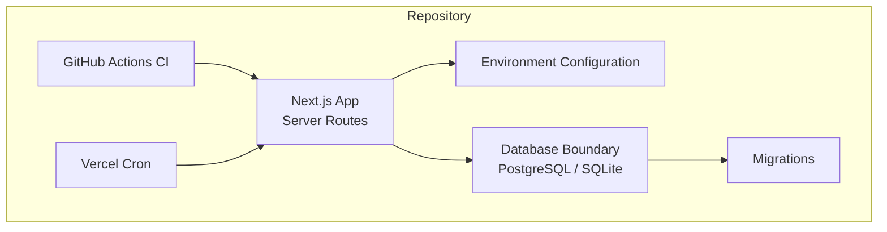
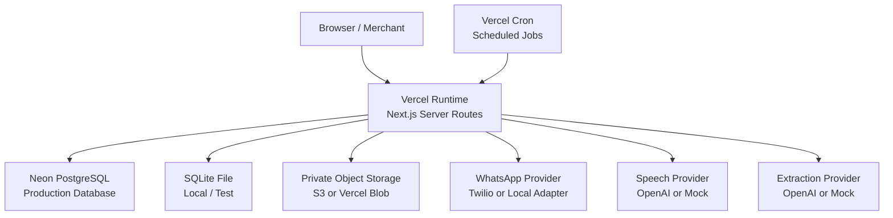
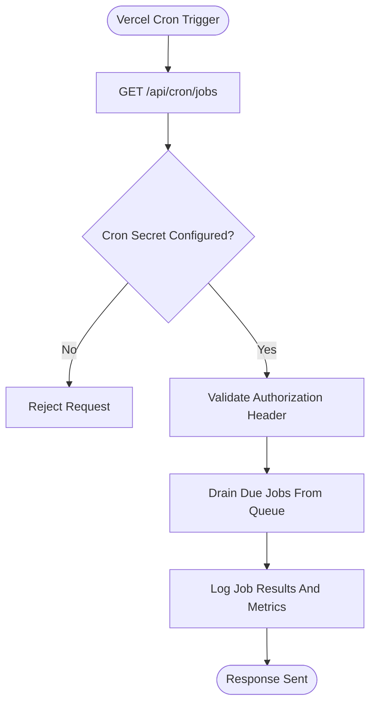
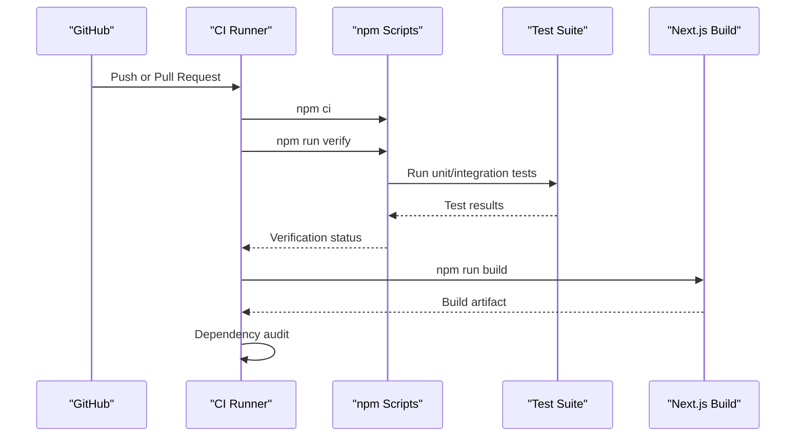
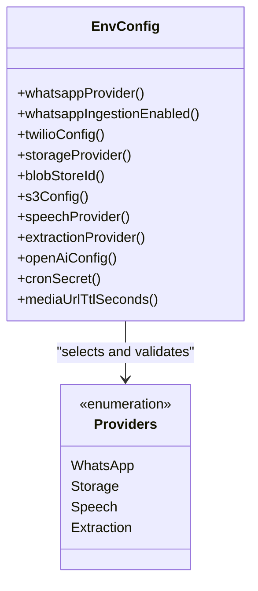
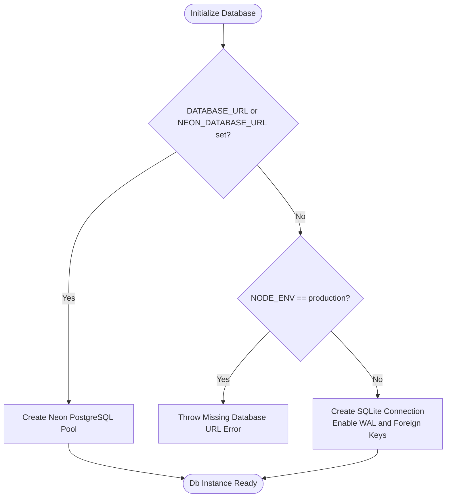
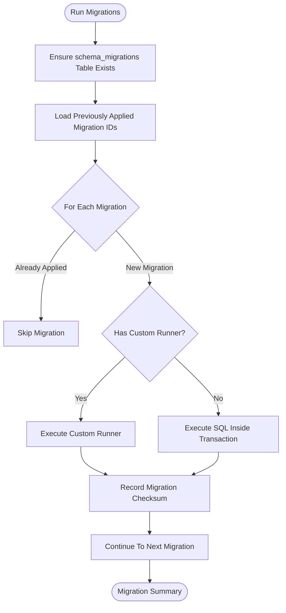
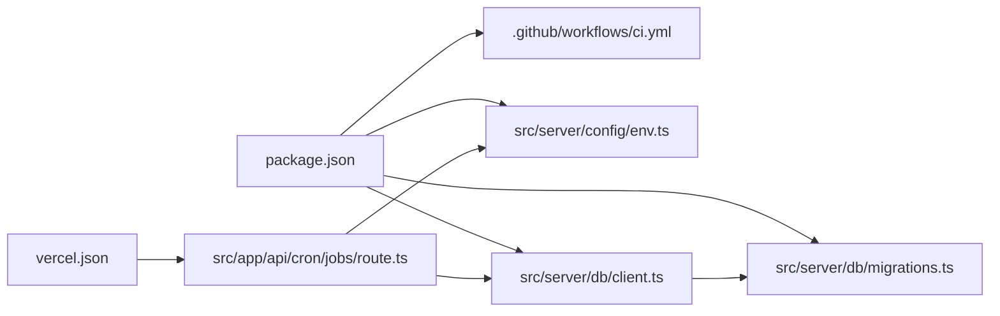

# Deployment Topology

<cite>
**Referenced Files in This Document**
- [vercel.json](file://vercel.json)
- [.github/workflows/ci.yml](file://.github/workflows/ci.yml)
- [package.json](file://package.json)
- [src/server/config/env.ts](file://src/server/config/env.ts)
- [src/server/db/client.ts](file://src/server/db/client.ts)
- [src/server/db/migrations.ts](file://src/server/db/migrations.ts)
- [src/app/api/cron/jobs/route.ts](file://src/app/api/cron/jobs/route.ts)
- [architecture.md](file://architecture.md)
</cite>

## Table of Contents
1. [Introduction](#introduction)
2. [Project Structure](#project-structure)
3. [Core Components](#core-components)
4. [Architecture Overview](#architecture-overview)
5. [Detailed Component Analysis](#detailed-component-analysis)
6. [Dependency Analysis](#dependency-analysis)
7. [Performance Considerations](#performance-considerations)
8. [Troubleshooting Guide](#troubleshooting-guide)
9. [Conclusion](#conclusion)
10. [Appendices](#appendices)

## Introduction
This document describes the deployment topology and infrastructure setup for Daftari as implemented in the repository. It focuses on:

- Vercel deployment configuration, including scheduled jobs.
- GitHub Actions CI/CD for type checking, linting, testing, building, and dependency auditing.
- Environment configuration management across providers such as WhatsApp, storage, speech/extraction, and database selection.
- Database strategy using Neon PostgreSQL for production and SQLite for local/testing.
- Infrastructure requirements, scaling considerations, performance optimization, monitoring/logging guidance, backup and disaster recovery procedures, and technology stack compatibility.

The goal is to help operators, developers, and reviewers understand how Daftari is built, configured, tested, and deployed without exposing secrets or implementation internals.

## Project Structure
At a high level, Daftari is a Next.js application with server routes, a typed environment configuration layer, a portable database boundary supporting PostgreSQL and SQLite, and a migration system. The repository also includes GitHub Actions for continuous integration and a Vercel cron definition for scheduled job execution.

**Diagram sources**
- [package.json:9-21](file://package.json#L9-L21)
- [vercel.json:1-9](file://vercel.json#L1-L9)
- [.github/workflows/ci.yml:1-71](file://.github/workflows/ci.yml#L1-L71)
- [src/server/config/env.ts:1-184](file://src/server/config/env.ts#L1-L184)
- [src/server/db/client.ts:1-350](file://src/server/db/client.ts#L1-L350)
- [src/server/db/migrations.ts:1-706](file://src/server/db/migrations.ts#L1-L706)

**Section sources**
- [package.json:1-47](file://package.json#L1-L47)
- [vercel.json:1-10](file://vercel.json#L1-L10)
- [.github/workflows/ci.yml:1-71](file://.github/workflows/ci.yml#L1-L71)

## Core Components
Daftari’s deployment-relevant core components are:

| Component | Responsibility | Key Files |
|---|---|---|
| Vercel runtime configuration | Declares scheduled cron endpoint and schema reference | [vercel.json](file://vercel.json) |
| CI pipeline | Typecheck, lint, test, build, and dependency audit | [.github/workflows/ci.yml](file://.github/workflows/ci.yml) |
| Environment configuration | Provider selection, required secrets, defaults, and validation | [src/server/config/env.ts](file://src/server/config/env.ts) |
| Database boundary | Selects Neon PostgreSQL or SQLite, manages connections, transactions, and portable queries | [src/server/db/client.ts](file://src/server/db/client.ts) |
| Schema migrations | Versioned additive migrations, checksum tracking, and safe structural changes | [src/server/db/migrations.ts](file://src/server/db/migrations.ts) |
| Scheduled job runner | Secured cron endpoint that drains durable jobs | [src/app/api/cron/jobs/route.ts](file://src/app/api/cron/jobs/route.ts) |
| Application scripts | Build, test, lint, database migration, seeding, reset, and job running | [package.json](file://package.json) |

**Section sources**
- [vercel.json:1-10](file://vercel.json#L1-L10)
- [.github/workflows/ci.yml:1-71](file://.github/workflows/ci.yml#L1-L71)
- [src/server/config/env.ts:1-184](file://src/server/config/env.ts#L1-L184)
- [src/server/db/client.ts:1-350](file://src/server/db/client.ts#L1-L350)
- [src/server/db/migrations.ts:1-706](file://src/server/db/migrations.ts#L1-L706)
- [src/app/api/cron/jobs/route.ts:1-32](file://src/app/api/cron/jobs/route.ts#L1-L32)
- [package.json:1-47](file://package.json#L1-L47)

## Architecture Overview
The operational architecture combines a serverless Next.js frontend and API layer hosted on Vercel, a managed PostgreSQL database via Neon for production, optional object storage for private media, and external integrations for WhatsApp, speech, and extraction.

**Diagram sources**
- [vercel.json:1-9](file://vercel.json#L1-L9)
- [src/server/config/env.ts:46-169](file://src/server/config/env.ts#L46-L169)
- [src/server/db/client.ts:52-89](file://src/server/db/client.ts#L52-L89)
- [architecture.md:53-79](file://architecture.md#L53-L79)

**Section sources**
- [architecture.md:53-79](file://architecture.md#L53-L79)
- [src/server/config/env.ts:46-169](file://src/server/config/env.ts#L46-L169)
- [src/server/db/client.ts:52-89](file://src/server/db/client.ts#L52-L89)

## Detailed Component Analysis

### Vercel Deployment Configuration
Vercel is used as the hosting platform. The repository defines a cron schedule for background job processing through a Next.js route.

Key points:
- The cron entry schedules a daily run at a fixed hour against `/api/cron/jobs`.
- The cron endpoint requires a shared secret and only drains durable jobs; it does not perform provider work inline.
- No custom build commands are declared in `vercel.json`; Next.js build behavior comes from the project’s package scripts and framework conventions.

**Diagram sources**
- [vercel.json:3-8](file://vercel.json#L3-L8)
- [src/app/api/cron/jobs/route.ts:1-32](file://src/app/api/cron/jobs/route.ts#L1-L32)

**Section sources**
- [vercel.json:1-10](file://vercel.json#L1-L10)
- [src/app/api/cron/jobs/route.ts:1-32](file://src/app/api/cron/jobs/route.ts#L1-L32)

### GitHub Actions CI/CD Pipeline
The CI pipeline runs on push and pull requests to `main` and `master`, with concurrency control to cancel stale runs.

Pipeline stages:
1. Checkout code.
2. Set up Node.js version 24 and cache npm dependencies.
3. Install dependencies.
4. Run verification: typecheck, lint, and tests.
5. Confirm tests ran by parsing test output.
6. Fail if any test failed.
7. Build the application with production environment variables.
8. Run a separate dependency audit job.

**Diagram sources**
- [.github/workflows/ci.yml:1-71](file://.github/workflows/ci.yml#L1-L71)
- [package.json:9-21](file://package.json#L9-L21)

**Section sources**
- [.github/workflows/ci.yml:1-71](file://.github/workflows/ci.yml#L1-L71)
- [package.json:1-47](file://package.json#L1-L47)

### Environment Configuration Management
Environment configuration is centralized in a typed module that validates selectors and required values. Missing or invalid configuration fails fast with clear error messages.

Provider categories:
- **WhatsApp:** provider selector (`local` or `twilio`), ingestion flag, and Twilio credentials when enabled.
- **Storage:** provider selector (`local`, `s3`, or `blob`), Vercel Blob store ID, or S3 connection details.
- **Speech and Extraction:** provider selectors (`mock` or `openai`) and OpenAI configuration.
- **Miscellaneous:** cron secret, signed media URL TTL, and development login flags.

**Diagram sources**
- [src/server/config/env.ts:46-184](file://src/server/config/env.ts#L46-L184)

Important environment variables include:

| Variable Group | Variables | Purpose |
|---|---|---|
| WhatsApp | `DAFTARI_WHATSAPP_PROVIDER`, `DAFTARI_WHATSAPP_ENABLED`, `TWILIO_ACCOUNT_SID`, `TWILIO_AUTH_TOKEN`, `TWILIO_WHATSAPP_NUMBER` | Select WhatsApp adapter and configure Twilio when active. |
| Storage | `DAFTARI_STORAGE_PROVIDER`, `BLOB_STORE_ID`, `S3_BUCKET`, `S3_REGION`, `S3_ACCESS_KEY_ID`, `S3_SECRET_ACCESS_KEY`, `S3_ENDPOINT`, `S3_FORCE_PATH_STYLE`, `S3_PREFIX`, `S3_SSE`, `DAFTARI_MEDIA_SIGNING_SECRET` | Select storage backend and configure private media access. |
| Speech / Extraction | `DAFTARI_SPEECH_PROVIDER`, `DAFTARI_EXTRACTION_PROVIDER`, `OPENAI_API_KEY`, `OPENAI_BASE_URL`, `OPENAI_TRANSCRIBE_MODEL`, `OPENAI_EXTRACTION_MODEL` | Select speech-to-text and AI extraction providers. |
| Operations | `DAFTARI_CRON_SECRET`, `CRON_SECRET`, `DAFTARI_MEDIA_URL_TTL_SECONDS` | Secure scheduled jobs and signed media link lifetime. |
| Development | `DAFTARI_ALLOW_DEV_LOGIN` | Allow developer sign-in flow where needed. |

**Section sources**
- [src/server/config/env.ts:1-184](file://src/server/config/env.ts#L1-L184)

### Database Setup: Neon PostgreSQL and SQLite
The database boundary chooses Neon PostgreSQL when a production connection string is present; otherwise, it falls back to SQLite for local or test environments.

Selection logic:
- If `DATABASE_URL` or `NEON_DATABASE_URL` is set, use PostgreSQL.
- In production without a PostgreSQL connection string, initialization throws an error.
- Otherwise, create or reuse a SQLite file under a configurable data directory.

**Diagram sources**
- [src/server/db/client.ts:52-89](file://src/server/db/client.ts#L52-L89)

PostgreSQL configuration:
- Uses `@neondatabase/serverless`.
- Connection pool size is limited, with idle and connection timeouts.
- Transactions use `AsyncLocalStorage` to route nested repository calls through the same client.

SQLite configuration:
- Uses Node’s built-in SQLite bindings.
- Enables WAL mode, foreign keys, busy timeout, and synchronous mode.
- Suitable for local development and tests but not intended for production.

Migration system:
- Migrations are versioned and additive.
- Applied migrations are tracked in a schema table with checksums.
- Structural migrations that cannot run inside a transaction have custom runners.
- Append-only enforcement and other database-specific triggers are installed idempotently.

**Diagram sources**
- [src/server/db/migrations.ts:656-688](file://src/server/db/migrations.ts#L656-L688)

**Section sources**
- [src/server/db/client.ts:1-350](file://src/server/db/client.ts#L1-L350)
- [src/server/db/migrations.ts:1-706](file://src/server/db/migrations.ts#L1-L706)

### Infrastructure Requirements
Based on the repository, Daftari requires:

- **Runtime:** Node.js version 24 or newer.
- **Framework:** Next.js with server routes.
- **Database:** Neon PostgreSQL for production; SQLite for local/testing.
- **Object Storage:** Private storage via S3-compatible service or Vercel Blob.
- **External Integrations (optional):** Twilio WhatsApp, OpenAI speech/extraction.
- **Secrets:** Provider credentials, storage secrets, cron secret, and media signing secret.
- **CI:** GitHub Actions with Node.js 24 and npm.

**Section sources**
- [package.json:1-47](file://package.json#L1-L47)
- [src/server/config/env.ts:46-184](file://src/server/config/env.ts#L46-L184)
- [src/server/db/client.ts:52-89](file://src/server/db/client.ts#L52-L89)

### Scaling Considerations
- **Application scaling:** Vercel scales serverless functions automatically. Long-running operations should be offloaded to durable jobs rather than executed inline.
- **Database scaling:** Use Neon PostgreSQL for production. For migrations and session-level operations, prefer direct/unpooled connection strings as recommended by Neon documentation.
- **Queue scaling:** Background jobs are persisted in the database and drained by the secured cron endpoint. Ensure retries, dead-letter handling, and rate limits are configured per operational policy.
- **Storage scaling:** Use private object storage with lifecycle policies and short-lived signed URLs. Avoid storing large files directly in the application runtime.
- **Concurrency and pooling:** PostgreSQL pool size and timeouts are configured in the database client. Adjust based on request volume and latency targets.

**Section sources**
- [src/server/db/client.ts:56-72](file://src/server/db/client.ts#L56-L72)
- [architecture.md:664-698](file://architecture.md#L664-L698)

### Performance Optimization Strategies
- Prefer parameterized queries and portable placeholders instead of string concatenation.
- Keep webhook responses fast by persisting events and queuing work.
- Use WAL mode and appropriate PRAGMAs for SQLite during local testing.
- Limit database pool size and timeouts to avoid resource exhaustion.
- Use short-lived signed URLs for media access.
- Apply structured logging and metrics without sensitive data.

**Section sources**
- [src/server/db/client.ts:99-166](file://src/server/db/client.ts#L99-L166)
- [src/server/db/client.ts:288-333](file://src/server/db/client.ts#L288-L333)
- [architecture.md:606-627](file://architecture.md#L606-L627)

### Monitoring and Logging
The repository emphasizes structured logs, metrics, and operational visibility:

- Logs should include severity, environment, service, correlation ID, operation, duration, result, and safe error codes.
- Sensitive data such as audio, transcripts, tokens, raw webhook bodies, and financial records must not appear in ordinary logs.
- Operational dashboards should track webhook acceptance, queue depth, job failures, provider latency, proposal review backlog, API errors, and storage issues.

**Section sources**
- [architecture.md:606-627](file://architecture.md#L606-L627)

### Backup Strategies and Disaster Recovery
- Define RPO and RTO with product owners after provider selection.
- Enable encrypted automated backups and point-in-time recovery where available.
- Test restore regularly in an isolated environment.
- Coordinate object retention/deletion with backups and documented deletion commitments.
- Never drop data as an automatic rollback; use forward-fix migrations for irreversible schema changes.

**Section sources**
- [architecture.md:692-698](file://architecture.md#L692-L698)
- [architecture.md:684-691](file://architecture.md#L684-L691)

### Step-by-Step Deployment Instructions
The following steps reflect the repository’s current configuration and scripts.

1. **Prepare environment variables**
   - Configure database connection for production: `DATABASE_URL` or `NEON_DATABASE_URL`.
   - Configure storage provider: `DAFTARI_STORAGE_PROVIDER`, plus either `BLOB_STORE_ID` for Vercel Blob or S3 credentials.
   - Configure WhatsApp provider if enabled: `DAFTARI_WHATSAPP_PROVIDER`, `DAFTARI_WHATSAPP_ENABLED`, and Twilio variables.
   - Configure speech/extraction providers if enabled: `DAFTARI_SPEECH_PROVIDER`, `DAFTARI_EXTRACTION_PROVIDER`, and OpenAI variables.
   - Configure `DAFTARI_CRON_SECRET` or `CRON_SECRET` for scheduled jobs.
   - Configure `DAFTARI_MEDIA_SIGNING_SECRET` for signed media links.

2. **Install dependencies**
   - Run `npm ci` to install dependencies using the lockfile.

3. **Run migrations**
   - Execute database migrations before serving traffic.
   - Use the provided script to apply migrations against the configured database.

4. **Seed data (development/staging)**
   - Use the seed script with appropriate environment variables for synthetic data.

5. **Build the application**
   - Run `npm run build` with `NODE_ENV=production`.
   - The CI pipeline sets `DAFTARI_ALLOW_DEV_LOGIN=1` during build verification.

6. **Deploy to Vercel**
   - Connect the repository to Vercel.
   - Add all required environment variables in the Vercel project settings.
   - Verify that the cron endpoint is reachable and authenticated.

7. **Verify deployment**
   - Confirm health endpoints respond.
   - Confirm scheduled jobs execute according to the cron schedule.
   - Confirm database connectivity and migration state.
   - Confirm storage provider can store and serve signed media.

**Section sources**
- [package.json:9-21](file://package.json#L9-L21)
- [src/server/config/env.ts:46-184](file://src/server/config/env.ts#L46-L184)
- [src/server/db/client.ts:52-89](file://src/server/db/client.ts#L52-L89)
- [src/server/db/migrations.ts:656-688](file://src/server/db/migrations.ts#L656-L688)
- [.github/workflows/ci.yml:52-58](file://.github/workflows/ci.yml#L52-L58)

### Troubleshooting Guide
Common deployment issues and resolutions:

| Symptom | Likely Cause | Resolution |
|---|---|---|
| Application starts but database queries fail | Missing or invalid `DATABASE_URL` / `NEON_DATABASE_URL` | Provide a valid Neon PostgreSQL connection string in production. |
| SQLite is used in production | No PostgreSQL connection string configured | Set `DATABASE_URL` or `NEON_DATABASE_URL` for production deployments. |
| Scheduled jobs do not run | Cron secret missing or unauthorized | Set `DAFTARI_CRON_SECRET` or `CRON_SECRET` and ensure the cron endpoint is protected. |
| Media upload/download fails | Incorrect storage provider configuration | Set `DAFTARI_STORAGE_PROVIDER`, `BLOB_STORE_ID`, or S3 variables correctly. |
| Signed media links rejected | Missing `DAFTARI_MEDIA_SIGNING_SECRET` | Configure the media signing secret so instances can verify signed URLs. |
| WhatsApp webhooks ignored | WhatsApp ingestion disabled or wrong provider | Enable `DAFTARI_WHATSAPP_ENABLED` and select the correct `DAFTARI_WHATSAPP_PROVIDER`. |
| OpenAI features fail | Missing or invalid OpenAI credentials | Set `OPENAI_API_KEY` and optionally `OPENAI_BASE_URL`, model names. |
| Tests pass locally but CI fails | Environment differences or missing secrets | Reproduce CI conditions locally and add required secrets to CI environment. |
| Build fails due to dev login restriction | Production build expects secure configuration | Ensure `DAFTARI_ALLOW_DEV_LOGIN` is handled consistently with deployment policy. |

**Section sources**
- [src/server/db/client.ts:75-77](file://src/server/db/client.ts#L75-L77)
- [src/app/api/cron/jobs/route.ts:28-32](file://src/app/api/cron/jobs/route.ts#L28-L32)
- [src/server/config/env.ts:77-131](file://src/server/config/env.ts#L77-L131)
- [.github/workflows/ci.yml:52-58](file://.github/workflows/ci.yml#L52-L58)

### Technology Stack Compatibility and Version Management
- **Node.js:** Engine requirement is Node.js 24 or newer.
- **Next.js:** Framework version pinned in dependencies.
- **React:** React and ReactDOM versions pinned.
- **TypeScript:** Pinned dev dependency for type checking.
- **Linting:** ESLint with TypeScript ESLint.
- **Database drivers:** `@neondatabase/serverless` for Neon PostgreSQL.
- **Object storage:** AWS SDK for S3 and Vercel Blob SDK.
- **Validation:** Zod for schema validation.

Version management recommendations:
- Pin major versions in `package.json`.
- Use CI to enforce Node.js version matching `engines.node`.
- Review dependency updates through `npm audit` and manual security reviews.
- Keep migration definitions additive and backward-compatible.
- Test migrations against both SQLite and PostgreSQL where possible.

**Section sources**
- [package.json:1-47](file://package.json#L1-L47)
- [.github/workflows/ci.yml:27-31](file://.github/workflows/ci.yml#L27-L31)
- [.github/workflows/ci.yml:64-71](file://.github/workflows/ci.yml#L64-L71)

## Dependency Analysis
The deployment-related dependencies form a small, focused graph:

**Diagram sources**
- [package.json:1-47](file://package.json#L1-L47)
- [vercel.json:1-10](file://vercel.json#L1-L10)
- [.github/workflows/ci.yml:1-71](file://.github/workflows/ci.yml#L1-L71)
- [src/server/config/env.ts:1-184](file://src/server/config/env.ts#L1-L184)
- [src/server/db/client.ts:1-350](file://src/server/db/client.ts#L1-L350)
- [src/server/db/migrations.ts:1-706](file://src/server/db/migrations.ts#L1-L706)
- [src/app/api/cron/jobs/route.ts:1-32](file://src/app/api/cron/jobs/route.ts#L1-L32)

**Section sources**
- [package.json:1-47](file://package.json#L1-L47)
- [vercel.json:1-10](file://vercel.json#L1-L10)
- [.github/workflows/ci.yml:1-71](file://.github/workflows/ci.yml#L1-L71)
- [src/server/config/env.ts:1-184](file://src/server/config/env.ts#L1-L184)
- [src/server/db/client.ts:1-350](file://src/server/db/client.ts#L1-L350)
- [src/server/db/migrations.ts:1-706](file://src/server/db/migrations.ts#L1-L706)
- [src/app/api/cron/jobs/route.ts:1-32](file://src/app/api/cron/jobs/route.ts#L1-L32)

## Performance Considerations
- Keep request paths short and delegate heavy work to jobs.
- Use parameterized queries and avoid unnecessary joins.
- Tune PostgreSQL pool size and timeouts for expected load.
- Use WAL mode and appropriate SQLite PRAGMAs for local testing performance.
- Cache tenant-scoped data carefully and invalidate on mutations.
- Monitor queue age, retry rates, and provider latency.

[No sources needed since this section provides general guidance]

## Troubleshooting Guide
This section consolidates operational troubleshooting beyond the earlier table.

- **Missing environment variables:** The environment configuration module throws explicit errors for required variables. Inspect startup logs for configuration errors.
- **Database connection failures:** Verify Neon connection strings and network access rules. For migrations, use unpooled connection strings where supported.
- **Cron endpoint failures:** Ensure the cron secret is configured and the authorization header matches.
- **Storage provider errors:** Validate bucket names, region, credentials, path style, prefix, and encryption settings.
- **WhatsApp webhook failures:** Confirm provider signature verification, phone number normalization, and ingestion enablement.
- **OpenAI failures:** Validate API key, base URL, and model names.

**Section sources**
- [src/server/config/env.ts:14-44](file://src/server/config/env.ts#L14-L44)
- [src/server/db/client.ts:52-89](file://src/server/db/client.ts#L52-L89)
- [src/app/api/cron/jobs/route.ts:28-32](file://src/app/api/cron/jobs/route.ts#L28-L32)

## Conclusion
Daftari’s deployment topology is intentionally minimal and portable:

- Vercel hosts the Next.js application and scheduled cron endpoint.
- GitHub Actions enforces quality gates and builds immutable artifacts.
- Environment configuration centralizes provider selection and validation.
- Neon PostgreSQL is the production database, while SQLite supports local and test workflows.
- Migrations are versioned, additive, and auditable.
- Monitoring, backups, and disaster recovery follow operational best practices outlined in the architecture document.

Operators should treat environment variables as secrets, validate them early, and keep migrations backward-compatible. Scaling should focus on serverless compute, managed database capacity, durable queues, and private object storage.

[No sources needed since this section summarizes without analyzing specific files]

## Appendices

### Appendix A: Environment Variable Reference Summary
| Category | Variables | Notes |
|---|---|---|
| Database | `DATABASE_URL`, `NEON_DATABASE_URL` | Required in production. |
| Storage | `DAFTARI_STORAGE_PROVIDER`, `BLOB_STORE_ID`, `S3_*`, `DAFTARI_MEDIA_SIGNING_SECRET` | Choose one storage backend. |
| WhatsApp | `DAFTARI_WHATSAPP_PROVIDER`, `DAFTARI_WHATSAPP_ENABLED`, `TWILIO_*` | Optional; disabled by default. |
| Speech / Extraction | `DAFTARI_SPEECH_PROVIDER`, `DAFTARI_EXTRACTION_PROVIDER`, `OPENAI_*` | Optional; disabled by default. |
| Operations | `DAFTARI_CRON_SECRET`, `CRON_SECRET`, `DAFTARI_MEDIA_URL_TTL_SECONDS` | Secure cron and signed URLs. |
| Development | `DAFTARI_ALLOW_DEV_LOGIN` | Controls developer sign-in behavior. |

**Section sources**
- [src/server/config/env.ts:46-184](file://src/server/config/env.ts#L46-L184)

### Appendix B: CI Commands Reference
| Command | Purpose |
|---|---|
| `npm ci` | Install dependencies from lockfile. |
| `npm run verify` | Run typecheck, lint, and tests. |
| `npm run test` | Run the test suite. |
| `npm run build` | Build the Next.js application. |
| `npm audit --audit-level=high` | Audit dependencies for security issues. |

**Section sources**
- [package.json:9-21](file://package.json#L9-L21)
- [.github/workflows/ci.yml:33-58](file://.github/workflows/ci.yml#L33-L58)
- [.github/workflows/ci.yml:64-71](file://.github/workflows/ci.yml#L64-L71)