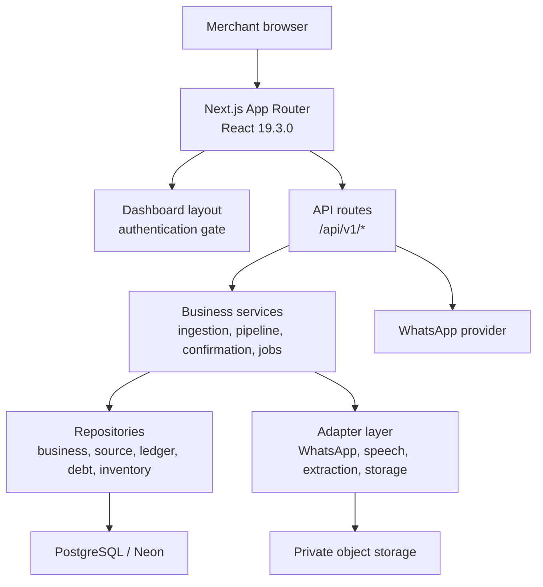
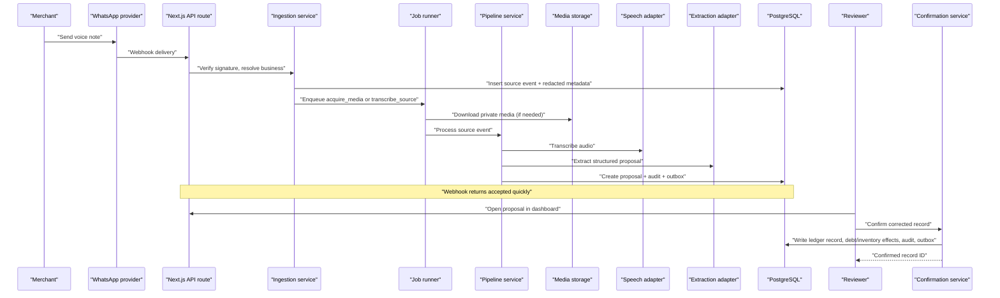
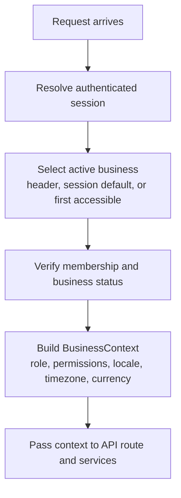
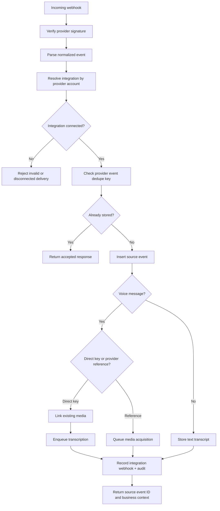
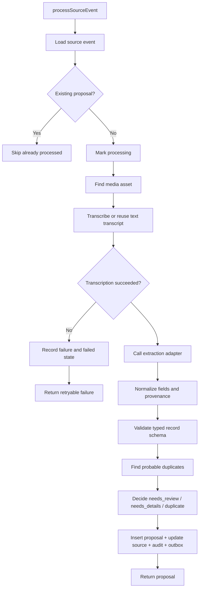
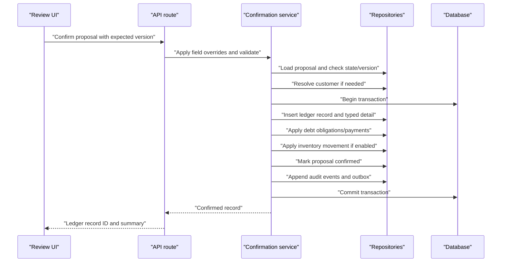
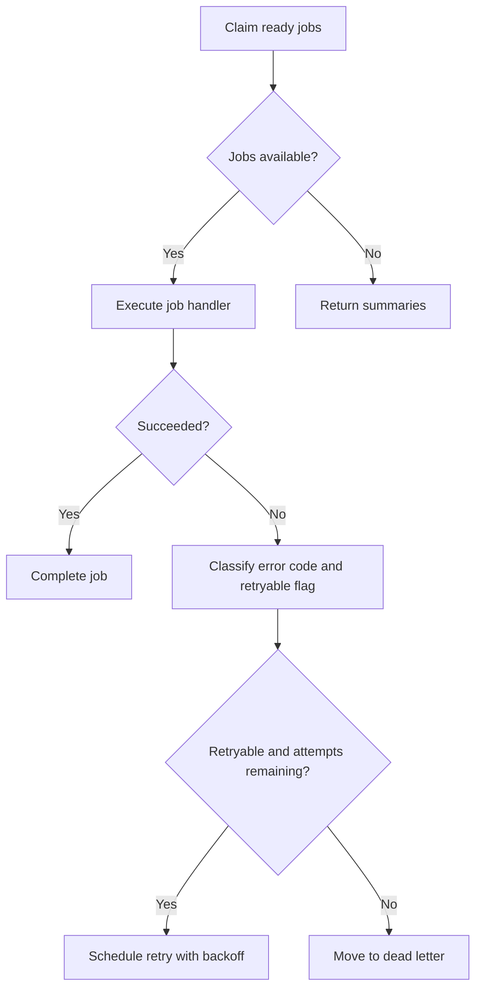
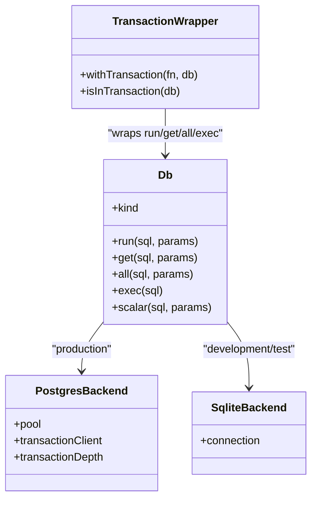
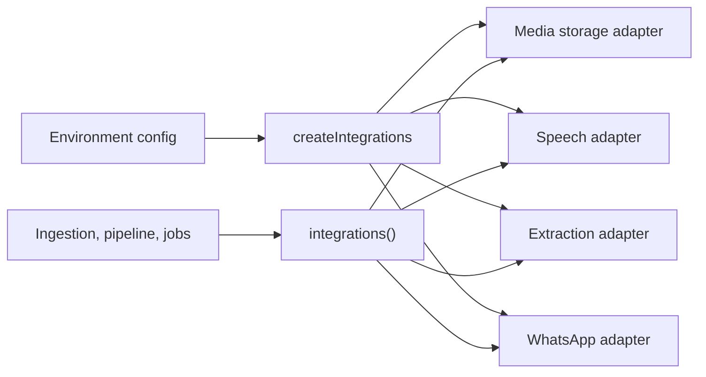
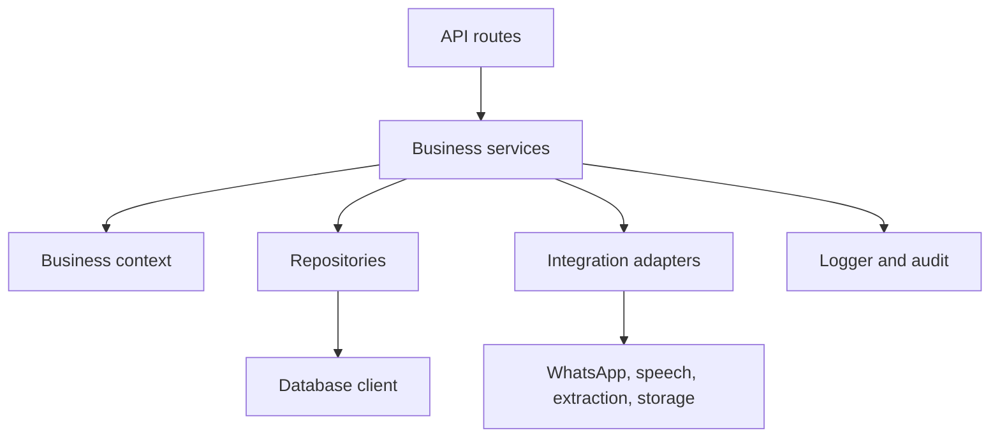

# High-Level Design

<cite>
**Referenced Files in This Document**
- [package.json](file://package.json)
- [architecture.md](file://architecture.md)
- [PRD.md](file://PRD.md)
- [next.config.ts](file://next.config.ts)
- [vercel.json](file://vercel.json)
- [src/app/layout.tsx](file://src/app/layout.tsx)
- [src/app/(dashboard)/layout.tsx](file://src/app/(dashboard)/layout.tsx)
- [src/app/api/v1/capture/voice/route.ts](file://src/app/api/v1/capture/voice/route.ts)
- [src/server/business-context/context.ts](file://src/server/business-context/context.ts)
- [src/server/business-context/resolve.ts](file://src/server/business-context/resolve.ts)
- [src/server/services/ingestion.ts](file://src/server/services/ingestion.ts)
- [src/server/services/pipeline.ts](file://src/server/services/pipeline.ts)
- [src/server/services/confirmation.ts](file://src/server/services/confirmation.ts)
- [src/server/services/jobs.ts](file://src/server/services/jobs.ts)
- [src/server/db/client.ts](file://src/server/db/client.ts)
- [src/server/integrations/index.ts](file://src/server/integrations/index.ts)
</cite>

## Table of Contents
1. [Introduction](#introduction)
2. [Project Structure](#project-structure)
3. [Core Components](#core-components)
4. [Architecture Overview](#architecture-overview)
5. [Detailed Component Analysis](#detailed-component-analysis)
6. [Dependency Analysis](#dependency-analysis)
7. [Performance Considerations](#performance-considerations)
8. [Troubleshooting Guide](#troubleshooting-guide)
9. [Conclusion](#conclusion)

## Introduction
Daftari is a voice-first, WhatsApp-native AI bookkeeper for Tanzanian small businesses. The system accepts business activity through WhatsApp or the dashboard, preserves source identity, transcribes and interprets input, presents reviewable proposals, and writes confirmed records to a tenant-scoped ledger. The React frontend is the merchant’s control surface; WhatsApp remains the primary recording channel.

The high-level design combines:
- Next.js App Router with server-side authentication and thin API routes.
- Layered backend architecture separating request handling, business services, repositories, and database access.
- Domain-driven boundaries around source events, transcripts, proposals, ledger records, debts, inventory, and audit history.
- A multi-tenant model where every request and background job is scoped to an active business.
- Adapter-based integrations for WhatsApp, speech-to-text, extraction, and media storage.

Technology stack decisions include Next.js 16.3.8, React 19.3.0, TypeScript, Zod validation, PostgreSQL via Neon, Vercel deployment, and optional local SQLite for development.

**Section sources**
- [package.json:1-47](file://package.json#L1-L47)
- [architecture.md:1-52](file://architecture.md#L1-L52)
- [PRD.md:1-37](file://PRD.md#L1-L37)

## Project Structure
The repository follows a feature-aware Next.js App Router layout:
- `src/app` contains route groups, pages, layouts, and versioned API routes under `/api/v1`.
- `src/server` holds domain services, repositories, integration adapters, business context, permissions, observability, and database utilities.
- `src/lib` provides shared formatting, localization, validation, and error helpers.
- `scripts` supports migrations, seeding, reset, and job execution.
- `tests` cover capture, confirmation, corrections, exports, idempotency, inventory, reports, providers, session behavior, and XLSX generation.

**Diagram sources**
- [src/app/layout.tsx:1-28](file://src/app/layout.tsx#L1-L28)
- [src/app/(dashboard)/layout.tsx:1-33](file://src/app/(dashboard)/layout.tsx#L1-L33)
- [src/app/api/v1/capture/voice/route.ts:1-84](file://src/app/api/v1/capture/voice/route.ts#L1-L84)
- [src/server/services/ingestion.ts:1-217](file://src/server/services/ingestion.ts#L1-L217)
- [src/server/services/pipeline.ts:1-506](file://src/server/services/pipeline.ts#L1-L506)
- [src/server/services/confirmation.ts:1-522](file://src/server/services/confirmation.ts#L1-L522)
- [src/server/services/jobs.ts:1-241](file://src/server/services/jobs.ts#L1-L241)
- [src/server/db/client.ts:1-350](file://src/server/db/client.ts#L1-L350)
- [src/server/integrations/index.ts:1-93](file://src/server/integrations/index.ts#L1-L93)

**Section sources**
- [architecture.md:496-558](file://architecture.md#L496-L558)
- [PRD.md:102-117](file://PRD.md#L102-L117)

## Core Components
The system is organized into clear layers:

| Layer | Responsibility | Key files |
|---|---|---|
| Frontend shell | Root metadata, viewport, global styles, dashboard authentication gate | [src/app/layout.tsx](file://src/app/layout.tsx), [src/app/(dashboard)/layout.tsx](file://src/app/(dashboard)/layout.tsx) |
| API routes | Parse, validate, authorize, call services, return stable JSON contracts | [src/app/api/v1/capture/voice/route.ts](file://src/app/api/v1/capture/voice/route.ts) |
| Business context | Tenant scoping, role mapping, permission checks, locale/timezone/currency | [src/server/business-context/context.ts](file://src/server/business-context/context.ts), [src/server/business-context/resolve.ts](file://src/server/business-context/resolve.ts) |
| Ingestion service | WhatsApp webhook verification, deduplication, source event creation, job enqueueing | [src/server/services/ingestion.ts](file://src/server/services/ingestion.ts) |
| Pipeline service | Transcription, extraction, proposal creation, duplicate detection, state routing | [src/server/services/pipeline.ts](file://src/server/services/pipeline.ts) |
| Confirmation service | Human decision, typed ledger record creation, debt/inventory effects, audit/outbox | [src/server/services/confirmation.ts](file://src/server/services/confirmation.ts) |
| Job runner | Durable queue processing, retries, dead-letter handling, retention cleanup | [src/server/services/jobs.ts](file://src/server/services/jobs.ts) |
| Database boundary | PostgreSQL pool, parameter translation, transactions, migration-safe SQL execution | [src/server/db/client.ts](file://src/server/db/client.ts) |
| Integration adapter selection | Provider configuration for WhatsApp, speech, extraction, storage | [src/server/integrations/index.ts](file://src/server/integrations/index.ts) |

Key architectural principles:
- AI never posts directly to the ledger; it creates proposals only.
- Source identity and lineage are preserved from webhook to transcript, proposal, decision, and ledger record.
- Every mutation is tenant-scoped and auditable.
- External providers are isolated behind adapters so domain logic does not depend on one vendor.
- Webhook acceptance is separate from processing success.

**Section sources**
- [architecture.md:9-36](file://architecture.md#L9-L36)
- [architecture.md:589-604](file://architecture.md#L589-L604)
- [src/server/business-context/context.ts:1-47](file://src/server/business-context/context.ts#L1-L47)
- [src/server/services/ingestion.ts:1-13](file://src/server/services/ingestion.ts#L1-L13)
- [src/server/services/pipeline.ts:1-10](file://src/server/services/pipeline.ts#L1-L10)
- [src/server/services/confirmation.ts:1-13](file://src/server/services/confirmation.ts#L1-L13)

## Architecture Overview
The end-to-end flow moves from voice input to confirmed ledger entries while preserving source lineage and enforcing human control.

**Diagram sources**
- [src/app/api/v1/capture/voice/route.ts:33-83](file://src/app/api/v1/capture/voice/route.ts#L33-L83)
- [src/server/services/ingestion.ts:66-207](file://src/server/services/ingestion.ts#L66-L207)
- [src/server/services/jobs.ts:51-94](file://src/server/services/jobs.ts#L51-L94)
- [src/server/services/pipeline.ts:354-503](file://src/server/services/pipeline.ts#L354-L503)
- [src/server/services/confirmation.ts:318-455](file://src/server/services/confirmation.ts#L318-L455)

System boundaries:
- **External trust boundaries**: WhatsApp provider callbacks, speech-to-text vendor, extraction model provider, object storage, identity provider.
- **Application boundaries**: Request handlers authenticate and authorize; services enforce business rules; repositories persist data; adapters isolate vendors.
- **Data boundaries**: Proposals are not ledger aggregates; only confirmed records affect totals. Audio, transcripts, and sensitive fields are treated as highly sensitive.

Security headers and privacy controls are applied at the Next.js configuration level, including strict content options, frame denial, referrer policy, and disabled camera/microphone/geolocation permissions for general routes.

**Section sources**
- [architecture.md:53-79](file://architecture.md#L53-L79)
- [architecture.md:450-480](file://architecture.md#L450-L480)
- [next.config.ts:1-24](file://next.config.ts#L1-L24)

## Detailed Component Analysis

### Multi-Tenant Business Context
Business context is the central tenant-scoping mechanism. It carries business identity, user identity, role, permissions, locale, timezone, currency, feature flags, retention settings, and analytics opt-in status. Context is produced only after verified authentication and membership resolution.

**Diagram sources**
- [src/server/business-context/resolve.ts:50-108](file://src/server/business-context/resolve.ts#L50-L108)
- [src/server/business-context/context.ts:27-41](file://src/server/business-context/context.ts#L27-L41)

Key behaviors:
- Client-supplied business selectors are validated against stored memberships.
- Cross-tenant access is denied without disclosing whether the target business exists.
- Repository methods receive a tenant scope derived from the verified context.
- Background jobs reconstruct business context from stored business identifiers.

**Section sources**
- [src/server/business-context/context.ts:1-47](file://src/server/business-context/context.ts#L1-L47)
- [src/server/business-context/resolve.ts:1-24](file://src/server/business-context/resolve.ts#L1-L24)
- [src/server/business-context/resolve.ts:73-108](file://src/server/business-context/resolve.ts#L73-L108)

### WhatsApp Webhook Ingestion
The ingestion service authenticates provider deliveries, resolves the owning business, deduplicates by provider event identifier, stores minimal redacted metadata, links or queues media, and enqueues asynchronous processing.

**Diagram sources**
- [src/server/services/ingestion.ts:66-207](file://src/server/services/ingestion.ts#L66-L207)

Important invariants:
- Signature verification fails before any business lookup.
- Provider event IDs provide idempotent receipt.
- Message body belongs to the transcript, not the redacted webhook payload.
- Acceptance is durable but does not imply successful transcription or extraction.

**Section sources**
- [src/server/services/ingestion.ts:1-13](file://src/server/services/ingestion.ts#L1-L13)
- [src/server/services/ingestion.ts:66-207](file://src/server/services/ingestion.ts#L66-L207)

### Source-to-Proposal Pipeline
The pipeline turns a source event into a reviewable proposal. It handles missing media, text-only messages, transcription failures, extraction failures, field normalization, validation issues, duplicate detection, and final proposal state routing.

**Diagram sources**
- [src/server/services/pipeline.ts:354-503](file://src/server/services/pipeline.ts#L354-L503)
- [src/server/services/pipeline.ts:277-285](file://src/server/services/pipeline.ts#L277-L285)
- [src/server/services/pipeline.ts:445-454](file://src/server/services/pipeline.ts#L445-L454)

Design notes:
- The pipeline never writes ledger records.
- Model output is treated as untrusted and validated through typed schemas.
- Missing or ambiguous fields route to clarification rather than guessed defaults.
- Duplicate candidates are surfaced for review, not auto-deleted.

**Section sources**
- [src/server/services/pipeline.ts:1-10](file://src/server/services/pipeline.ts#L1-L10)
- [src/server/services/pipeline.ts:65-172](file://src/server/services/pipeline.ts#L65-L172)
- [src/server/services/pipeline.ts:243-285](file://src/server/services/pipeline.ts#L243-L285)
- [src/server/services/pipeline.ts:354-503](file://src/server/services/pipeline.ts#L354-L503)

### Human Confirmation and Ledger Posting
Confirmation is the only path from proposal to ledger. It validates reviewer overrides, resolves customers when required, inserts typed ledger records, applies debt and inventory side effects, updates proposal state, records audit events, and emits outbox events inside a transaction.

**Diagram sources**
- [src/server/services/confirmation.ts:318-455](file://src/server/services/confirmation.ts#L318-L455)
- [src/server/services/confirmation.ts:124-232](file://src/server/services/confirmation.ts#L124-L232)
- [src/server/services/confirmation.ts:234-272](file://src/server/services/confirmation.ts#L234-L272)

Critical guarantees:
- Human confirmation is mandatory.
- Optimistic version checks prevent stale overwrites.
- Idempotent reconfirmation returns the existing record.
- All financial side effects commit atomically.

**Section sources**
- [src/server/services/confirmation.ts:1-13](file://src/server/services/confirmation.ts#L1-L13)
- [src/server/services/confirmation.ts:318-455](file://src/server/services/confirmation.ts#L318-L455)

### Durable Job Runner
The job runner claims work atomically, executes tenant-scoped handlers, records attempts, applies exponential backoff for retryable errors, and moves exhausted jobs to dead-letter states. It orchestrates media acquisition, transcription, export building, retention cleanup, and provider health checks.

**Diagram sources**
- [src/server/services/jobs.ts:142-207](file://src/server/services/jobs.ts#L142-L207)
- [src/server/services/jobs.ts:195-207](file://src/server/services/jobs.ts#L195-L207)

Reliability characteristics:
- Handlers are idempotent per entity because the queue is at-least-once.
- Bad payloads and unknown job types are non-retryable.
- Retention jobs require a valid business ID to avoid cross-tenant deletion.
- Failed jobs expose safe error codes and attempt metrics.

**Section sources**
- [src/server/services/jobs.ts:1-8](file://src/server/services/jobs.ts#L1-L8)
- [src/server/services/jobs.ts:51-140](file://src/server/services/jobs.ts#L51-L140)
- [src/server/services/jobs.ts:142-207](file://src/server/services/jobs.ts#L142-L207)

### Database Layer and Transactions
The database layer abstracts PostgreSQL and local SQLite. Production uses a connection pool with parameterized queries, while development can fall back to SQLite. Transactions use savepoints for nested calls, ensuring atomic ledger confirmations.

**Diagram sources**
- [src/server/db/client.ts:14-26](file://src/server/db/client.ts#L14-L26)
- [src/server/db/client.ts:56-89](file://src/server/db/client.ts#L56-L89)
- [src/server/db/client.ts:155-198](file://src/server/db/client.ts#L155-L198)
- [src/server/db/client.ts:280-333](file://src/server/db/client.ts#L280-L333)

Operational implications:
- Parameter translation avoids driver coupling in repositories.
- Migration scripts are split safely across comments, quotes, and dollar-quoted blocks.
- Production requires a configured PostgreSQL URL; SQLite is rejected in production mode.
- Nested repository calls share the same transaction client through async local storage.

**Section sources**
- [src/server/db/client.ts:1-7](file://src/server/db/client.ts#L1-L7)
- [src/server/db/client.ts:52-89](file://src/server/db/client.ts#L52-L89)
- [src/server/db/client.ts:200-286](file://src/server/db/client.ts#L200-L286)
- [src/server/db/client.ts:288-339](file://src/server/db/client.ts#L288-L339)

### Integration Adapter Selection
The integration module selects WhatsApp, speech, extraction, and storage implementations based on environment configuration. Feature code depends on adapter interfaces, not concrete providers.

**Diagram sources**
- [src/server/integrations/index.ts:34-78](file://src/server/integrations/index.ts#L34-L78)

Provider isolation benefits:
- Mock adapters support deterministic testing.
- Real providers can be swapped without changing domain logic.
- Speech adapters may read from the same storage adapter used by the pipeline.
- Tests can override integrations temporarily.

**Section sources**
- [src/server/integrations/index.ts:1-93](file://src/server/integrations/index.ts#L1-L93)

## Dependency Analysis
The application follows a layered dependency graph:
- Routes depend on services.
- Services depend on repositories, business context, integration adapters, and observability.
- Repositories depend on the database boundary.
- Adapters depend on external providers and storage.
- Domain logic does not depend on React or provider SDK types.

**Diagram sources**
- [src/app/api/v1/capture/voice/route.ts:33-83](file://src/app/api/v1/capture/voice/route.ts#L33-L83)
- [src/server/services/ingestion.ts:66-207](file://src/server/services/ingestion.ts#L66-L207)
- [src/server/services/pipeline.ts:354-503](file://src/server/services/pipeline.ts#L354-L503)
- [src/server/services/confirmation.ts:318-455](file://src/server/services/confirmation.ts#L318-L455)
- [src/server/db/client.ts:155-198](file://src/server/db/client.ts#L155-L198)

Coupling and cohesion observations:
- High cohesion within services: ingestion, pipeline, confirmation, and jobs each own a bounded workflow.
- Low coupling to providers through adapter interfaces.
- Strong tenant isolation through explicit context and repository scopes.
- Clear separation between proposal lifecycle and ledger lifecycle.

Potential risks:
- Tight coupling between pipeline and repositories for source/transcript/proposal operations.
- Shared integration factory cached per process; tests must restore previous integrations.
- Database abstraction adds complexity but reduces driver-specific leakage.

**Section sources**
- [architecture.md:589-604](file://architecture.md#L589-L604)
- [src/server/integrations/index.ts:73-93](file://src/server/integrations/index.ts#L73-L93)

## Performance Considerations
- **Webhook latency:** Acceptance is fast; transcription and extraction run asynchronously through jobs.
- **Queue throughput:** Jobs claim batches and apply bounded retries; concurrency should be tuned by provider rate limits and spend thresholds.
- **Database connections:** PostgreSQL pool size and idle timeout are configured centrally; long-running workers should reuse connections carefully.
- **Media handling:** Private storage access is deferred until necessary; signed URLs are short-lived and authorized.
- **Frontend performance:** First useful screen should remain lightweight; pagination, lazy loading, and tenant-scoped cache keys reduce unnecessary data transfer.
- **Caching strategy:** Authenticated HTML and API output must not be cached publicly; tenant-scoped caches must include business identity and permission versions.

Scalability considerations:
- Separate worker processes or managed queues for transcription, extraction, export, and retention jobs.
- Horizontal scaling of API routes behind load balancers with sticky sessions only if required by session storage.
- Database scaling through read replicas for reporting queries, keeping write paths on the primary.
- Provider rate limiting, circuit breaking, and per-business quotas to protect cost and reliability.

Infrastructure requirements for production:
- Managed PostgreSQL with encrypted backups and point-in-time recovery.
- Private object storage with server-side encryption and lifecycle policies.
- Secure secret management for provider credentials and database URLs.
- Structured logging, metrics, traces, error tracking, and alerting.
- Separate development, staging, and production environments with isolated resources.

**Section sources**
- [architecture.md:394-425](file://architecture.md#L394-L425)
- [architecture.md:606-627](file://architecture.md#L606-L627)
- [architecture.md:664-698](file://architecture.md#L664-L698)
- [src/server/db/client.ts:56-89](file://src/server/db/client.ts#L56-L89)

## Troubleshooting Guide
Common operational scenarios:

| Symptom | Likely cause | Recommended action |
|---|---|---|
| Webhook returns signature error | Invalid provider signature or timestamp | Inspect provider configuration and request headers; do not log raw payload |
| Source event accepted but no proposal | Media acquisition or transcription failed | Check job runs, provider health, and failure codes |
| Proposal stuck in processing | Extraction provider failure or transient error | Review retryable flag, provider logs, and job backoff |
| Confirmation conflicts | Stale proposal version or concurrent reviewer | Refresh proposal and reconcile changes |
| Duplicate ledger record suspected | Idempotency or dedupe key issue | Verify provider event ID uniqueness and job idempotency keys |
| Export stays queued | Export job not executed or failed | Run job runner, inspect dead-letter queue, and rebuild export |
| Media not available | Expired retention or storage access failure | Check retention deadline, storage adapter, and signed URL authorization |

Debugging guidance:
- Use correlation IDs and opaque entity IDs in logs.
- Never log raw audio, transcripts, provider secrets, or full financial records.
- Inspect job attempt counts, error codes, and retryable flags.
- Validate tenant scoping whenever cross-business data exposure is suspected.
- Test idempotency by replaying webhooks and confirming single-source, single-proposal, single-ledger outcomes.

**Section sources**
- [architecture.md:412-425](file://architecture.md#L412-L425)
- [architecture.md:606-627](file://architecture.md#L606-L627)
- [src/server/services/jobs.ts:142-207](file://src/server/services/jobs.ts#L142-L207)

## Conclusion
Daftari’s high-level design separates concerns cleanly: Next.js routes handle requests, business services enforce domain rules, repositories manage persistence, and adapters isolate external providers. The multi-tenant model ensures that every request, job, and query is scoped to an active business. The pipeline preserves source lineage and defers financial posting to a human decision, making the system trustworthy for small-business accounting.

For production, prioritize secure webhook verification, tenant isolation, idempotent processing, auditable ledger changes, private media handling, scalable queues, and robust observability. The current implementation provides a strong foundation for extending providers, adding new record types, and scaling to multiple tenants while keeping financial correctness and merchant control at the center.