# Security Model

<cite>
**Referenced Files in This Document**
- [session.ts](file://src/server/auth/session.ts)
- [session-store.ts](file://src/server/auth/session-store.ts)
- [password.ts](file://src/server/auth/password.ts)
- [rate-limit.ts](file://src/server/auth/rate-limit.ts)
- [policy.ts](file://src/server/permissions/policy.ts)
- [context.ts](file://src/server/business-context/context.ts)
- [resolve.ts](file://src/server/business-context/resolve.ts)
- [route.ts (sign-in)](file://src/app/api/v1/auth/sign-in/route.ts)
- [route.ts (register)](file://src/app/api/v1/auth/register/route.ts)
- [route.ts (session)](file://src/app/api/v1/session/route.ts)
- [route.ts (switch business)](file://src/app/api/v1/session/switch/route.ts)
- [types.ts](file://src/server/domain/types.ts)
- [errors.ts](file://src/lib/errors.ts)
</cite>

## Table of Contents
1. [Introduction](#introduction)
2. [Project Structure](#project-structure)
3. [Core Components](#core-components)
4. [Architecture Overview](#architecture-overview)
5. [Detailed Component Analysis](#detailed-component-analysis)
6. [Dependency Analysis](#dependency-analysis)
7. [Performance Considerations](#performance-considerations)
8. [Troubleshooting Guide](#troubleshooting-guide)
9. [Conclusion](#conclusion)
10. [Appendices](#appendices)

## Introduction
This document explains the security model implemented in Daftari. It covers session management with HTTP-only cookies, password hashing and policy enforcement, rate limiting for credential endpoints, role-based access control, permission policies, and a multi-tenant security model that isolates data between businesses. It also provides concrete examples of how API routes validate sessions, enforce permissions, and scope requests to a tenant context. Finally, it documents best practices such as input validation, uniform error responses, and secure cookie configuration, and gives guidance on extending the permission system and adding new security policies.

## Project Structure
The security implementation is split into focused modules:
- Authentication and session handling live under `src/server/auth`.
- Permission and role definitions are centralized under `src/server/permissions`.
- Multi-tenant context resolution lives under `src/server/business-context`.
- API routes under `src/app/api/v1` use these modules to protect endpoints.
- Shared domain types and error contracts live under `src/server/domain` and `src/lib`.

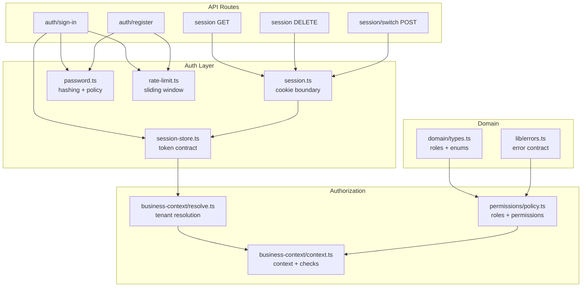

**Diagram sources**
- [route.ts (sign-in):1-87](file://src/app/api/v1/auth/sign-in/route.ts#L1-L87)
- [route.ts (register):1-126](file://src/app/api/v1/auth/register/route.ts#L1-L126)
- [route.ts (session):1-39](file://src/app/api/v1/session/route.ts#L1-L39)
- [route.ts (switch business):1-31](file://src/app/api/v1/session/switch/route.ts#L1-L31)
- [session.ts:1-69](file://src/server/auth/session.ts#L1-L69)
- [session-store.ts:1-105](file://src/server/auth/session-store.ts#L1-L105)
- [password.ts:1-145](file://src/server/auth/password.ts#L1-L145)
- [rate-limit.ts:1-91](file://src/server/auth/rate-limit.ts#L1-L91)
- [policy.ts:1-104](file://src/server/permissions/policy.ts#L1-L104)
- [context.ts:1-131](file://src/server/business-context/context.ts#L1-L131)
- [resolve.ts:1-152](file://src/server/business-context/resolve.ts#L1-L152)
- [types.ts:64-65](file://src/server/domain/types.ts#L64-L65)
- [errors.ts:1-130](file://src/lib/errors.ts#L1-L130)

**Section sources**
- [session.ts:1-69](file://src/server/auth/session.ts#L1-L69)
- [session-store.ts:1-105](file://src/server/auth/session-store.ts#L1-L105)
- [password.ts:1-145](file://src/server/auth/password.ts#L1-L145)
- [rate-limit.ts:1-91](file://src/server/auth/rate-limit.ts#L1-L91)
- [policy.ts:1-104](file://src/server/permissions/policy.ts#L1-L104)
- [context.ts:1-131](file://src/server/business-context/context.ts#L1-L131)
- [resolve.ts:1-152](file://src/server/business-context/resolve.ts#L1-L152)
- [types.ts:64-65](file://src/server/domain/types.ts#L64-L65)
- [errors.ts:1-130](file://src/lib/errors.ts#L1-L130)

## Core Components
- Cookie-based session boundary: reads, writes, and clears an HTTP-only session cookie; resolves tokens to authenticated sessions.
- Framework-free session store: issues opaque tokens, hashes them before storage, enforces TTL, revokes sessions, and switches active business.
- Password hashing and policy: memory-hard scrypt hashing, constant-time verification, parameterized stored format, and client-facing policy checks.
- Rate limiting: in-process sliding-window limiter for credential endpoints with per-client and per-email controls.
- RBAC and permissions: central capability table mapping roles to permissions, with helper functions for checks and assertions.
- Multi-tenant context: resolves the active business from headers or session defaults, verifies membership, and builds a typed context used by repositories.

**Section sources**
- [session.ts:1-69](file://src/server/auth/session.ts#L1-L69)
- [session-store.ts:1-105](file://src/server/auth/session-store.ts#L1-L105)
- [password.ts:1-145](file://src/server/auth/password.ts#L1-L145)
- [rate-limit.ts:1-91](file://src/server/auth/rate-limit.ts#L1-L91)
- [policy.ts:1-104](file://src/server/permissions/policy.ts#L1-L104)
- [context.ts:1-131](file://src/server/business-context/context.ts#L1-L131)
- [resolve.ts:1-152](file://src/server/business-context/resolve.ts#L1-L152)

## Architecture Overview
The authentication flow uses a server-side session token stored in an HTTP-only cookie. The raw token never reaches the database; only its hash is persisted. On each request, the route layer reads the cookie, resolves the token against the database, and returns an authenticated session object. Tenant resolution then validates the user’s membership in the requested business and constructs a typed context containing role-derived permissions. Authorization checks run at the route/service boundary using the central permission policy.

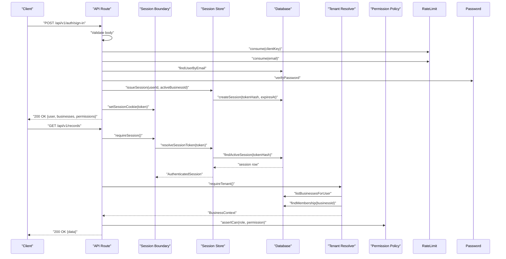

**Diagram sources**
- [route.ts (sign-in):1-87](file://src/app/api/v1/auth/sign-in/route.ts#L1-L87)
- [session.ts:40-69](file://src/server/auth/session.ts#L40-L69)
- [session-store.ts:67-96](file://src/server/auth/session-store.ts#L67-L96)
- [password.ts:65-86](file://src/server/auth/password.ts#L65-L86)
- [rate-limit.ts:43-63](file://src/server/auth/rate-limit.ts#L43-L63)
- [resolve.ts:73-108](file://src/server/business-context/resolve.ts#L73-L108)
- [policy.ts:84-91](file://src/server/permissions/policy.ts#L84-L91)

## Detailed Component Analysis

### Session Management and Cookie-Based Authentication
- Cookie boundary:
  - Reads the session cookie by name.
  - Sets the cookie with HTTP-only, SameSite=Lax, and production-only Secure flag.
  - Clears the cookie on logout.
  - Provides `requireSession()` and `optionalSession()` helpers that throw unauthenticated errors when no valid session exists.
- Token contract:
  - Generates an opaque random token for the cookie.
  - Hashes the token before storing it in the database.
  - Stores expiration time, hashed user agent, and active business ID.
  - Supports revocation and switching the active business for a session.
- Resolution:
  - Looks up the hashed token, loads the session, and ensures the associated user is active.
  - Returns an authenticated session object including the database handle.

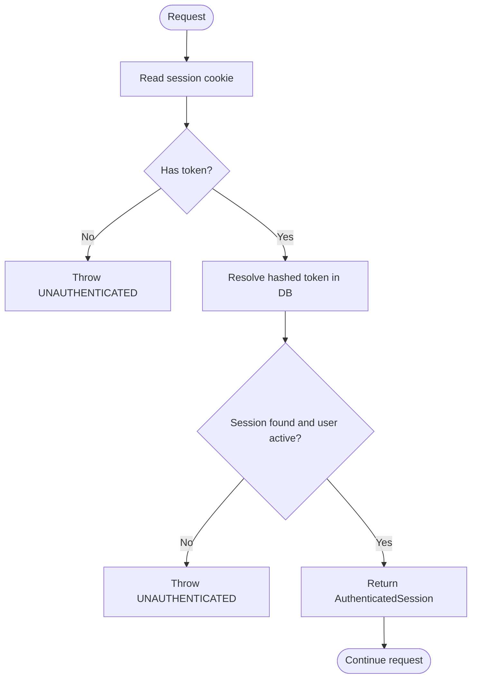

**Diagram sources**
- [session.ts:40-69](file://src/server/auth/session.ts#L40-L69)
- [session-store.ts:41-63](file://src/server/auth/session-store.ts#L41-L63)
- [session-store.ts:90-96](file://src/server/auth/session-store.ts#L90-L96)

**Section sources**
- [session.ts:1-69](file://src/server/auth/session.ts#L1-L69)
- [session-store.ts:1-105](file://src/server/auth/session-store.ts#L1-L105)

### Password Hashing and Policy Enforcement
- Hashing:
  - Uses scrypt with OWASP-aligned parameters and configurable cost factors.
  - Stores parameters inside the hash string so upgrades do not invalidate existing rows.
  - Enforces maximum memory usage and validates stored parameters defensively.
- Verification:
  - Performs constant-time comparison.
  - Ensures timing parity for missing accounts by running a dummy derivation.
- Policy:
  - Enforces minimum length, maximum length, and character class requirements.
  - Centralizes policy logic so UI and API remain consistent.

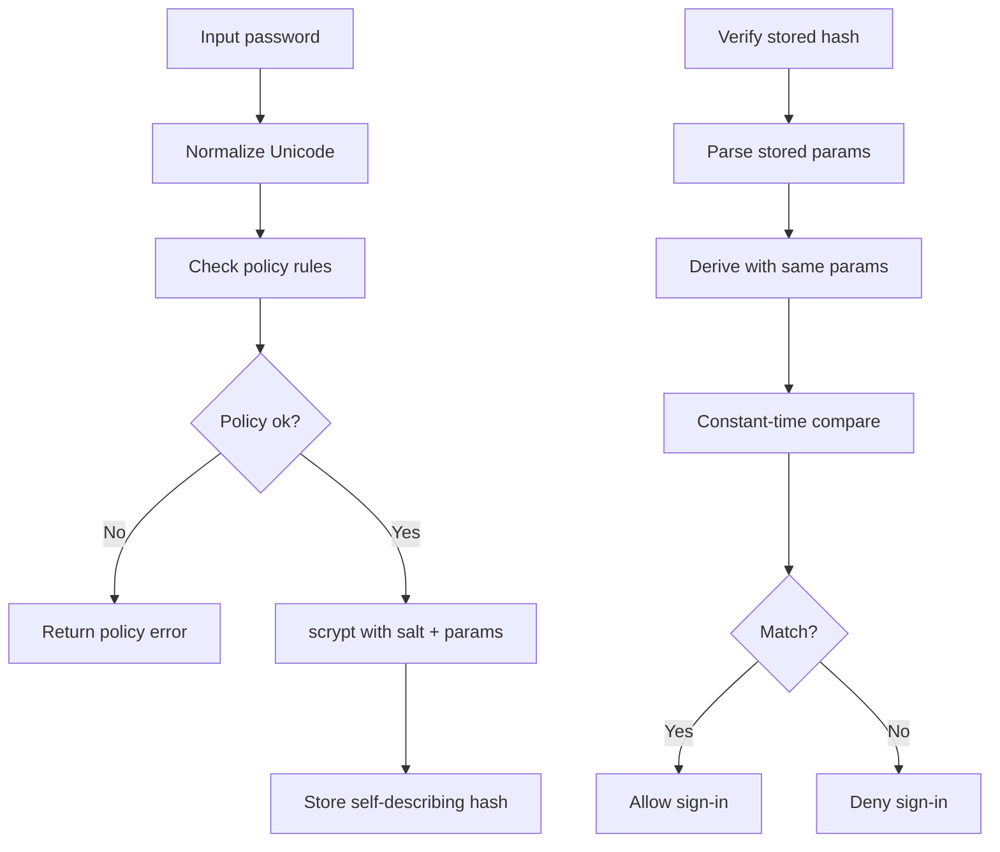

**Diagram sources**
- [password.ts:37-55](file://src/server/auth/password.ts#L37-L55)
- [password.ts:65-86](file://src/server/auth/password.ts#L65-L86)
- [password.ts:134-145](file://src/server/auth/password.ts#L134-L145)

**Section sources**
- [password.ts:1-145](file://src/server/auth/password.ts#L1-L145)

### Rate Limiting for Credential Endpoints
- Sliding window:
  - Tracks hits per key within a fixed window.
  - Sweeps expired entries periodically to prevent unbounded growth.
- Keys:
  - Per-client key derived from proxy headers.
  - Per-email key for credential stuffing protection.
- Reset:
  - Resets per-email bucket after successful sign-in to avoid locking out legitimate users.

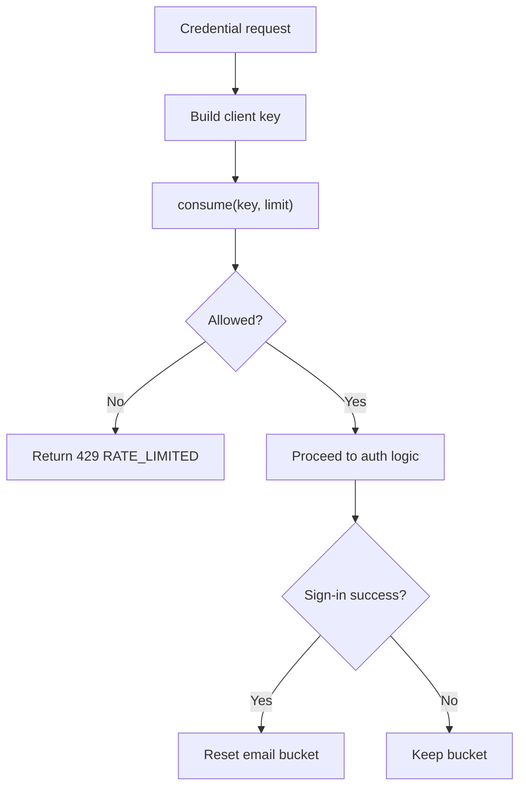

**Diagram sources**
- [rate-limit.ts:12-63](file://src/server/auth/rate-limit.ts#L12-L63)
- [rate-limit.ts:73-85](file://src/server/auth/rate-limit.ts#L73-L85)
- [route.ts (sign-in):26-52](file://src/app/api/v1/auth/sign-in/route.ts#L26-L52)

**Section sources**
- [rate-limit.ts:1-91](file://src/server/auth/rate-limit.ts#L1-L91)
- [route.ts (sign-in):26-52](file://src/app/api/v1/auth/sign-in/route.ts#L26-L52)

### Role-Based Access Control and Permission Policies
- Roles:
  - Defined centrally as owner, manager, staff.
- Permissions:
  - Central capability list covering dashboard, proposals, records, deni, inventory, reports, team, integrations, settings, privacy, and audit.
- Mapping:
  - Owner has all permissions.
  - Manager has most operational permissions plus read-only capabilities for team/integrations/settings/privacy.
  - Staff has minimal read/capture/read-only capabilities.
- Enforcement:
  - `can`, `assertCan`, and `permissionsForRole` provide type-safe checks.
  - Some permissions are grantable to managers by owners.

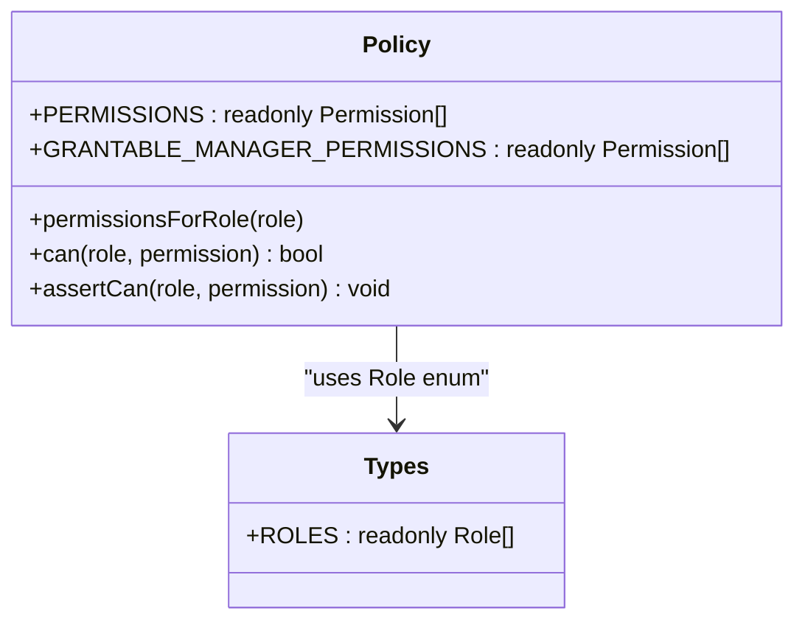

**Diagram sources**
- [policy.ts:11-104](file://src/server/permissions/policy.ts#L11-L104)
- [types.ts:64-65](file://src/server/domain/types.ts#L64-L65)

**Section sources**
- [policy.ts:1-104](file://src/server/permissions/policy.ts#L1-L104)
- [types.ts:64-65](file://src/server/domain/types.ts#L64-L65)

### Multi-Tenant Security Model and Business Context Resolution
- Header-driven selection:
  - Clients may send an active business header, but the server verifies membership on every request.
- Fallbacks:
  - If no header is provided, the session’s active business is used.
  - If none is set, the first accessible business is selected.
- Membership verification:
  - Resolves the business and confirms the user’s membership status.
  - Cross-tenant access attempts return a generic forbidden response without leaking existence.
- Context construction:
  - Builds a typed `BusinessContext` with role-derived permissions, locale, timezone, currency, feature flags, and retention/analytics settings.
  - Exposes `tenantScope(context)` to pass a minimal tenant identifier to repositories.

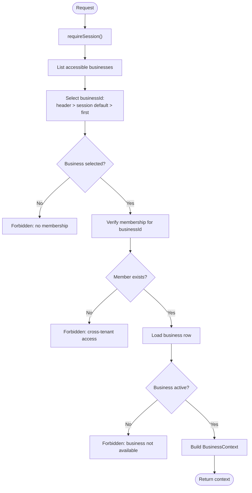

**Diagram sources**
- [resolve.ts:50-108](file://src/server/business-context/resolve.ts#L50-L108)
- [context.ts:66-86](file://src/server/business-context/context.ts#L66-L86)

**Section sources**
- [resolve.ts:1-152](file://src/server/business-context/resolve.ts#L1-L152)
- [context.ts:1-131](file://src/server/business-context/context.ts#L1-L131)

### Concrete Examples of Security Checks in API Routes

#### Sign-In Flow
- Validates request body with a schema.
- Applies per-client and per-email rate limits.
- Verifies password uniformly regardless of account existence.
- Issues a session and sets the cookie.
- Returns user info, accessible businesses, and role-derived permissions.

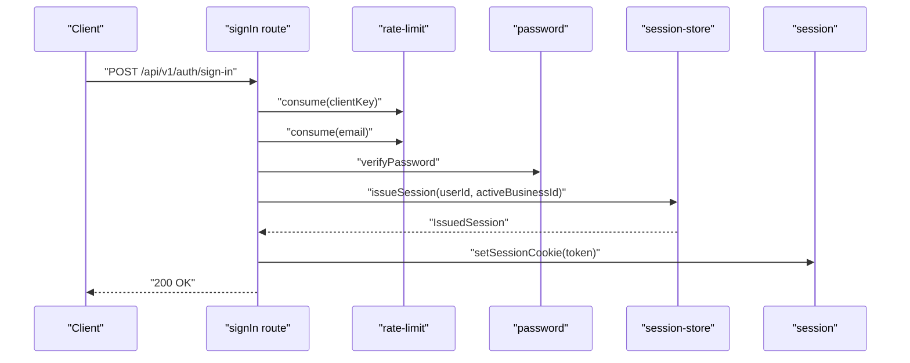

**Diagram sources**
- [route.ts (sign-in):35-87](file://src/app/api/v1/auth/sign-in/route.ts#L35-L87)
- [session-store.ts:67-81](file://src/server/auth/session-store.ts#L67-L81)
- [session.ts:45-48](file://src/server/auth/session.ts#L45-L48)

**Section sources**
- [route.ts (sign-in):1-87](file://src/app/api/v1/auth/sign-in/route.ts#L1-L87)

#### Registration Flow
- Validates email shape and password policy.
- Applies per-client registration rate limit.
- Hashes password outside the transaction to avoid holding pooled connections during slow KDF work.
- Creates user, business, and owner membership in a transaction.
- Issues a session and sets the cookie.

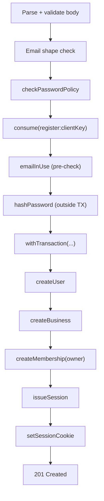

**Diagram sources**
- [route.ts (register):35-126](file://src/app/api/v1/auth/register/route.ts#L35-L126)
- [password.ts:37-55](file://src/server/auth/password.ts#L37-L55)

**Section sources**
- [route.ts (register):1-126](file://src/app/api/v1/auth/register/route.ts#L1-L126)

#### Session Lifecycle
- GET: returns current user, accessible businesses, active business, role, and permissions.
- DELETE: revokes the session and clears the cookie.

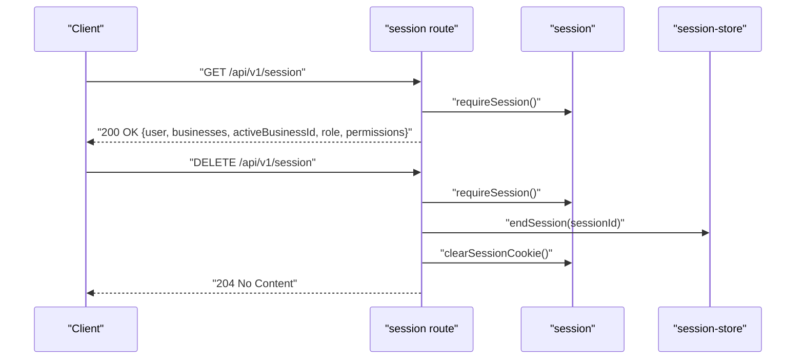

**Diagram sources**
- [route.ts (session):17-39](file://src/app/api/v1/session/route.ts#L17-L39)
- [session-store.ts:98-100](file://src/server/auth/session-store.ts#L98-L100)
- [session.ts:50-53](file://src/server/auth/session.ts#L50-L53)

**Section sources**
- [route.ts (session):1-39](file://src/app/api/v1/session/route.ts#L1-L39)

#### Switching Active Business
- Requires a valid session.
- Parses and validates the target business ID.
- Verifies the user can access the target business via membership.
- Updates the session’s active business.

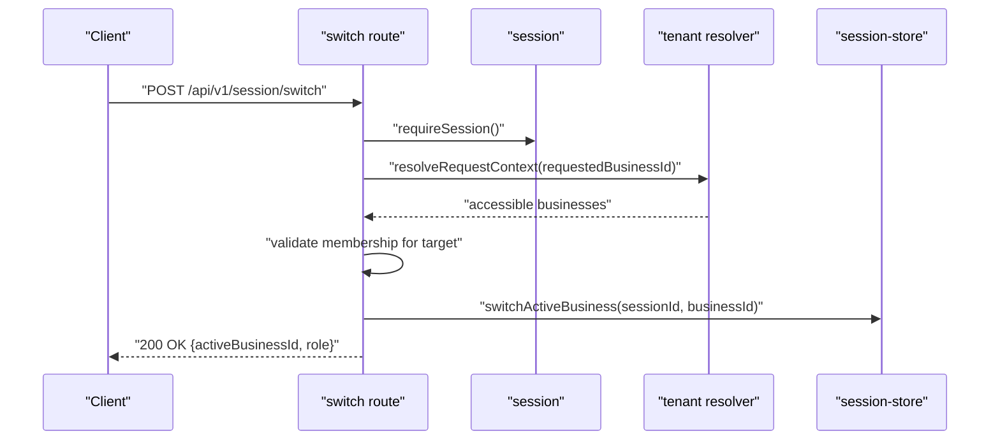

**Diagram sources**
- [route.ts (switch business):15-31](file://src/app/api/v1/session/switch/route.ts#L15-L31)
- [resolve.ts:73-108](file://src/server/business-context/resolve.ts#L73-L108)
- [session-store.ts:102-104](file://src/server/auth/session-store.ts#L102-L104)

**Section sources**
- [route.ts (switch business):1-31](file://src/app/api/v1/session/switch/route.ts#L1-L31)

## Dependency Analysis
The following diagram shows how core security modules depend on each other:

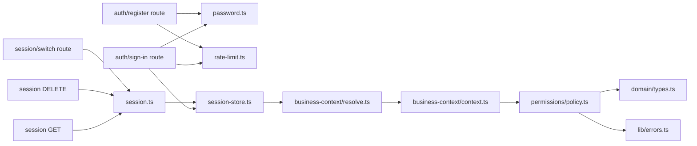

**Diagram sources**
- [route.ts (sign-in):1-87](file://src/app/api/v1/auth/sign-in/route.ts#L1-L87)
- [route.ts (register):1-126](file://src/app/api/v1/auth/register/route.ts#L1-L126)
- [route.ts (session):1-39](file://src/app/api/v1/session/route.ts#L1-L39)
- [route.ts (switch business):1-31](file://src/app/api/v1/session/switch/route.ts#L1-L31)
- [session.ts:1-69](file://src/server/auth/session.ts#L1-L69)
- [session-store.ts:1-105](file://src/server/auth/session-store.ts#L1-L105)
- [context.ts:1-131](file://src/server/business-context/context.ts#L1-L131)
- [resolve.ts:1-152](file://src/server/business-context/resolve.ts#L1-L152)
- [policy.ts:1-104](file://src/server/permissions/policy.ts#L1-L104)
- [types.ts:64-65](file://src/server/domain/types.ts#L64-L65)
- [errors.ts:1-130](file://src/lib/errors.ts#L1-L130)

**Section sources**
- [session.ts:1-69](file://src/server/auth/session.ts#L1-L69)
- [session-store.ts:1-105](file://src/server/auth/session-store.ts#L1-L105)
- [password.ts:1-145](file://src/server/auth/password.ts#L1-L145)
- [rate-limit.ts:1-91](file://src/server/auth/rate-limit.ts#L1-L91)
- [policy.ts:1-104](file://src/server/permissions/policy.ts#L1-L104)
- [context.ts:1-131](file://src/server/business-context/context.ts#L1-L131)
- [resolve.ts:1-152](file://src/server/business-context/resolve.ts#L1-L152)
- [types.ts:64-65](file://src/server/domain/types.ts#L64-L65)
- [errors.ts:1-130](file://src/lib/errors.ts#L1-L130)

## Performance Considerations
- Password hashing:
  - Scrypt is intentionally slow; hashing is performed outside database transactions to avoid holding pooled connections.
  - Parameter bounds are enforced to prevent excessive memory allocation.
- Rate limiting:
  - In-memory buckets are swept periodically to prevent unbounded growth.
  - Limits are tight enough to deter abuse while allowing legitimate retries.
- Session resolution:
  - Reuses the same database connection obtained from the authenticated session to reduce overhead.
- Cookie options:
  - Secure flag is enabled in production to ensure HTTPS-only transmission.

[No sources needed since this section provides general guidance]

## Troubleshooting Guide
Common issues and their likely causes:
- 401 UNAUTHENTICATED:
  - Missing or invalid session cookie.
  - Expired or revoked session.
  - Inactive user account.
- 403 FORBIDDEN:
  - User lacks required permission for the action.
  - Cross-tenant access attempt.
  - Business not active or not available.
- 422 VALIDATION_FAILED:
  - Invalid request body or policy violation (e.g., weak password).
- 429 RATE_LIMITED:
  - Too many sign-in attempts from the same client or email.

Error handling:
- Application errors carry structured codes and messages without sensitive details.
- Internal exceptions are normalized to safe 500 responses.

**Section sources**
- [errors.ts:8-130](file://src/lib/errors.ts#L8-L130)
- [route.ts (sign-in):54-66](file://src/app/api/v1/auth/sign-in/route.ts#L54-L66)
- [route.ts (register):58-70](file://src/app/api/v1/auth/register/route.ts#L58-L70)
- [resolve.ts:91-106](file://src/server/business-context/resolve.ts#L91-L106)

## Conclusion
Daftari’s security model centers on a robust session contract, strong password hashing, strict rate limiting, centralized RBAC, and explicit multi-tenant context resolution. Requests are authenticated via HTTP-only cookies, authorized through role-derived permissions, and scoped to a verified business context. Error responses are uniform and non-leaking. This design supports future integration with managed identity providers while keeping the rest of the application unchanged.

[No sources needed since this section summarizes without analyzing specific files]

## Appendices

### Extending the Permission System
- Add a new permission:
  - Extend the central permission list.
  - Decide which roles receive it by updating the role-to-permission mapping.
  - Optionally mark it as grantable to managers if appropriate.
- Enforce the permission:
  - Use `assertCan(role, permission)` at the route or service boundary.
  - Alternatively, use `hasPermission(context, permission)` for conditional behavior.

**Section sources**
- [policy.ts:11-104](file://src/server/permissions/policy.ts#L11-L104)

### Adding New Security Policies
- For credential endpoints:
  - Apply per-client and per-entity rate limits using the shared limiter.
  - Validate inputs with schemas before performing expensive operations.
- For tenant-scoped operations:
  - Always resolve the business context and verify membership.
  - Pass `tenantScope(context)` to repository methods to guarantee isolation.

**Section sources**
- [rate-limit.ts:43-63](file://src/server/auth/rate-limit.ts#L43-L63)
- [resolve.ts:73-108](file://src/server/business-context/resolve.ts#L73-L108)
- [context.ts:48-50](file://src/server/business-context/context.ts#L48-L50)