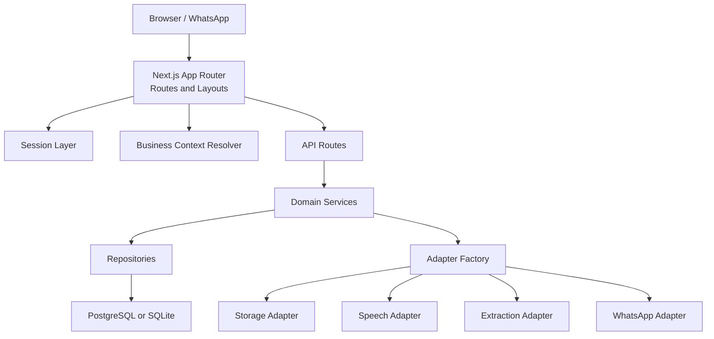
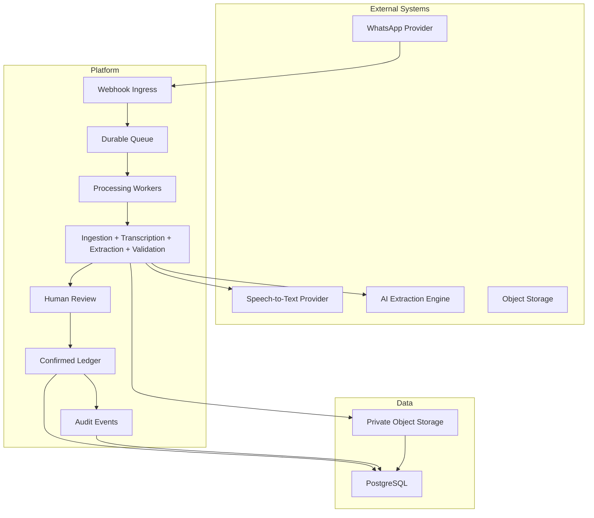
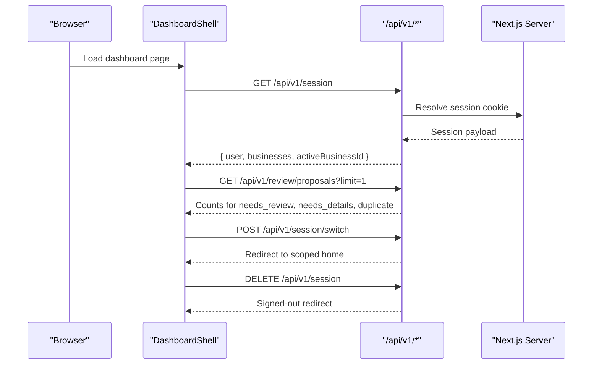
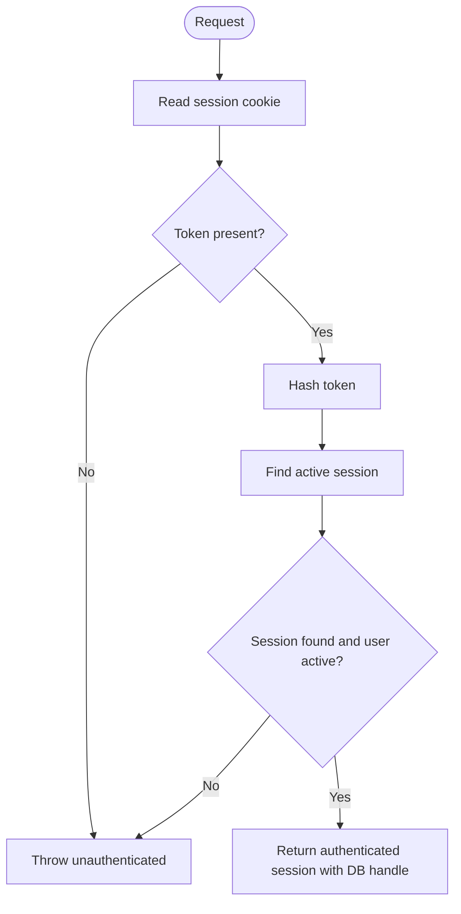
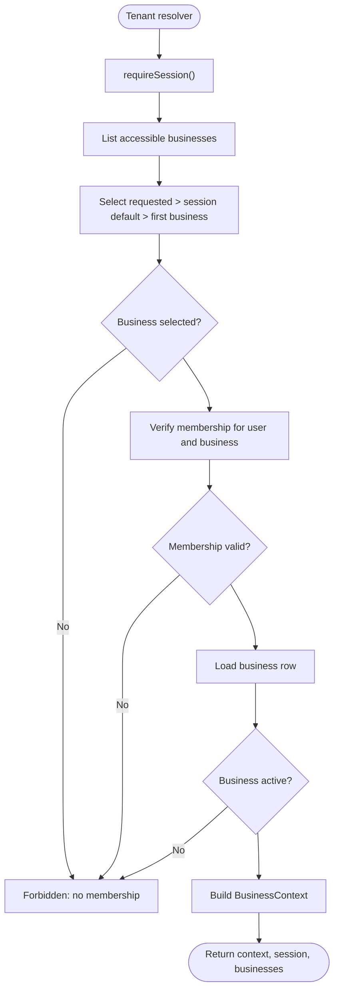
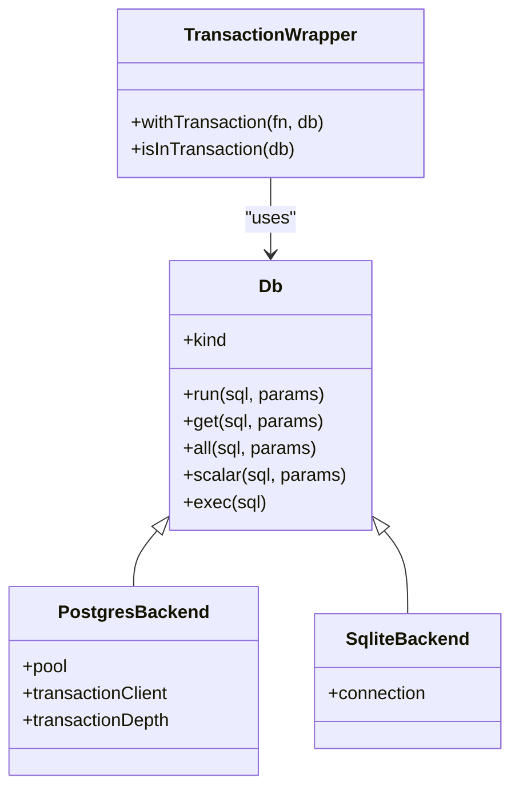
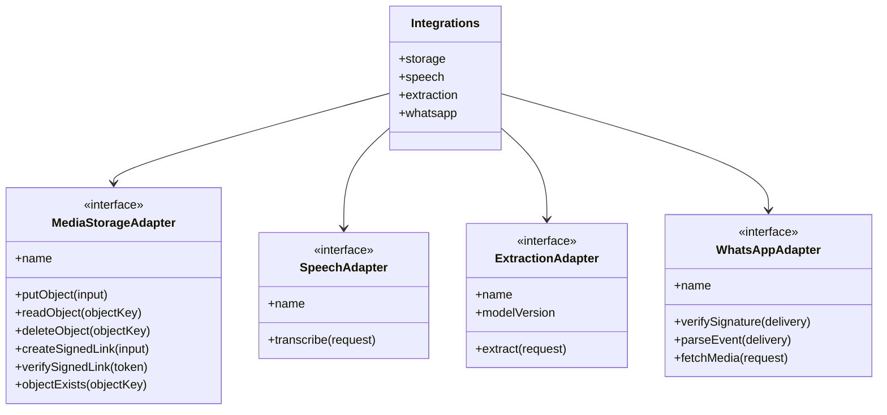
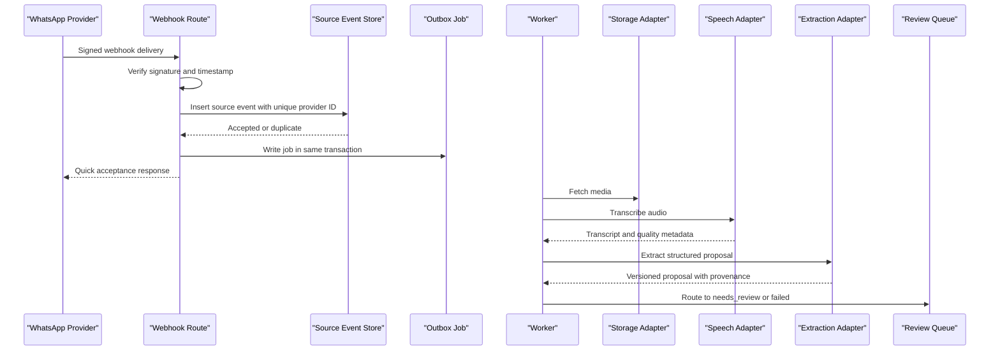
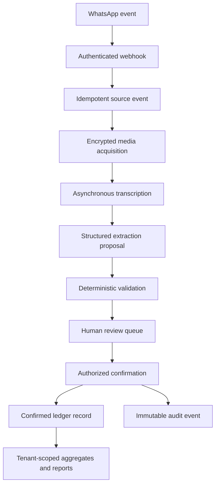
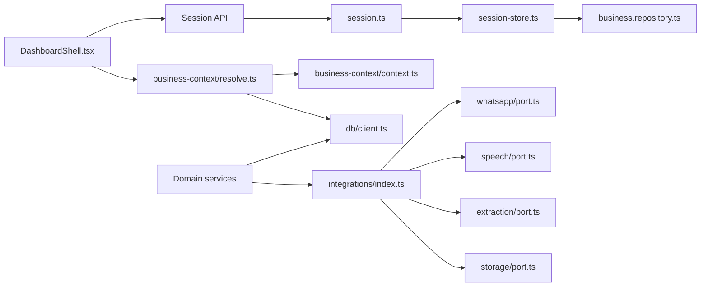

# System Architecture

<cite>
**Referenced Files in This Document**
- [architecture.md](file://architecture.md)
- [package.json](file://package.json)
- [next.config.ts](file://next.config.ts)
- [vercel.json](file://vercel.json)
- [src/app/layout.tsx](file://src/app/layout.tsx)
- [src/app/(dashboard)/layout.tsx](file://src/app/(dashboard)/layout.tsx)
- [src/app/(dashboard)/components/DashboardShell.tsx](file://src/app/(dashboard)/components/DashboardShell.tsx)
- [src/server/business-context/context.ts](file://src/server/business-context/context.ts)
- [src/server/business-context/resolve.ts](file://src/server/business-context/resolve.ts)
- [src/server/auth/session.ts](file://src/server/auth/session.ts)
- [src/server/auth/session-store.ts](file://src/server/auth/session-store.ts)
- [src/server/db/client.ts](file://src/server/db/client.ts)
- [src/server/integrations/index.ts](file://src/server/integrations/index.ts)
- [src/server/integrations/whatsapp/port.ts](file://src/server/integrations/whatsapp/port.ts)
- [src/server/integrations/speech/port.ts](file://src/server/integrations/speech/port.ts)
- [src/server/integrations/extraction/port.ts](file://src/server/integrations/extraction/port.ts)
- [src/server/integrations/storage/port.ts](file://src/server/integrations/storage/port.ts)
</cite>

## Table of Contents
1. [Introduction](#introduction)
2. [Project Structure](#project-structure)
3. [Core Components](#core-components)
4. [Architecture Overview](#architecture-overview)
5. [Detailed Component Analysis](#detailed-component-analysis)
6. [Dependency Analysis](#dependency-analysis)
7. [Performance Considerations](#performance-considerations)
8. [Troubleshooting Guide](#troubleshooting-guide)
9. [Conclusion](#conclusion)

## Introduction
Daftari is a voice-first, WhatsApp-native bookkeeping system for Tanzanian small businesses. The product receives business activity through WhatsApp, preserves the original source, transcribes and interprets it, presents a proposal for human review, and writes confirmed records to a tenant-scoped ledger. The dashboard is the review and control center; WhatsApp remains the default capture channel.

The repository implements a Next.js App Router application with server-side authentication, a typed database boundary, domain services, repositories, and an adapter layer for external providers. The architecture emphasizes:
- Source-first lineage from webhook to transcript, proposal, decision, ledger record, correction, and export.
- Mandatory tenant scoping through `BusinessContext`.
- Idempotent boundaries for webhooks, jobs, confirmations, and exports.
- Replaceable adapters for WhatsApp, speech-to-text, AI extraction, and storage.
- Human confirmation before any financial ledger write.
- Auditability, privacy-by-design, and operational observability.

**Section sources**
- [architecture.md:1-36](file://architecture.md#L1-L36)

## Project Structure
The project follows Next.js conventions with feature-oriented routes under `src/app`, shared UI components under `src/components`, and backend logic under `src/server`. Key areas include:
- `src/app`: Next.js App Router pages, route groups, API routes, and layout shells.
- `src/server`: Authentication, business context resolution, database client, domain types, integrations, repositories, services, permissions, and observability.
- `src/lib`: Formatting, localization, validation, and shared utilities.
- `scripts`: Database migrations, seeding, reset, and job execution helpers.
- `tests`: Unit, integration, contract, and end-to-end tests aligned with the pipeline and domain rules.

**Diagram sources**
- [src/app/(dashboard)/layout.tsx:1-33](file://src/app/(dashboard)/layout.tsx#L1-L33)
- [src/server/business-context/resolve.ts:73-108](file://src/server/business-context/resolve.ts#L73-L108)
- [src/server/auth/session.ts:55-68](file://src/server/auth/session.ts#L55-L68)
- [src/server/integrations/index.ts:41-78](file://src/server/integrations/index.ts#L41-L78)
- [src/server/db/client.ts:56-88](file://src/server/db/client.ts#L56-L88)

**Section sources**
- [architecture.md:496-558](file://architecture.md#L496-L558)
- [package.json:9-21](file://package.json#L9-L21)

## Core Components
This section summarizes the core runtime components that shape Daftari’s layered architecture.

| Component | Responsibility | Implementation Notes |
|---|---|---|
| Next.js App Router | Entry points for pages, layouts, and API routes | Uses server-side session checks for protected routes; public metadata and viewport are defined at root layout. |
| Session Layer | Cookie-based session boundary and token lifecycle | Stores hashed tokens, resolves active sessions, supports dev login only in non-production environments. |
| Business Context | Tenant scoping, role mapping, permission checks, locale/timezone/currency features | Every repository call requires a verified `BusinessContext`; cross-tenant access is denied without disclosing entity existence. |
| Database Boundary | Portable SQL execution over PostgreSQL or SQLite | Supports transactions, savepoints, parameter normalization, and migration-safe statement splitting. |
| Integration Factory | Provider selection and test override seam | Chooses storage, speech, extraction, and WhatsApp adapters based on configuration; exposes `overrideIntegrations` for testing. |
| Adapters | External provider contracts | WhatsApp, speech, extraction, and storage ports define stable interfaces; implementations are isolated behind ports. |

**Section sources**
- [src/app/layout.tsx:5-20](file://src/app/layout.tsx#L5-L20)
- [src/app/(dashboard)/layout.tsx:1-33](file://src/app/(dashboard)/layout.tsx#L1-L33)
- [src/server/auth/session-store.ts:21-58](file://src/server/auth/session-store.ts#L21-L58)
- [src/server/business-context/context.ts:27-50](file://src/server/business-context/context.ts#L27-L50)
- [src/server/db/client.ts:56-88](file://src/server/db/client.ts#L56-L88)
- [src/server/integrations/index.ts:34-78](file://src/server/integrations/index.ts#L34-L78)

## Architecture Overview
The system separates inbound events, processing, review, and confirmed accounting into clear layers.

**Diagram sources**
- [architecture.md:53-79](file://architecture.md#L53-L79)
- [architecture.md:314-393](file://architecture.md#L314-L393)

### System Boundaries and Trust Model
- External trust boundaries include WhatsApp callbacks, speech-to-text vendors, model providers, object storage, identity providers, and payment data sources.
- Provider signatures/tokens are verified at ingress; payloads and model output are treated as untrusted input.
- Sensitive artifacts such as audio, transcripts, customer identifiers, and financial values are minimized in logs and analytics.

**Section sources**
- [architecture.md:53-79](file://architecture.md#L53-L79)
- [architecture.md:450-480](file://architecture.md#L450-L480)

## Detailed Component Analysis

### Frontend React Components and Dashboard Shell
The dashboard shell provides navigation, workspace switching, account menu, and mobile-friendly controls. It fetches session data and review counts from `/api/v1/session` and `/api/v1/review/proposals`, switches business context through `/api/v1/session/switch`, and signs out via `/api/v1/session`.

**Diagram sources**
- [src/app/(dashboard)/components/DashboardShell.tsx:134-174](file://src/app/(dashboard)/components/DashboardShell.tsx#L134-L174)
- [src/app/(dashboard)/components/DashboardShell.tsx:200-234](file://src/app/(dashboard)/components/DashboardShell.tsx#L200-L234)

**Section sources**
- [src/app/(dashboard)/components/DashboardShell.tsx:1-461](file://src/app/(dashboard)/components/DashboardShell.tsx#L1-L461)

### Authentication and Session Boundary
Authentication uses an HTTP-only cookie session. The session store hashes tokens before persistence, issues short-lived opaque tokens, and resolves active sessions against the database. Development sign-in is disabled in production by design.

**Diagram sources**
- [src/server/auth/session.ts:40-68](file://src/server/auth/session.ts#L40-L68)
- [src/server/auth/session-store.ts:41-96](file://src/server/auth/session-store.ts#L41-L96)

**Section sources**
- [src/server/auth/session.ts:1-69](file://src/server/auth/session.ts#L1-L69)
- [src/server/auth/session-store.ts:1-105](file://src/server/auth/session-store.ts#L1-L105)

### Multi-Tenant Business Context Resolution
Every request resolves an authenticated session, lists accessible businesses, selects the requested or default business, verifies membership, loads business settings, and constructs a typed `BusinessContext`. Cross-tenant access is denied without revealing whether the target business exists.

**Diagram sources**
- [src/server/business-context/resolve.ts:73-108](file://src/server/business-context/resolve.ts#L73-L108)
- [src/server/business-context/context.ts:66-86](file://src/server/business-context/context.ts#L66-L86)

**Section sources**
- [src/server/business-context/resolve.ts:1-152](file://src/server/business-context/resolve.ts#L1-L152)
- [src/server/business-context/context.ts:1-131](file://src/server/business-context/context.ts#L1-L131)

### Database Layer and Transactions
The database boundary supports Neon PostgreSQL in production and local/test SQLite. It normalizes parameters, translates placeholders, splits migration statements safely, and provides transactional wrappers using savepoints for nested operations.

**Diagram sources**
- [src/server/db/client.ts:15-26](file://src/server/db/client.ts#L15-L26)
- [src/server/db/client.ts:291-333](file://src/server/db/client.ts#L291-L333)

**Section sources**
- [src/server/db/client.ts:1-350](file://src/server/db/client.ts#L1-L350)

### Adapter Pattern for External Services
The integration factory centralizes provider selection and exposes a stable `Integrations` interface. Tests can override adapters through `overrideIntegrations`. Ports define contracts for WhatsApp, speech, extraction, and storage.

**Diagram sources**
- [src/server/integrations/index.ts:34-78](file://src/server/integrations/index.ts#L34-L78)
- [src/server/integrations/storage/port.ts:9-34](file://src/server/integrations/storage/port.ts#L9-L34)
- [src/server/integrations/speech/port.ts:9-45](file://src/server/integrations/speech/port.ts#L9-L45)
- [src/server/integrations/extraction/port.ts:11-38](file://src/server/integrations/extraction/port.ts#L11-L38)
- [src/server/integrations/whatsapp/port.ts:71-91](file://src/server/integrations/whatsapp/port.ts#L71-L91)

**Section sources**
- [src/server/integrations/index.ts:1-93](file://src/server/integrations/index.ts#L1-L93)
- [src/server/integrations/storage/port.ts:1-34](file://src/server/integrations/storage/port.ts#L1-L34)
- [src/server/integrations/speech/port.ts:1-45](file://src/server/integrations/speech/port.ts#L1-L45)
- [src/server/integrations/extraction/port.ts:1-38](file://src/server/integrations/extraction/port.ts#L1-L38)
- [src/server/integrations/whatsapp/port.ts:1-91](file://src/server/integrations/whatsapp/port.ts#L1-L91)

### WhatsApp Webhook Processing Pipeline
The webhook ingress authenticates the provider, parses and validates the event, persists a deduplicated source event, writes an outbox job atomically, and responds quickly. Processing then acquires media, transcribes, extracts a proposal, validates it, and routes it to review.

**Diagram sources**
- [architecture.md:314-393](file://architecture.md#L314-L393)
- [src/server/integrations/whatsapp/port.ts:12-38](file://src/server/integrations/whatsapp/port.ts#L12-L38)

**Section sources**
- [architecture.md:314-393](file://architecture.md#L314-L393)

### Technology Stack Decisions
- **Runtime:** Node.js engine requirement and Next.js 16 App Router.
- **Frontend:** React 19 with Tailwind CSS and TypeScript.
- **Validation:** Zod schemas for API and adapter contracts.
- **Database:** Neon PostgreSQL driver with portable SQL layer; SQLite fallback for local/test.
- **Storage:** AWS S3 SDK and Vercel Blob SDK available; adapter factory chooses implementation.
- **Deployment:** Vercel cron configuration for scheduled jobs.

**Section sources**
- [package.json:1-47](file://package.json#L1-L47)
- [next.config.ts:1-24](file://next.config.ts#L1-L24)
- [vercel.json:1-10](file://vercel.json#L1-L10)

### Infrastructure Requirements and Deployment Topology
- Separate development, staging, and production environments with isolated secrets and service accounts.
- Managed PostgreSQL, durable queue, and private object storage.
- CI/CD includes linting, type checking, tests, dependency scanning, immutable artifact build, migration planning, staged deployment, health checks, and rollback strategy.
- Backups should be encrypted with point-in-time recovery; retention/deletion must coordinate with backups and documented deletion commitments.

**Section sources**
- [architecture.md:664-698](file://architecture.md#L664-L698)

### Scalability Considerations
- Assume at-least-once delivery; all handlers must be idempotent.
- Use bounded exponential backoff with jitter, respect `Retry-After`, and avoid retrying permanent failures.
- Apply per-business/provider rate limits, concurrency caps, maximum audio size/duration, and spend alarms.
- Dead-letter queues and operator replay workflows preserve idempotency and audit metadata.
- Cache keys include business ID, user permission/version, query arguments, and locale; never cache unscoped financial responses.

**Section sources**
- [architecture.md:394-436](file://architecture.md#L394-L436)

### Security Model
- TLS in transit; encryption at rest for database, backups, and object storage.
- Least-privilege service accounts; secrets in secret manager; CSRF protection; secure cookies; strict CORS; CSP; parameterized queries; upload validation; dependency scanning.
- Redact sensitive fields centrally; restrict audio playback and transcript access by role; log only safe error codes and opaque identifiers.
- Vendor review covers data processing terms, training usage, sub-processors, location, retention, deletion, incident notification, and breach handling.

**Section sources**
- [architecture.md:426-480](file://architecture.md#L426-L480)
- [next.config.ts:3-21](file://next.config.ts#L3-L21)

### Audit Logging, Error Handling, and Observability
- Append-only audit events capture who did what, to which business/entity, when, using what source, and why.
- Structured logs include correlation IDs, operation names, durations, results, and safe error codes; they exclude raw payloads, credentials, audio, transcripts, and full financial records.
- Metrics cover webhook acceptance, queue depth, provider latency, transcription/extraction failure rates, proposal backlog age, API latency/error rate, storage errors, auth failures, export status, and cost per source.
- Operational tools provide safe retry/replay, integration health checks, retention/deletion status, and export status with authorized operator access.

**Section sources**
- [architecture.md:482-627](file://architecture.md#L482-L627)

### Data Flow from Source Events to Confirmed Ledger Records

**Diagram sources**
- [architecture.md:13-25](file://architecture.md#L13-L25)
- [architecture.md:314-393](file://architecture.md#L314-L393)

## Dependency Analysis
The following diagram maps key runtime dependencies between frontend, authentication, business context, database, and integration adapters.

**Diagram sources**
- [src/app/(dashboard)/components/DashboardShell.tsx:134-174](file://src/app/(dashboard)/components/DashboardShell.tsx#L134-L174)
- [src/server/auth/session.ts:55-68](file://src/server/auth/session.ts#L55-L68)
- [src/server/auth/session-store.ts:67-96](file://src/server/auth/session-store.ts#L67-L96)
- [src/server/business-context/resolve.ts:73-108](file://src/server/business-context/resolve.ts#L73-L108)
- [src/server/business-context/context.ts:66-86](file://src/server/business-context/context.ts#L66-L86)
- [src/server/db/client.ts:56-88](file://src/server/db/client.ts#L56-L88)
- [src/server/integrations/index.ts:41-78](file://src/server/integrations/index.ts#L41-L78)
- [src/server/integrations/whatsapp/port.ts:71-91](file://src/server/integrations/whatsapp/port.ts#L71-L91)
- [src/server/integrations/speech/port.ts:42-45](file://src/server/integrations/speech/port.ts#L42-L45)
- [src/server/integrations/extraction/port.ts:34-38](file://src/server/integrations/extraction/port.ts#L34-L38)
- [src/server/integrations/storage/port.ts:20-34](file://src/server/integrations/storage/port.ts#L20-L34)

**Section sources**
- [src/server/integrations/index.ts:1-93](file://src/server/integrations/index.ts#L1-L93)
- [src/server/business-context/resolve.ts:1-152](file://src/server/business-context/resolve.ts#L1-L152)
- [src/server/auth/session-store.ts:1-105](file://src/server/auth/session-store.ts#L1-L105)
- [src/server/db/client.ts:1-350](file://src/server/db/client.ts#L1-L350)

## Performance Considerations
- Keep webhook responses fast by persisting work and responding after durable acceptance.
- Use bounded retries, circuit breakers, and provider timeouts for speech and extraction calls.
- Avoid floating-point arithmetic for money; use integer minor units and explicit currency.
- Normalize timestamps to UTC and apply business timezone filters for date ranges.
- Cache tenant-scoped data with appropriate invalidation; never cache unscoped financial responses.
- Monitor queue depth, provider latency, transcription/extraction failure rates, and proposal backlog age.

[No sources needed since this section provides general guidance]

## Troubleshooting Guide
Common operational issues and their architectural implications:

| Symptom | Likely Cause | Recommended Action |
|---|---|---|
| Webhook accepted but no processing | Job pending or queued | Check queue depth, job attempts, and dead-letter state. |
| Duplicate proposals or ledger entries | Missing idempotency key or handler not idempotent | Enforce provider event uniqueness and idempotency keys for mutations. |
| Cross-tenant data exposure risk | Missing business context or unchecked body-supplied business ID | Revalidate `BusinessContext` and verify membership for every request. |
| Audio playback fails | Expired signed link or unauthorized access | Issue short-lived signed links after authorization; do not log URLs. |
| Transcription delays | Provider throttling or unsupported media | Respect `Retry-After`, validate MIME/type/size, and surface safe failure states. |
| Confirmation conflicts | Concurrent edits or optimistic lock mismatch | Refresh proposal, show conflict state, and require expected version. |
| Export download expired | Short-lived signed URL or policy expiration | Regenerate export job and issue new authorized link. |

**Section sources**
- [architecture.md:412-425](file://architecture.md#L412-L425)
- [architecture.md:628-663](file://architecture.md#L628-L663)

## Conclusion
Daftari’s architecture combines Next.js App Router routing with a layered backend that enforces authentication, tenant isolation, domain validation, and auditability. External services are decoupled through adapter ports, while the ingestion pipeline preserves source lineage and defers financial commitment to human review. The system is designed for reliability, security, and scalability on Vercel with managed PostgreSQL, durable queues, and private object storage. Production readiness depends on provider verification, idempotency, tenant isolation, privacy compliance, observability, and tested backup/retention behavior.

[No sources needed since this section summarizes without analyzing specific files]