# Testing Strategy

<cite>
**Referenced Files in This Document**
- [package.json](file://package.json)
- [.github/workflows/ci.yml](file://.github/workflows/ci.yml)
- [tests/helpers/fixture.ts](file://tests/helpers/fixture.ts)
- [tests/auth.test.ts](file://tests/auth.test.ts)
- [tests/session.test.ts](file://tests/session.test.ts)
- [tests/providers.test.ts](file://tests/providers.test.ts)
- [tests/pipeline.test.ts](file://tests/pipeline.test.ts)
- [tests/capture.test.ts](file://tests/capture.test.ts)
- [tests/confirmation.test.ts](file://tests/confirmation.test.ts)
- [tests/corrections.test.ts](file://tests/corrections.test.ts)
- [tests/exports.test.ts](file://tests/exports.test.ts)
- [tests/idempotency.test.ts](file://tests/idempotency.test.ts)
- [tests/inventory.test.ts](file://tests/inventory.test.ts)
</cite>

## Table of Contents
1. [Introduction](#introduction)
2. [Project Structure](#project-structure)
3. [Core Components](#core-components)
4. [Architecture Overview](#architecture-overview)
5. [Detailed Component Analysis](#detailed-component-analysis)
6. [Dependency Analysis](#dependency-analysis)
7. [Performance Considerations](#performance-considerations)
8. [Troubleshooting Guide](#troubleshooting-guide)
9. [Conclusion](#conclusion)

## Introduction
This document explains the testing strategy and implementation for Daftari. The suite uses Node’s built-in test runner to exercise authentication, voice capture, provider integrations, business logic services, database interactions, exports, idempotency, and feature-gated inventory behavior. Tests are organized by domain, use a shared fixture helper for isolated SQLite databases and tenant isolation, and rely on mock adapters and injected fetch implementations to avoid real network calls. Continuous integration runs type checking, linting, tests, and a production build to prevent regressions such as exposing developer-only endpoints.

## Project Structure
The repository follows a layered architecture: API routes call services, which depend on repositories, integrations, and configuration. Tests mirror this structure by focusing on service contracts, provider adapters, and end-to-end flows through a migrated SQLite database.

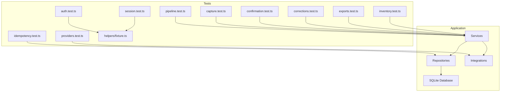

**Diagram sources**
- [tests/auth.test.ts:1-280](file://tests/auth.test.ts#L1-L280)
- [tests/session.test.ts:1-86](file://tests/session.test.ts#L1-L86)
- [tests/providers.test.ts:1-291](file://tests/providers.test.ts#L1-L291)
- [tests/pipeline.test.ts:1-496](file://tests/pipeline.test.ts#L1-L496)
- [tests/capture.test.ts:1-359](file://tests/capture.test.ts#L1-L359)
- [tests/confirmation.test.ts:1-341](file://tests/confirmation.test.ts#L1-L341)
- [tests/corrections.test.ts:1-464](file://tests/corrections.test.ts#L1-L464)
- [tests/exports.test.ts:1-300](file://tests/exports.test.ts#L1-L300)
- [tests/idempotency.test.ts:1-140](file://tests/idempotency.test.ts#L1-L140)
- [tests/inventory.test.ts:1-233](file://tests/inventory.test.ts#L1-L233)
- [tests/helpers/fixture.ts:1-105](file://tests/helpers/fixture.ts#L1-L105)

**Section sources**
- [package.json:9-21](file://package.json#L9-L21)
- [.github/workflows/ci.yml:18-53](file://.github/workflows/ci.yml#L18-L53)

## Core Components
- Test runner and scripts: Node’s built-in test runner is used via npm scripts. The test command loads TypeScript aliases and discovers files under `tests/**/*.test.ts`.
- Fixture helper: Creates an isolated temporary SQLite database per process, applies migrations, creates a user/business/membership, sets up a scoped business context, and provisions a second “other” tenant for cross-tenant isolation assertions. It also redirects media storage to a process-scoped directory.
- Provider mocks: External providers (Twilio WhatsApp, OpenAI speech/extraction, S3/local storage) are replaced with injected fetch implementations or adapter factories that return deterministic responses.
- Service-level tests: Most tests target services such as ingestion, pipeline, capture, confirmation, corrections, exports, and inventory. They assert database state, error codes, idempotency, tenant isolation, and auditability.

Key responsibilities:
- Authentication and session security: password hashing, policy checks, rate limiting, dev login guard, and session token lifecycle.
- Voice processing pipeline: signed delivery ingestion, source event creation, transcription, proposal normalization, review queue ordering, and retry semantics.
- Provider integrations: signature verification, media download, checksums, error classification, and signed link interoperability.
- Business logic: proposal confirmation, denial handling, corrections, reversals, export generation, job queuing, and feature-gated inventory.

**Section sources**
- [package.json:9-21](file://package.json#L9-L21)
- [tests/helpers/fixture.ts:1-105](file://tests/helpers/fixture.ts#L1-L105)
- [tests/providers.test.ts:1-291](file://tests/providers.test.ts#L1-L291)
- [tests/pipeline.test.ts:1-496](file://tests/pipeline.test.ts#L1-L496)
- [tests/capture.test.ts:1-359](file://tests/capture.test.ts#L1-L359)
- [tests/confirmation.test.ts:1-341](file://tests/confirmation.test.ts#L1-L341)
- [tests/corrections.test.ts:1-464](file://tests/corrections.test.ts#L1-L464)
- [tests/exports.test.ts:1-300](file://tests/exports.test.ts#L1-L300)
- [tests/idempotency.test.ts:1-140](file://tests/idempotency.test.ts#L1-L140)
- [tests/inventory.test.ts:1-233](file://tests/inventory.test.ts#L1-L233)

## Architecture Overview
The testing architecture emphasizes isolation, determinism, and contract validation:

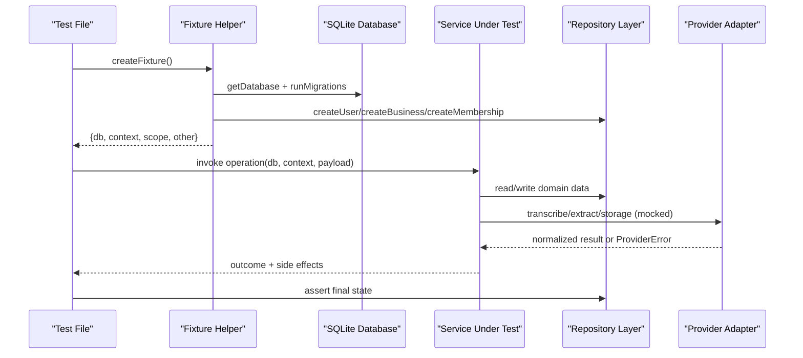

**Diagram sources**
- [tests/helpers/fixture.ts:48-104](file://tests/helpers/fixture.ts#L48-L104)
- [tests/pipeline.test.ts:94-199](file://tests/pipeline.test.ts#L94-L199)
- [tests/providers.test.ts:44-134](file://tests/providers.test.ts#L44-L134)

## Detailed Component Analysis

### Authentication and Session Testing
Authentication tests cover password hashing, policy enforcement, rate limiting, environment-based dev login gating, and safe redirect logic. Session tests verify opaque token issuance, hash-only persistence, revocation, expiration, and uniqueness.

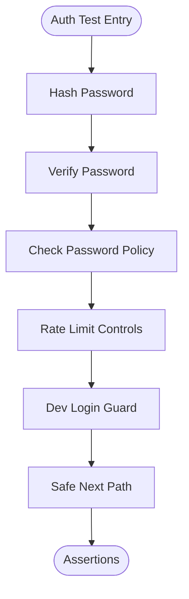

**Diagram sources**
- [tests/auth.test.ts:35-97](file://tests/auth.test.ts#L35-L97)
- [tests/auth.test.ts:99-137](file://tests/auth.test.ts#L99-L137)
- [tests/auth.test.ts:139-168](file://tests/auth.test.ts#L139-L168)
- [tests/auth.test.ts:256-280](file://tests/auth.test.ts#L256-L280)
- [tests/session.test.ts:17-85](file://tests/session.test.ts#L17-L85)

**Section sources**
- [tests/auth.test.ts:1-280](file://tests/auth.test.ts#L1-L280)
- [tests/session.test.ts:1-86](file://tests/session.test.ts#L1-L86)

### Voice Capture and Draft Reclassification
Voice capture tests ensure recordings are stored once, attributed correctly, validated, queued for transcription, and isolated across tenants. Draft reclassification tests validate retyping rules, version conflicts, and protection against model-driven drafts being silently rewritten.

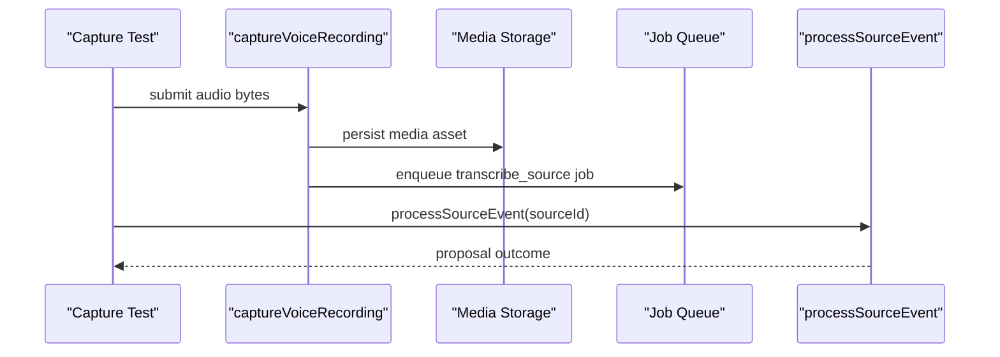

**Diagram sources**
- [tests/capture.test.ts:82-206](file://tests/capture.test.ts#L82-L206)
- [tests/capture.test.ts:208-307](file://tests/capture.test.ts#L208-L307)
- [tests/capture.test.ts:309-359](file://tests/capture.test.ts#L309-L359)

**Section sources**
- [tests/capture.test.ts:1-359](file://tests/capture.test.ts#L1-L359)

### Ingestion and Processing Pipeline
The pipeline tests pin critical behaviors: signed delivery acceptance, deduplication, tenant scoping, transcription failure handling, retry semantics, and review queue ordering.

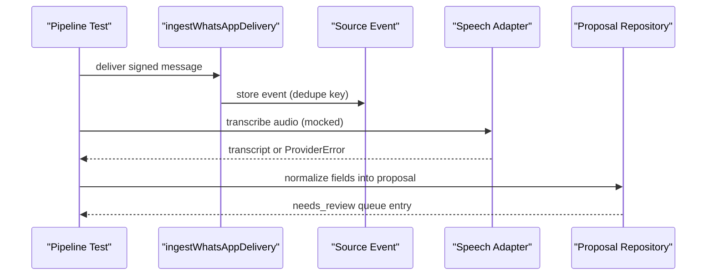

**Diagram sources**
- [tests/pipeline.test.ts:94-199](file://tests/pipeline.test.ts#L94-L199)
- [tests/pipeline.test.ts:201-379](file://tests/pipeline.test.ts#L201-L379)
- [tests/pipeline.test.ts:381-496](file://tests/pipeline.test.ts#L381-L496)

**Section sources**
- [tests/pipeline.test.ts:1-496](file://tests/pipeline.test.ts#L1-L496)

### Provider Integrations
Provider tests validate Twilio signature verification, media parsing, authenticated downloads, OpenAI speech transcription normalization, extraction proposal parsing, confidence clamping, malformed input handling, and signed link interoperability between storage adapters.

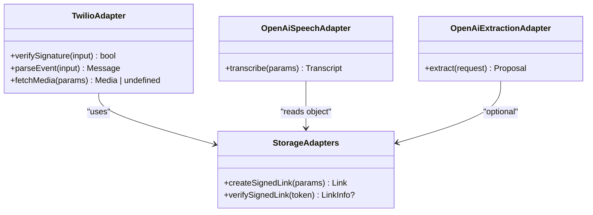

**Diagram sources**
- [tests/providers.test.ts:44-134](file://tests/providers.test.ts#L44-L134)
- [tests/providers.test.ts:136-183](file://tests/providers.test.ts#L136-L183)
- [tests/providers.test.ts:185-259](file://tests/providers.test.ts#L185-L259)
- [tests/providers.test.ts:261-291](file://tests/providers.test.ts#L261-L291)

**Section sources**
- [tests/providers.test.ts:1-291](file://tests/providers.test.ts#L1-L291)

### Confirmation and Corrections
Confirmation tests assert ledger posting, deni account creation/reuse, partial payment handling, reviewer overrides, idempotent confirmations, and cross-tenant isolation. Correction tests enforce version history, debt adjustments, reversal semantics, report impact, and permission boundaries.

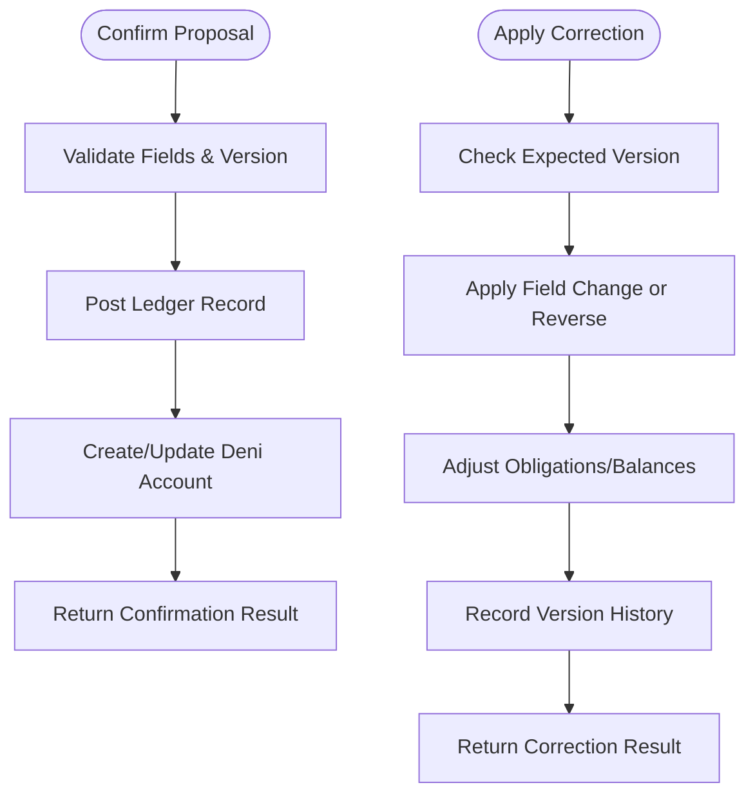

**Diagram sources**
- [tests/confirmation.test.ts:84-259](file://tests/confirmation.test.ts#L84-L259)
- [tests/confirmation.test.ts:261-341](file://tests/confirmation.test.ts#L261-L341)
- [tests/corrections.test.ts:128-336](file://tests/corrections.test.ts#L128-L336)
- [tests/corrections.test.ts:338-464](file://tests/corrections.test.ts#L338-L464)

**Section sources**
- [tests/confirmation.test.ts:1-341](file://tests/confirmation.test.ts#L1-L341)
- [tests/corrections.test.ts:1-464](file://tests/corrections.test.ts#L1-L464)

### Exports and Job Queuing
Export tests validate date range semantics, timezone-aware filtering, tenant isolation, column presence, job queuing, idempotent job execution, and atomic job claiming.

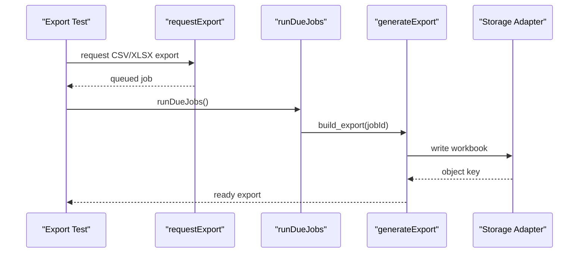

**Diagram sources**
- [tests/exports.test.ts:87-237](file://tests/exports.test.ts#L87-L237)
- [tests/exports.test.ts:239-287](file://tests/exports.test.ts#L239-L287)

**Section sources**
- [tests/exports.test.ts:1-300](file://tests/exports.test.ts#L1-L300)

### Idempotency
Idempotency tests verify key parsing, single execution with replay, body mismatch rejection, transaction rollback on failure, concurrent claim detection, and conflict handling.

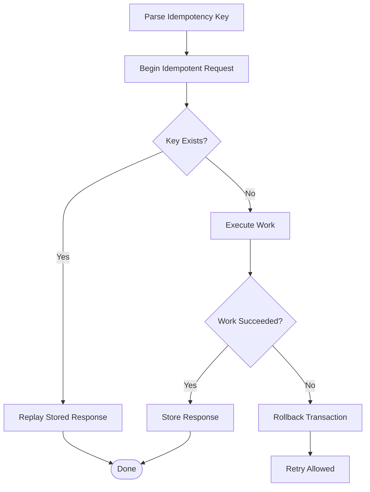

**Diagram sources**
- [tests/idempotency.test.ts:21-29](file://tests/idempotency.test.ts#L21-L29)
- [tests/idempotency.test.ts:31-139](file://tests/idempotency.test.ts#L31-L139)

**Section sources**
- [tests/idempotency.test.ts:1-140](file://tests/idempotency.test.ts#L1-L140)

### Inventory Feature-Gating
Inventory tests ensure the feature is hidden until enabled, item names are unique per business, ownership and manager permissions are enforced, low-stock flags derive from thresholds, and cross-tenant isolation holds.

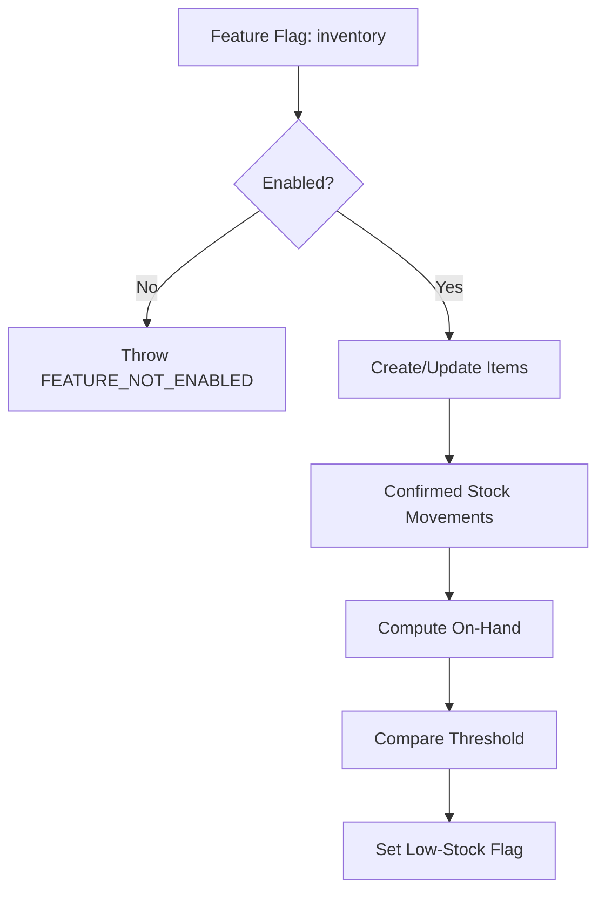

**Diagram sources**
- [tests/inventory.test.ts:93-233](file://tests/inventory.test.ts#L93-L233)

**Section sources**
- [tests/inventory.test.ts:1-233](file://tests/inventory.test.ts#L1-L233)

## Dependency Analysis
The test suite depends on:
- Node’s built-in test runner and strict assertions.
- Application modules for services, repositories, integrations, and database clients.
- The fixture helper for isolated SQLite databases and business contexts.
- Mock adapters and injected fetch implementations to replace external dependencies.

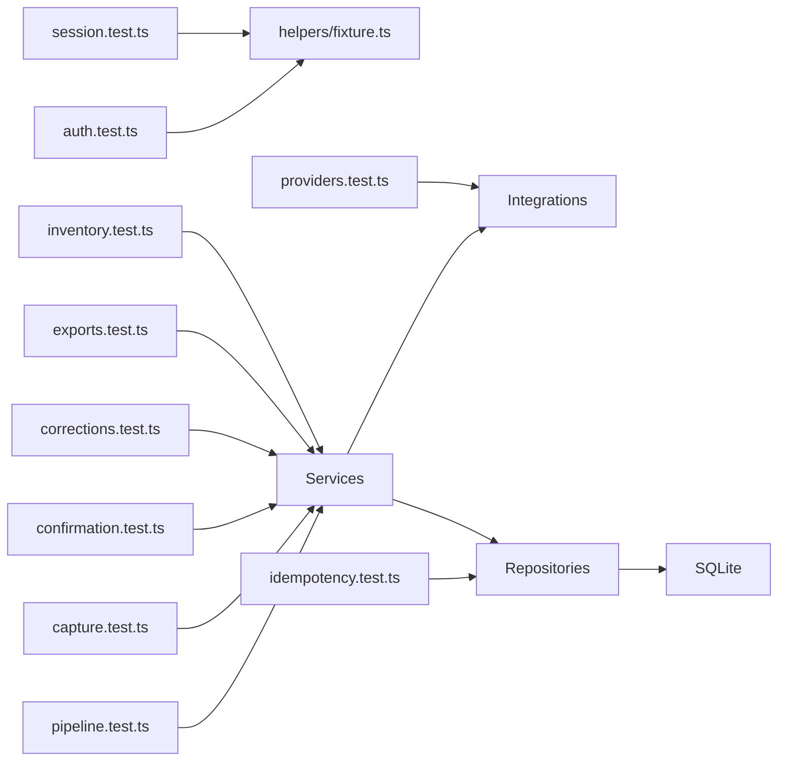

**Diagram sources**
- [tests/auth.test.ts:1-280](file://tests/auth.test.ts#L1-L280)
- [tests/session.test.ts:1-86](file://tests/session.test.ts#L1-L86)
- [tests/providers.test.ts:1-291](file://tests/providers.test.ts#L1-L291)
- [tests/pipeline.test.ts:1-496](file://tests/pipeline.test.ts#L1-L496)
- [tests/capture.test.ts:1-359](file://tests/capture.test.ts#L1-L359)
- [tests/confirmation.test.ts:1-341](file://tests/confirmation.test.ts#L1-L341)
- [tests/corrections.test.ts:1-464](file://tests/corrections.test.ts#L1-L464)
- [tests/exports.test.ts:1-300](file://tests/exports.test.ts#L1-L300)
- [tests/idempotency.test.ts:1-140](file://tests/idempotency.test.ts#L1-L140)
- [tests/inventory.test.ts:1-233](file://tests/inventory.test.ts#L1-L233)
- [tests/helpers/fixture.ts:1-105](file://tests/helpers/fixture.ts#L1-L105)

**Section sources**
- [tests/helpers/fixture.ts:1-105](file://tests/helpers/fixture.ts#L1-L105)

## Performance Considerations
- Isolated SQLite databases per process reduce contention and flakiness; cleanup occurs after all tests finish.
- Mocking external providers avoids slow network calls and nondeterministic responses.
- Using synthetic audio and deterministic payloads keeps pipeline tests fast while validating real storage reads and normalization paths.
- Job queue tests assert atomicity and idempotency without requiring long-running workers.

[No sources needed since this section provides general guidance]

## Troubleshooting Guide
Common issues and how to diagnose them:
- Flaky tests due to shared state: ensure each test uses `createFixture` and does not mutate global environment variables without restoring them.
- Cross-tenant data leaks: verify queries use the provided `scope` and that fixtures include an “other” tenant for negative assertions.
- Provider failures: check whether errors are classified as retryable or non-retryable using `ProviderError`; tests assert both outcomes.
- Export mismatches: read generated files through the same storage adapter used in production to catch read/write path differences.
- CI failures: inspect logs from the CI step that confirms tests ran and fails if any test failed; ensure environment variables like `NODE_ENV` and `DAFTARI_ALLOW_DEV_LOGIN` are set as expected.

**Section sources**
- [.github/workflows/ci.yml:36-53](file://.github/workflows/ci.yml#L36-L53)
- [tests/providers.test.ts:121-134](file://tests/providers.test.ts#L121-L134)
- [tests/exports.test.ts:291-300](file://tests/exports.test.ts#L291-L300)

## Conclusion
Daftari’s testing strategy centers on deterministic, isolated, and contract-focused tests. The fixture helper guarantees tenant isolation and migration-backed SQLite environments. Provider integrations are mocked to validate exact contracts and error classifications. Service tests cover critical financial flows—capture, ingestion, transcription, proposal normalization, confirmation, corrections, reversals, exports, and idempotency—with strong assertions around idempotency, versioning, and multi-tenancy. CI enforces type safety, linting, full test execution, and a production build to prevent dangerous misconfigurations. Following these patterns ensures reliable, maintainable tests that protect core accounting integrity.