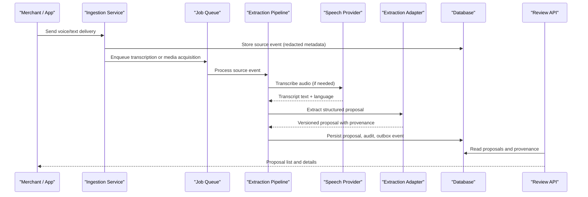
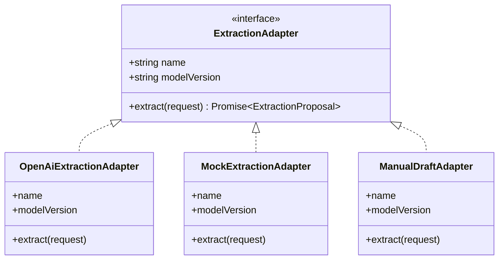
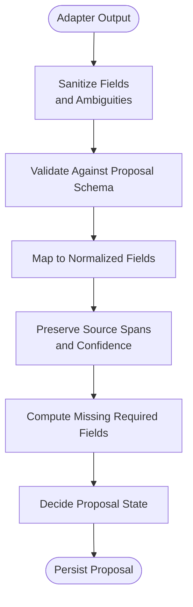
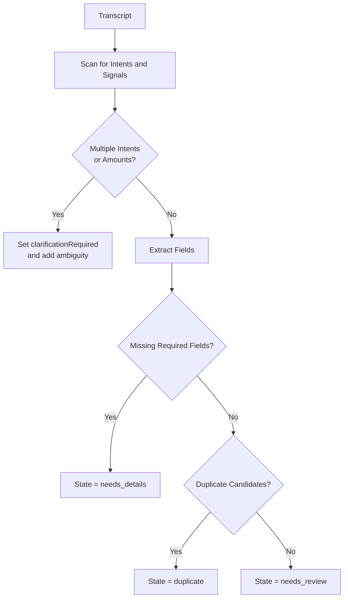
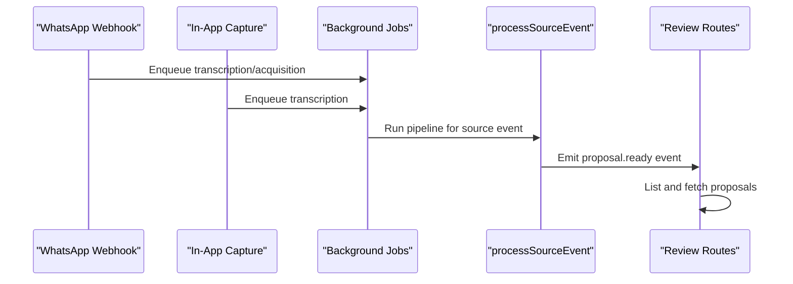
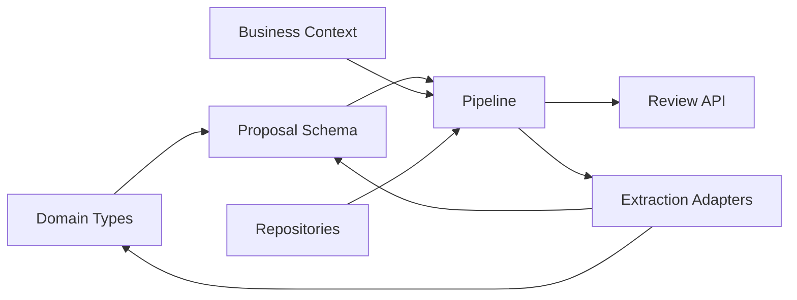

# AI Business Intent Extraction

<cite>
**Referenced Files in This Document**
- [port.ts](file://src/server/integrations/extraction/port.ts)
- [openai-extraction-adapter.ts](file://src/server/integrations/extraction/openai-extraction-adapter.ts)
- [manual-draft-adapter.ts](file://src/server/integrations/extraction/manual-draft-adapter.ts)
- [mock-extraction-adapter.ts](file://src/server/integrations/extraction/mock-extraction-adapter.ts)
- [proposal.ts](file://src/lib/validation/proposal.ts)
- [types.ts](file://src/server/domain/types.ts)
- [pipeline.ts](file://src/server/services/pipeline.ts)
- [ingestion.ts](file://src/server/services/ingestion.ts)
- [capture.ts](file://src/server/services/capture.ts)
- [env.ts](file://src/server/config/env.ts)
- [context.ts](file://src/server/business-context/context.ts)
- [resolve.ts](file://src/server/business-context/resolve.ts)
- [route.ts](file://src/app/api/v1/review/proposals/route.ts)
- [route.ts](file://src/app/api/v1/review/proposals/[proposalId]/route.ts)
</cite>

## Table of Contents
1. [Introduction](#introduction)
2. [Project Structure](#project-structure)
3. [Core Components](#core-components)
4. [Architecture Overview](#architecture-overview)
5. [Detailed Component Analysis](#detailed-component-analysis)
6. [Dependency Analysis](#dependency-analysis)
7. [Performance Considerations](#performance-considerations)
8. [Troubleshooting Guide](#troubleshooting-guide)
9. [Conclusion](#conclusion)

## Introduction
This document explains the AI-powered business intent extraction system that turns transcribed merchant messages into structured, reviewable accounting proposals. The system supports multiple AI providers through an adapter pattern, falls back to manual draft processing when extraction is disabled, and enforces strict validation so unclear or incomplete data never becomes a ledger entry without human review.

Key goals:
- Identify accounting intents such as sales, expenses, debts, stock movements, and notes.
- Extract structured fields with field-level provenance for transparency.
- Detect ambiguity and missing information so reviewers can ask focused questions.
- Support configurable models, business context injection, and validation rules.
- Provide deterministic behavior for development and safe fallbacks for production.

## Project Structure
The extraction subsystem lives under `src/server/integrations/extraction` and integrates with the ingestion pipeline, domain types, proposal schema, and review APIs.

```mermaid
graph TB
subgraph "Ingestion"
Ingest["WhatsApp Ingestion"]
Capture["In-App Voice Capture"]
end
subgraph "Pipeline"
Pipeline["Source -> Transcript -> Proposal Pipeline"]
end
subgraph "Extraction Adapters"
Port["Extraction Adapter Port"]
OpenAI["OpenAI Extraction Adapter"]
Mock["Mock Rule-Based Adapter"]
Manual["Manual Draft Adapter"]
end
subgraph "Validation & Domain"
Schema["Proposal Schema"]
Types["Domain Types"]
end
subgraph "Review API"
ListProposals["List Proposals"]
GetProposal["Get Proposal Details"]
end
Ingest --> Pipeline
Capture --> Pipeline
Pipeline --> Port
Port --> OpenAI
Port --> Mock
Port --> Manual
OpenAI --> Schema
Mock --> Schema
Manual --> Schema
Schema --> Types
Pipeline --> ListProposals
Pipeline --> GetProposal
```

**Diagram sources**
- [ingestion.ts:1-217](file://src/server/services/ingestion.ts#L1-L217)
- [capture.ts:1-147](file://src/server/services/capture.ts#L1-L147)
- [pipeline.ts:1-506](file://src/server/services/pipeline.ts#L1-L506)
- [port.ts:1-38](file://src/server/integrations/extraction/port.ts#L1-L38)
- [openai-extraction-adapter.ts:1-224](file://src/server/integrations/extraction/openai-extraction-adapter.ts#L1-L224)
- [mock-extraction-adapter.ts:1-528](file://src/server/integrations/extraction/mock-extraction-adapter.ts#L1-L528)
- [manual-draft-adapter.ts:1-52](file://src/server/integrations/extraction/manual-draft-adapter.ts#L1-L52)
- [proposal.ts:1-312](file://src/lib/validation/proposal.ts#L1-L312)
- [types.ts:1-217](file://src/server/domain/types.ts#L1-L217)
- [route.ts:52-109](file://src/app/api/v1/review/proposals/route.ts#L52-L109)
- [route.ts:26-81](file://src/app/api/v1/review/proposals/[proposalId]/route.ts#L26-L81)

**Section sources**
- [ingestion.ts:1-217](file://src/server/services/ingestion.ts#L1-L217)
- [capture.ts:1-147](file://src/server/services/capture.ts#L1-L147)
- [pipeline.ts:1-506](file://src/server/services/pipeline.ts#L1-L506)
- [port.ts:1-38](file://src/server/integrations/extraction/port.ts#L1-L38)
- [openai-extraction-adapter.ts:1-224](file://src/server/integrations/extraction/openai-extraction-adapter.ts#L1-L224)
- [mock-extraction-adapter.ts:1-528](file://src/server/integrations/extraction/mock-extraction-adapter.ts#L1-L528)
- [manual-draft-adapter.ts:1-52](file://src/server/integrations/extraction/manual-draft-adapter.ts#L1-L52)
- [proposal.ts:1-312](file://src/lib/validation/proposal.ts#L1-L312)
- [types.ts:1-217](file://src/server/domain/types.ts#L1-L217)
- [route.ts:52-109](file://src/app/api/v1/review/proposals/route.ts#L52-L109)
- [route.ts:26-81](file://src/app/api/v1/review/proposals/[proposalId]/route.ts#L26-L81)

## Core Components
- Extraction adapter port: Defines the stable interface for all extraction providers, including request shape, candidate lists, and the versioned proposal contract.
- OpenAI extraction adapter: Calls a configured model with a strict prompt, sanitizes output, validates against the shared schema, and maps provider errors.
- Mock rule-based adapter: Deterministic Swahili/English rules for local testing; refuses to guess and produces clarifications when needed.
- Manual draft adapter: Used when extraction is disabled; keeps the transcript as a note and routes proposals to “needs details.”
- Proposal schema: Versioned Zod schemas for extraction proposals, normalized reviewer fields, record-type payloads, required-field checks, and validation issues.
- Pipeline: Orchestrates transcription, calls the selected extraction adapter, builds normalized fields and provenance, detects duplicates, decides proposal state, and persists the proposal.
- Configuration: Selects extraction provider (`off`, `mock`, `openai`) and OpenAI model settings.
- Review APIs: Expose proposals and detailed proposal data, including provenance, missing fields, and options for customer/item selection.

**Section sources**
- [port.ts:1-38](file://src/server/integrations/extraction/port.ts#L1-L38)
- [openai-extraction-adapter.ts:1-224](file://src/server/integrations/extraction/openai-extraction-adapter.ts#L1-L224)
- [mock-extraction-adapter.ts:1-528](file://src/server/integrations/extraction/mock-extraction-adapter.ts#L1-L528)
- [manual-draft-adapter.ts:1-52](file://src/server/integrations/extraction/manual-draft-adapter.ts#L1-L52)
- [proposal.ts:1-312](file://src/lib/validation/proposal.ts#L1-L312)
- [pipeline.ts:1-506](file://src/server/services/pipeline.ts#L1-L506)
- [env.ts:134-169](file://src/server/config/env.ts#L134-L169)
- [route.ts:52-109](file://src/app/api/v1/review/proposals/route.ts#L52-L109)
- [route.ts:26-81](file://src/app/api/v1/review/proposals/[proposalId]/route.ts#L26-L81)

## Architecture Overview
The system separates ingestion, transcription, extraction, validation, and review. Transcription and extraction are asynchronous so webhook responses stay fast and provider failures do not lose messages.



**Diagram sources**
- [ingestion.ts:1-217](file://src/server/services/ingestion.ts#L1-L217)
- [pipeline.ts:287-506](file://src/server/services/pipeline.ts#L287-L506)
- [openai-extraction-adapter.ts:131-224](file://src/server/integrations/extraction/openai-extraction-adapter.ts#L131-L224)
- [route.ts:52-109](file://src/app/api/v1/review/proposals/route.ts#L52-L109)
- [route.ts:26-81](file://src/app/api/v1/review/proposals/[proposalId]/route.ts#L26-L81)

## Detailed Component Analysis

### Adapter Pattern for AI Providers
The extraction subsystem uses a single adapter interface so the pipeline does not branch on provider configuration.



**Diagram sources**
- [port.ts:34-38](file://src/server/integrations/extraction/port.ts#L34-L38)
- [openai-extraction-adapter.ts:131-224](file://src/server/integrations/extraction/openai-extraction-adapter.ts#L131-L224)
- [mock-extraction-adapter.ts:361-516](file://src/server/integrations/extraction/mock-extraction-adapter.ts#L361-L516)
- [manual-draft-adapter.ts:23-50](file://src/server/integrations/extraction/manual-draft-adapter.ts#L23-L50)

**Section sources**
- [port.ts:1-38](file://src/server/integrations/extraction/port.ts#L1-L38)
- [openai-extraction-adapter.ts:1-224](file://src/server/integrations/extraction/openai-extraction-adapter.ts#L1-L224)
- [mock-extraction-adapter.ts:1-528](file://src/server/integrations/extraction/mock-extraction-adapter.ts#L1-L528)
- [manual-draft-adapter.ts:1-52](file://src/server/integrations/extraction/manual-draft-adapter.ts#L1-L52)

### Prompt Engineering for Structured Business Data
The OpenAI adapter constructs a strict system prompt that:
- Limits output to one JSON object per message.
- Enumerates supported record types and their expected fields.
- Requires money in minor units, ISO timestamps with UTC offsets, calendar dates for due dates, and exact source spans.
- Restricts payment status and method to known enums.
- Forces customer/item IDs only when there is a clear match from provided candidates.
- Requests clarification when multiple records are detected.
- Falls back to a note when no accounting intent fits.

The prompt also injects business context such as currency, timezone, current time, inventory availability, detected language, and candidate lists for customers and items.

**Section sources**
- [openai-extraction-adapter.ts:96-129](file://src/server/integrations/extraction/openai-extraction-adapter.ts#L96-L129)
- [openai-extraction-adapter.ts:141-151](file://src/server/integrations/extraction/openai-extraction-adapter.ts#L141-L151)
- [types.ts:8-15](file://src/server/domain/types.ts#L8-L15)
- [types.ts:67-85](file://src/server/domain/types.ts#L67-L85)

### Field Provenance Tracking
Every extracted value carries:
- A typed value.
- A short source span showing the original words used.
- A confidence score between 0 and 1.
- Optional currency when relevant.

The pipeline maps adapter fields to normalized reviewer fields while preserving provenance. Unknown fields remain in provenance instead of being silently dropped.



**Diagram sources**
- [openai-extraction-adapter.ts:43-94](file://src/server/integrations/extraction/openai-extraction-adapter.ts#L43-L94)
- [openai-extraction-adapter.ts:202-220](file://src/server/integrations/extraction/openai-extraction-adapter.ts#L202-L220)
- [pipeline.ts:65-172](file://src/server/services/pipeline.ts#L65-L172)
- [proposal.ts:24-53](file://src/lib/validation/proposal.ts#L24-L53)

**Section sources**
- [proposal.ts:24-53](file://src/lib/validation/proposal.ts#L24-L53)
- [pipeline.ts:65-172](file://src/server/services/pipeline.ts#L65-L172)

### Customer Identification, Amount Parsing, Date Inference, and Category Classification
- **Customer identification:** Both adapters prefer explicit customer names and map them to stored customer IDs only when there is a clear match. Cash sales paid in full may intentionally omit a named customer because no debt remains.
- **Amount parsing:** The mock adapter extracts numeric amounts, handles thousand/million/hundred scaling, converts to minor units, and marks derived values with lower confidence. The OpenAI adapter requires integer minor-unit amounts.
- **Date inference:** The mock adapter recognizes today, yesterday, numeric dates, and named months relative to the business’s current time. The OpenAI adapter requires offset-bearing ISO timestamps resolved from the given business context.
- **Category classification:** The mock adapter applies category patterns for expenses and sales. The OpenAI adapter expects the model to return a category string when clearly stated.

**Section sources**
- [mock-extraction-adapter.ts:210-359](file://src/server/integrations/extraction/mock-extraction-adapter.ts#L210-L359)
- [mock-extraction-adapter.ts:414-493](file://src/server/integrations/extraction/mock-extraction-adapter.ts#L414-L493)
- [openai-extraction-adapter.ts:96-129](file://src/server/integrations/extraction/openai-extraction-adapter.ts#L96-L129)

### Ambiguity Detection and Human Clarification
Ambiguity handling is central:
- Multiple intents or multiple amounts produce a clarification proposal rather than guessing.
- Missing required fields route proposals to “needs details.”
- The OpenAI adapter sets `clarificationRequired` when more than one record is described.
- The pipeline computes final missing fields by combining adapter-reported missing fields with schema-required fields.
- The review API exposes ambiguity notes and missing fields so reviewers can act on focused questions.



**Diagram sources**
- [mock-extraction-adapter.ts:378-404](file://src/server/integrations/extraction/mock-extraction-adapter.ts#L378-L404)
- [pipeline.ts:277-285](file://src/server/services/pipeline.ts#L277-L285)
- [pipeline.ts:445-454](file://src/server/services/pipeline.ts#L445-L454)
- [route.ts:78-109](file://src/app/api/v1/review/proposals/route.ts#L78-L109)

**Section sources**
- [mock-extraction-adapter.ts:378-404](file://src/server/integrations/extraction/mock-extraction-adapter.ts#L378-L404)
- [pipeline.ts:277-285](file://src/server/services/pipeline.ts#L277-L285)
- [pipeline.ts:445-454](file://src/server/services/pipeline.ts#L445-L454)
- [route.ts:78-109](file://src/app/api/v1/review/proposals/route.ts#L78-L109)

### Validation Rules and Record-Type Contracts
The proposal schema defines:
- A versioned extraction proposal structure.
- Field provenance constraints.
- Record-type payloads for sale, expense, debt creation, debt payment, stock movement, and note.
- Required fields per record type.
- Custom validations such as partial payment requiring an already-received amount less than the total.

The pipeline uses these schemas to generate validation issues for the reviewer UI.

**Section sources**
- [proposal.ts:18-53](file://src/lib/validation/proposal.ts#L18-L53)
- [proposal.ts:161-264](file://src/lib/validation/proposal.ts#L161-L264)
- [proposal.ts:274-312](file://src/lib/validation/proposal.ts#L274-L312)
- [pipeline.ts:243-255](file://src/server/services/pipeline.ts#L243-L255)

### Configuration for Extraction Models and Context Injection
Configuration controls:
- Which extraction provider is active: `off`, `mock`, or `openai`.
- OpenAI base URL, API key, transcription model, and extraction model.
- Business context injected into extraction requests includes currency, timezone, current ISO time, inventory feature flag, customer and item candidates, and detected language.

**Section sources**
- [env.ts:134-169](file://src/server/config/env.ts#L134-L169)
- [pipeline.ts:396-414](file://src/server/services/pipeline.ts#L396-L414)
- [context.ts:20-41](file://src/server/business-context/context.ts#L20-L41)

### Manual Draft Processing
When extraction is disabled, the manual draft adapter:
- Keeps the transcript as a note.
- Reports the record type as missing.
- Adds an ambiguity asking the reviewer to classify the recording and fill details.
- Ensures the provider seam stays intact so the pipeline does not branch on environment flags.

**Section sources**
- [manual-draft-adapter.ts:1-52](file://src/server/integrations/extraction/manual-draft-adapter.ts#L1-L52)
- [env.ts:150-152](file://src/server/config/env.ts#L150-L152)

### Integration with Ingestion and Review Workflows
Ingestion accepts WhatsApp deliveries and in-app voice captures, stores redacted metadata, persists media references, and enqueues background jobs. The pipeline then performs transcription, extraction, validation, duplicate detection, and proposal persistence. The review API surfaces proposals, missing fields, provenance, and options for selecting customers and items.



**Diagram sources**
- [ingestion.ts:66-207](file://src/server/services/ingestion.ts#L66-L207)
- [capture.ts:67-145](file://src/server/services/capture.ts#L67-L145)
- [pipeline.ts:354-503](file://src/server/services/pipeline.ts#L354-L503)
- [route.ts:52-109](file://src/app/api/v1/review/proposals/route.ts#L52-L109)
- [route.ts:26-81](file://src/app/api/v1/review/proposals/[proposalId]/route.ts#L26-L81)

**Section sources**
- [ingestion.ts:1-217](file://src/server/services/ingestion.ts#L1-L217)
- [capture.ts:1-147](file://src/server/services/capture.ts#L1-L147)
- [pipeline.ts:354-503](file://src/server/services/pipeline.ts#L354-L503)
- [route.ts:52-109](file://src/app/api/v1/review/proposals/route.ts#L52-L109)
- [route.ts:26-81](file://src/app/api/v1/review/proposals/[proposalId]/route.ts#L26-L81)

## Dependency Analysis
The extraction layer depends on:
- Domain types for record types, payment statuses, payment methods, movement types, and job vocabulary.
- Proposal schema for validation and normalization.
- Business context for tenant-scoped configuration such as currency, timezone, and feature flags.
- Repository services for customers, items, source events, transcripts, and proposals.
- Provider error abstraction for consistent failure classification.



**Diagram sources**
- [types.ts:1-217](file://src/server/domain/types.ts#L1-L217)
- [proposal.ts:1-312](file://src/lib/validation/proposal.ts#L1-L312)
- [context.ts:1-131](file://src/server/business-context/context.ts#L1-L131)
- [pipeline.ts:1-506](file://src/server/services/pipeline.ts#L1-L506)
- [route.ts:52-109](file://src/app/api/v1/review/proposals/route.ts#L52-L109)
- [openai-extraction-adapter.ts:1-224](file://src/server/integrations/extraction/openai-extraction-adapter.ts#L1-L224)

**Section sources**
- [types.ts:1-217](file://src/server/domain/types.ts#L1-L217)
- [proposal.ts:1-312](file://src/lib/validation/proposal.ts#L1-L312)
- [context.ts:1-131](file://src/server/business-context/context.ts#L1-L131)
- [pipeline.ts:1-506](file://src/server/services/pipeline.ts#L1-L506)
- [route.ts:52-109](file://src/app/api/v1/review/proposals/route.ts#L52-L109)
- [openai-extraction-adapter.ts:1-224](file://src/server/integrations/extraction/openai-extraction-adapter.ts#L1-L224)

## Performance Considerations
- Asynchronous processing: Ingestion returns quickly after persisting redacted metadata and enqueueing work. Transcription and extraction run in background jobs, preventing slow providers from blocking webhooks.
- Idempotency: Source events and capture uploads are deduplicated so retries do not create duplicate transcripts or proposals.
- Bounded outputs: The OpenAI adapter limits list sizes, truncates strings, clamps confidence scores, and rejects malformed JSON before schema validation.
- Safe defaults: When dates cannot be inferred safely, the pipeline avoids inventing timestamps and leaves them missing for the reviewer.
- Batch processing guidance: For large batches, rely on the existing job queue and idempotent pipeline. Avoid synchronous extraction calls from HTTP handlers. Monitor provider error codes and retryable failures.
- Cost management: Use the lowest-cost suitable extraction model via configuration, keep temperature at zero for deterministic output, and avoid unnecessary retries by handling transient provider errors correctly.

[No sources needed since this section provides general guidance]

## Troubleshooting Guide
Common issues and how the system responds:
- Provider authentication failures: The OpenAI adapter throws a non-retryable provider error when credentials are rejected.
- Provider timeouts or server errors: Transient HTTP statuses are classified as retryable so the job runner can back off.
- Malformed model output: If the model returns invalid JSON or fails schema validation, the adapter reports a provider error with a sanitized detail.
- Missing transcription: Text-only WhatsApp messages store the message body directly as a transcript; voice messages require media acquisition and transcription.
- No matching customer or item: The adapters set text fields and leave IDs missing, prompting the reviewer to choose or clarify.
- Ambiguous messages: Multiple intents or amounts trigger clarification and move the proposal to “needs details.”

Operational tips:
- Check proposal state: `needs_review`, `needs_details`, `duplicate`, or `failed`.
- Inspect missing fields and ambiguity notes in the proposal list and detail endpoints.
- Verify extraction provider configuration and OpenAI model settings.
- Use the mock adapter during development to validate the full flow without external AI costs.

**Section sources**
- [openai-extraction-adapter.ts:171-219](file://src/server/integrations/extraction/openai-extraction-adapter.ts#L171-L219)
- [pipeline.ts:376-436](file://src/server/services/pipeline.ts#L376-L436)
- [pipeline.ts:445-474](file://src/server/services/pipeline.ts#L445-L474)
- [route.ts:78-109](file://src/app/api/v1/review/proposals/route.ts#L78-L109)
- [route.ts:42-81](file://src/app/api/v1/review/proposals/[proposalId]/route.ts#L42-L81)

## Conclusion
The AI business intent extraction system combines a strict adapter pattern, deterministic rule-based fallback, and a versioned proposal schema to turn natural-language merchant messages into transparent, reviewable accounting data. By enforcing provenance, ambiguity detection, and validation, it ensures that only verified, complete transactions reach the ledger. Configuration allows flexible model selection and cost control, while asynchronous processing and idempotency support reliable batch workflows.

[No sources needed since this section summarizes without analyzing specific files]