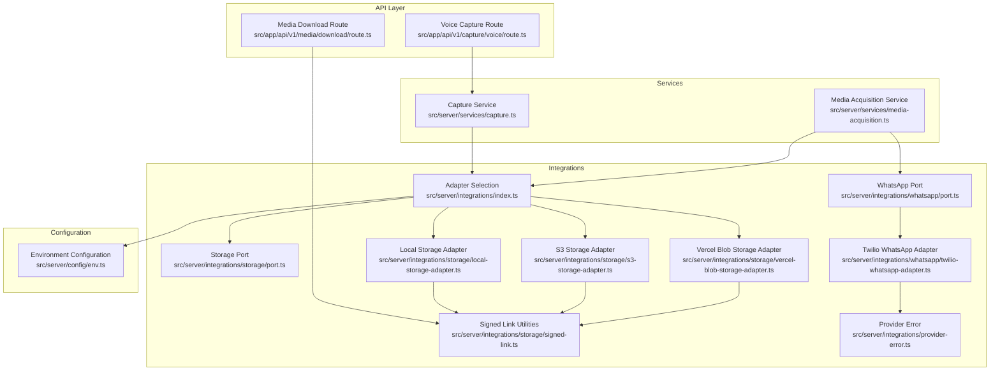
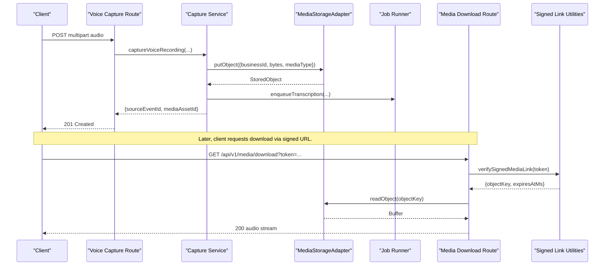
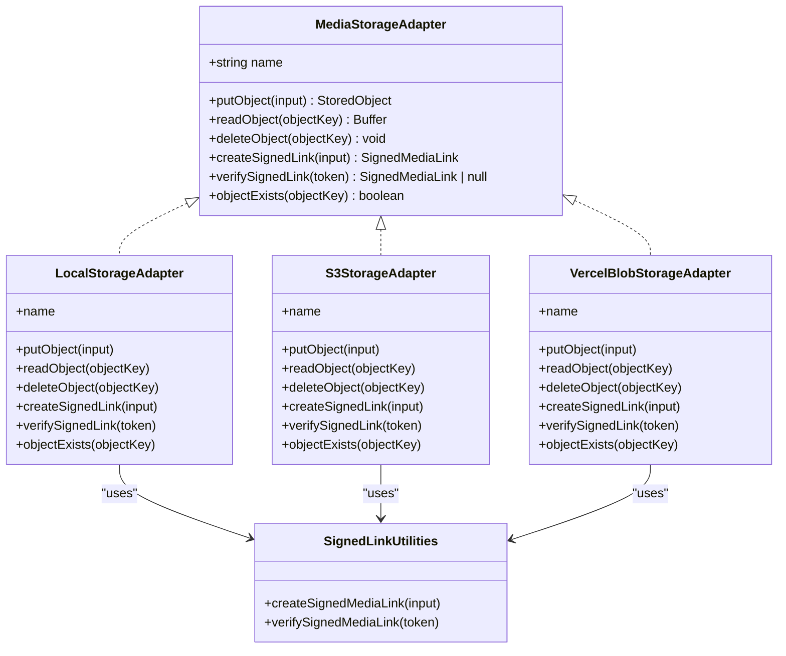
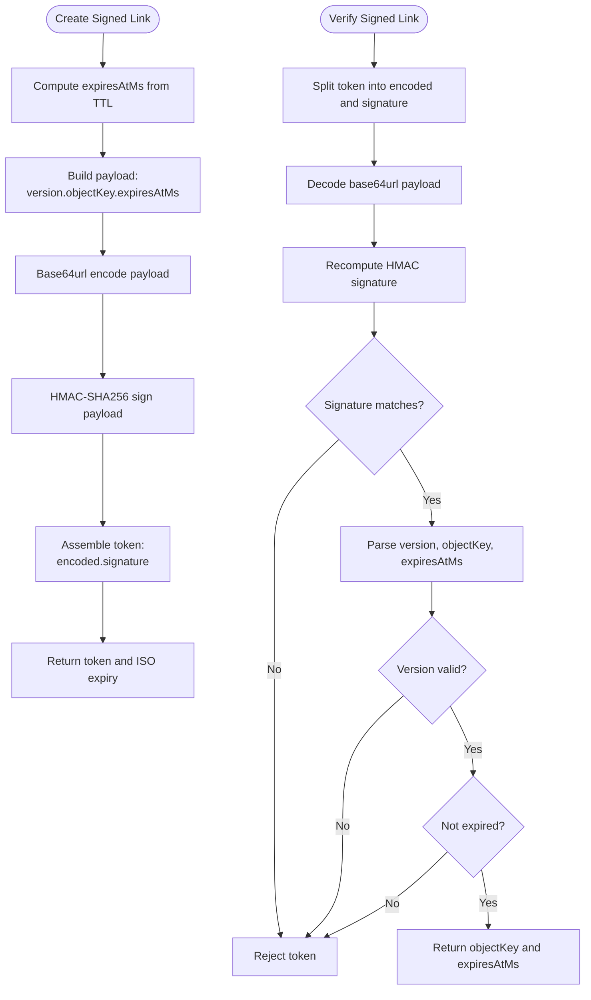
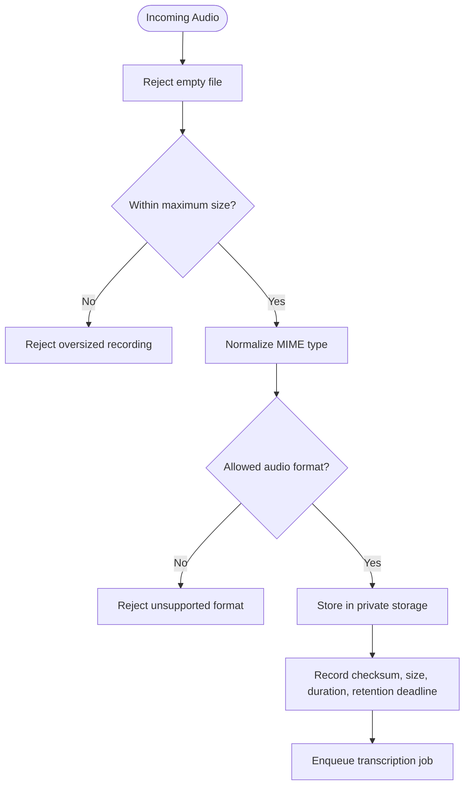
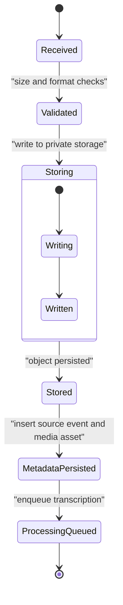
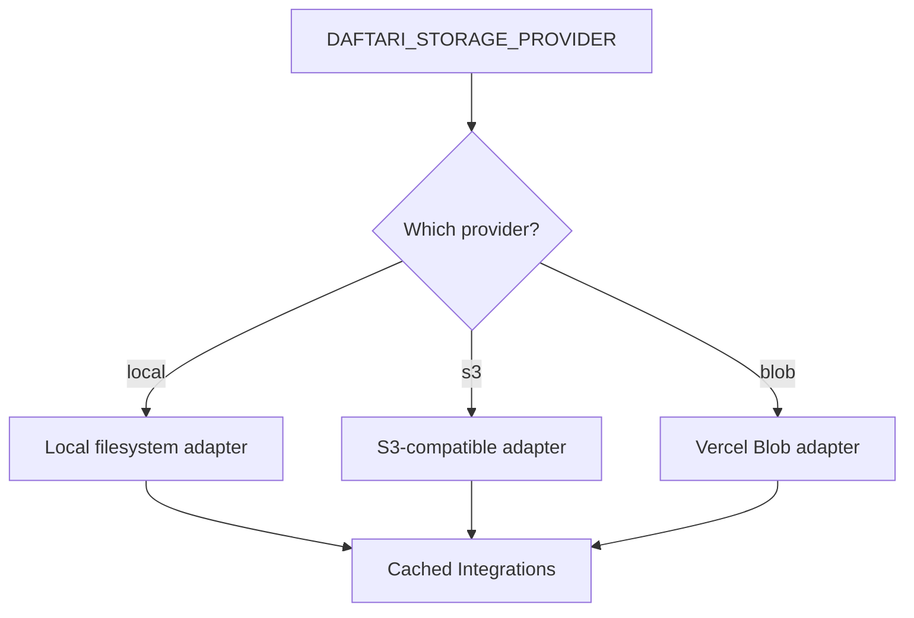
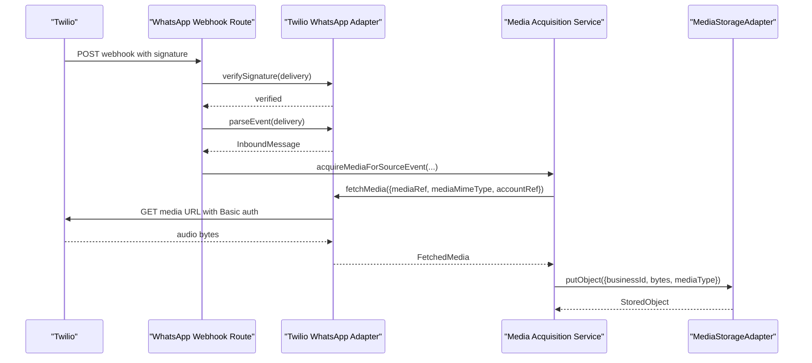
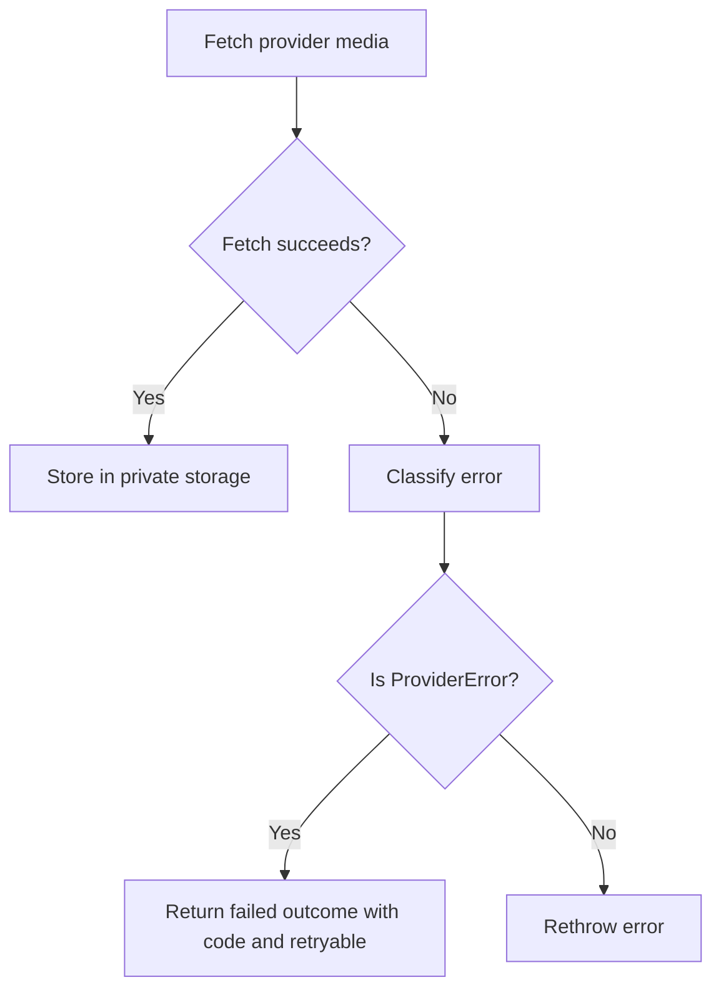
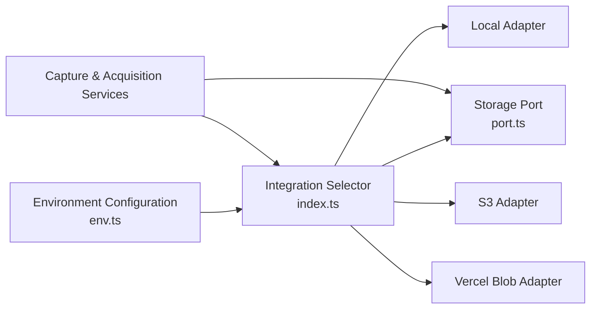

# Media Acquisition & Storage

<cite>
**Referenced Files in This Document**
- [port.ts](file://src/server/integrations/storage/port.ts)
- [local-storage-adapter.ts](file://src/server/integrations/storage/local-storage-adapter.ts)
- [s3-storage-adapter.ts](file://src/server/integrations/storage/s3-storage-adapter.ts)
- [vercel-blob-storage-adapter.ts](file://src/server/integrations/storage/vercel-blob-storage-adapter.ts)
- [signed-link.ts](file://src/server/integrations/storage/signed-link.ts)
- [index.ts](file://src/server/integrations/index.ts)
- [env.ts](file://src/server/config/env.ts)
- [media-acquisition.ts](file://src/server/services/media-acquisition.ts)
- [capture.ts](file://src/server/services/capture.ts)
- [route.ts (voice capture)](file://src/app/api/v1/capture/voice/route.ts)
- [route.ts (media download)](file://src/app/api/v1/media/download/route.ts)
- [port.ts (WhatsApp)](file://src/server/integrations/whatsapp/port.ts)
- [twilio-whatsapp-adapter.ts](file://src/server/integrations/whatsapp/twilio-whatsapp-adapter.ts)
- [provider-error.ts](file://src/server/integrations/provider-error.ts)
</cite>

## Table of Contents
1. [Introduction](#introduction)
2. [Project Structure](#project-structure)
3. [Core Components](#core-components)
4. [Architecture Overview](#architecture-overview)
5. [Detailed Component Analysis](#detailed-component-analysis)
6. [Dependency Analysis](#dependency-analysis)
7. [Performance Considerations](#performance-considerations)
8. [Troubleshooting Guide](#troubleshooting-guide)
9. [Conclusion](#conclusion)

## Introduction
This document explains the media acquisition and storage system used to handle audio from WhatsApp voice notes and in-app voice recordings. It covers the full lifecycle: receiving audio, validating it, storing it privately through a storage adapter abstraction, issuing short-lived signed download links, enforcing retention deadlines, and handling provider failures with retryable error semantics.

The system supports three storage backends behind one interface:
- Local filesystem
- AWS S3-compatible object storage
- Vercel Blob

It also documents how WhatsApp voice notes are fetched from providers such as Twilio, how signed URLs protect private media, and how configuration selects providers without scattering environment checks across the codebase.

## Project Structure
The media subsystem spans API routes, services, integration adapters, and configuration:

**Diagram sources**
- [route.ts (voice capture):1-84](file://src/app/api/v1/capture/voice/route.ts#L1-L84)
- [route.ts (media download):1-44](file://src/app/api/v1/media/download/route.ts#L1-L44)
- [capture.ts:1-147](file://src/server/services/capture.ts#L1-L147)
- [media-acquisition.ts:1-102](file://src/server/services/media-acquisition.ts#L1-L102)
- [index.ts:1-93](file://src/server/integrations/index.ts#L1-L93)
- [port.ts (storage):1-34](file://src/server/integrations/storage/port.ts#L1-L34)
- [local-storage-adapter.ts:1-88](file://src/server/integrations/storage/local-storage-adapter.ts#L1-L88)
- [s3-storage-adapter.ts:1-101](file://src/server/integrations/storage/s3-storage-adapter.ts#L1-L101)
- [vercel-blob-storage-adapter.ts:1-72](file://src/server/integrations/storage/vercel-blob-storage-adapter.ts#L1-L72)
- [signed-link.ts:1-62](file://src/server/integrations/storage/signed-link.ts#L1-L62)
- [port.ts (WhatsApp):1-91](file://src/server/integrations/whatsapp/port.ts#L1-L91)
- [twilio-whatsapp-adapter.ts:1-122](file://src/server/integrations/whatsapp/twilio-whatsapp-adapter.ts#L1-L122)
- [provider-error.ts:1-19](file://src/server/integrations/provider-error.ts#L1-L19)
- [env.ts:1-184](file://src/server/config/env.ts#L1-L184)

**Section sources**
- [route.ts (voice capture):1-84](file://src/app/api/v1/capture/voice/route.ts#L1-L84)
- [route.ts (media download):1-44](file://src/app/api/v1/media/download/route.ts#L1-L44)
- [capture.ts:1-147](file://src/server/services/capture.ts#L1-L147)
- [media-acquisition.ts:1-102](file://src/server/services/media-acquisition.ts#L1-L102)
- [index.ts:1-93](file://src/server/integrations/index.ts#L1-L93)
- [port.ts (storage):1-34](file://src/server/integrations/storage/port.ts#L1-L34)
- [local-storage-adapter.ts:1-88](file://src/server/integrations/storage/local-storage-adapter.ts#L1-L88)
- [s3-storage-adapter.ts:1-101](file://src/server/integrations/storage/s3-storage-adapter.ts#L1-L101)
- [vercel-blob-storage-adapter.ts:1-72](file://src/server/integrations/storage/vercel-blob-storage-adapter.ts#L1-L72)
- [signed-link.ts:1-62](file://src/server/integrations/storage/signed-link.ts#L1-L62)
- [port.ts (WhatsApp):1-91](file://src/server/integrations/whatsapp/port.ts#L1-L91)
- [twilio-whatsapp-adapter.ts:1-122](file://src/server/integrations/whatsapp/twilio-whatsapp-adapter.ts#L1-L122)
- [provider-error.ts:1-19](file://src/server/integrations/provider-error.ts#L1-L19)
- [env.ts:1-184](file://src/server/config/env.ts#L1-L184)

## Core Components
The system is built around a small set of focused components:

- **Storage port**: Defines the contract for private media storage, including put/read/delete operations, signed link creation and verification, and existence checks.
- **Storage adapters**: Implement the storage port for local filesystem, S3-compatible stores, and Vercel Blob.
- **Signed link utilities**: Generate and verify HMAC-signed tokens that bind an object key to an expiry time.
- **Integration selector**: Chooses the active storage, speech, extraction, and WhatsApp adapters based on environment configuration.
- **Capture service**: Validates and stores in-app voice recordings, records source events, inserts media assets, and enqueues transcription.
- **Media acquisition service**: Downloads provider-hosted media (for example from Twilio), stores it privately, persists media metadata, and computes retention deadlines.
- **WhatsApp adapters**: Normalize inbound messages and fetch provider-hosted media when needed.
- **API routes**: Expose voice capture and secure media download endpoints.

Key responsibilities:
- Never expose public URLs for private audio.
- Require both authorization and a short-lived signed token to read media.
- Keep storage backend selection out of business logic.
- Make acquisition idempotent per source event or capture ID.
- Record checksums, sizes, durations, and retention deadlines.

**Section sources**
- [port.ts (storage):1-34](file://src/server/integrations/storage/port.ts#L1-L34)
- [signed-link.ts:1-62](file://src/server/integrations/storage/signed-link.ts#L1-L62)
- [index.ts:1-93](file://src/server/integrations/index.ts#L1-L93)
- [capture.ts:1-147](file://src/server/services/capture.ts#L1-L147)
- [media-acquisition.ts:1-102](file://src/server/services/media-acquisition.ts#L1-L102)
- [port.ts (WhatsApp):1-91](file://src/server/integrations/whatsapp/port.ts#L1-L91)

## Architecture Overview
The media architecture separates intake, validation, storage, access control, and provider integration:

**Diagram sources**
- [route.ts (voice capture):33-83](file://src/app/api/v1/capture/voice/route.ts#L33-L83)
- [capture.ts:67-145](file://src/server/services/capture.ts#L67-L145)
- [route.ts (media download):20-43](file://src/app/api/v1/media/download/route.ts#L20-L43)
- [signed-link.ts:31-60](file://src/server/integrations/storage/signed-link.ts#L31-L60)

## Detailed Component Analysis

### Storage Port and Adapter Pattern
The storage port defines a stable interface so business logic does not depend on whether audio is stored locally, in S3, or in Vercel Blob. The same interface exposes:
- Object upload with business context, bytes, MIME type, and optional metadata.
- Object read and delete.
- Signed link creation and verification.
- Existence checking.

All adapters implement this interface and delegate signed link generation and verification to shared utilities. This ensures that switching storage backends does not change the download contract.

**Diagram sources**
- [port.ts (storage):9-34](file://src/server/integrations/storage/port.ts#L9-L34)
- [local-storage-adapter.ts:26-66](file://src/server/integrations/storage/local-storage-adapter.ts#L26-L66)
- [s3-storage-adapter.ts:19-99](file://src/server/integrations/storage/s3-storage-adapter.ts#L19-L99)
- [vercel-blob-storage-adapter.ts:21-70](file://src/server/integrations/storage/vercel-blob-storage-adapter.ts#L21-L70)
- [signed-link.ts:31-60](file://src/server/integrations/storage/signed-link.ts#L31-L60)

**Section sources**
- [port.ts (storage):1-34](file://src/server/integrations/storage/port.ts#L1-L34)
- [local-storage-adapter.ts:1-88](file://src/server/integrations/storage/local-storage-adapter.ts#L1-L88)
- [s3-storage-adapter.ts:1-101](file://src/server/integrations/storage/s3-storage-adapter.ts#L1-L101)
- [vercel-blob-storage-adapter.ts:1-72](file://src/server/integrations/storage/vercel-blob-storage-adapter.ts#L1-L72)
- [signed-link.ts:1-62](file://src/server/integrations/storage/signed-link.ts#L1-L62)

### Signed URL Generation and Access Control
Signed URLs are the only way to read private media. A token binds:
- Signature version
- Object key
- Expiration timestamp

Verification validates the HMAC signature using a shared secret, decodes the payload, checks the signature version, parses the object key and expiration, and rejects expired or tampered tokens.

**Diagram sources**
- [signed-link.ts:18-60](file://src/server/integrations/storage/signed-link.ts#L18-L60)

Security considerations:
- Object keys alone do not authorize reads.
- Tokens expire after a configured TTL, capped at one day.
- In development, a deterministic per-data-directory fallback is used; production deployments must set a shared signing secret.
- All comparisons use constant-time equality where applicable.

**Section sources**
- [signed-link.ts:1-62](file://src/server/integrations/storage/signed-link.ts#L1-L62)
- [env.ts:178-183](file://src/server/config/env.ts#L178-L183)

### File Validation, Format Detection, Size Limits, and Security
In-app voice capture performs strict validation before storage:
- Empty files are rejected.
- Maximum size is enforced to match downstream transcription limits.
- Allowed MIME types include common audio formats such as WebM, OGG, MP4, MPEG, WAV, AAC, and M4A variants.
- MIME types are normalized by stripping codec parameters and lowercasing.

For WhatsApp voice notes, the provider adapter determines whether a delivery is audio based on the presence of a media URL and an `audio/*` MIME type. The acquisition service then downloads the provider-hosted media and stores it privately.

**Diagram sources**
- [capture.ts:27-49](file://src/server/services/capture.ts#L27-L49)
- [capture.ts:67-96](file://src/server/services/capture.ts#L67-L96)
- [twilio-whatsapp-adapter.ts:71-96](file://src/server/integrations/whatsapp/twilio-whatsapp-adapter.ts#L71-L96)

**Section sources**
- [capture.ts:27-49](file://src/server/services/capture.ts#L27-L49)
- [capture.ts:67-96](file://src/server/services/capture.ts#L67-L96)
- [twilio-whatsapp-adapter.ts:71-96](file://src/server/integrations/whatsapp/twilio-whatsapp-adapter.ts#L71-L96)

### Media Asset Lifecycle
The lifecycle differs slightly depending on intake path:

- **In-app voice capture**:
  - API route receives multipart audio.
  - Capture service validates input and stores bytes in private storage.
  - Source event and media asset are persisted.
  - Transcription is enqueued.

- **WhatsApp voice note acquisition**:
  - Provider delivers a temporary media reference.
  - Acquisition service downloads media through the WhatsApp adapter.
  - Media is stored privately.
  - Media asset metadata is persisted with a retention deadline.

**Diagram sources**
- [route.ts (voice capture):33-83](file://src/app/api/v1/capture/voice/route.ts#L33-L83)
- [capture.ts:67-145](file://src/server/services/capture.ts#L67-L145)
- [media-acquisition.ts:42-100](file://src/server/services/media-acquisition.ts#L42-L100)

**Section sources**
- [route.ts (voice capture):33-83](file://src/app/api/v1/capture/voice/route.ts#L33-L83)
- [capture.ts:67-145](file://src/server/services/capture.ts#L67-L145)
- [media-acquisition.ts:42-100](file://src/server/services/media-acquisition.ts#L42-L100)

### Storage Backend Abstraction and Adapter Selection
The integration selector chooses the active storage adapter based on `DAFTARI_STORAGE_PROVIDER`:
- `local`: uses the local filesystem adapter.
- `s3`: uses the S3-compatible adapter.
- `blob`: uses the Vercel Blob adapter.

The selector caches the integrations instance and can be overridden for tests.

**Diagram sources**
- [index.ts:41-48](file://src/server/integrations/index.ts#L41-L48)
- [env.ts:89-93](file://src/server/config/env.ts#L89-L93)

**Section sources**
- [index.ts:1-93](file://src/server/integrations/index.ts#L1-L93)
- [env.ts:89-93](file://src/server/config/env.ts#L89-L93)

### Local Filesystem Storage Adapter
The local adapter stores objects under an opaque key inside a private data directory. It:
- Generates a deterministic-looking object key from business ID, timestamp, randomness, and checksum.
- Writes files with restrictive permissions.
- Computes and returns a SHA-256 checksum.
- Uses signed links for access control.

It also provides helpers for private export files, but those are separate from the media acquisition flow.

**Section sources**
- [local-storage-adapter.ts:1-88](file://src/server/integrations/storage/local-storage-adapter.ts#L1-L88)

### S3-Compatible Storage Adapter
The S3 adapter works with AWS S3, Cloudflare R2, MinIO, and other S3-compatible endpoints. It:
- Lazily imports the AWS SDK to avoid loading it unless S3 is selected.
- Supports bucket, region, endpoint, path-style mode, credentials, prefix, server-side encryption, and metadata.
- Stores objects privately and computes checksums.
- Returns best-effort existence results because synchronous existence checks would require network calls.

**Section sources**
- [s3-storage-adapter.ts:1-101](file://src/server/integrations/storage/s3-storage-adapter.ts#L1-L101)

### Vercel Blob Storage Adapter
The Vercel Blob adapter is selected when `DAFTARI_STORAGE_PROVIDER=blob`. It:
- Uses OIDC authentication provided by Vercel together with `BLOB_STORE_ID`.
- Lazily imports the Vercel Blob SDK.
- Stores objects as private blobs.
- Uses the same signed link scheme as other adapters.

**Section sources**
- [vercel-blob-storage-adapter.ts:1-72](file://src/server/integrations/storage/vercel-blob-storage-adapter.ts#L1-L72)
- [env.ts:95-103](file://src/server/config/env.ts#L95-L103)

### WhatsApp Voice Note Intake and Media Fetching
The WhatsApp port defines the expected inbound message shape, webhook delivery metadata, and media fetch request/response contracts. The Twilio adapter:
- Verifies the provider’s HMAC signature over the request URL and form parameters.
- Parses voice versus text deliveries.
- Extracts media URL and MIME type for voice notes.
- Downloads media using HTTP Basic authentication with account credentials.
- Wraps network failures and non-success responses in `ProviderError`, marking them retryable when appropriate.

**Diagram sources**
- [port.ts (WhatsApp):56-81](file://src/server/integrations/whatsapp/port.ts#L56-L81)
- [twilio-whatsapp-adapter.ts:34-119](file://src/server/integrations/whatsapp/twilio-whatsapp-adapter.ts#L34-L119)
- [media-acquisition.ts:61-87](file://src/server/services/media-acquisition.ts#L61-L87)

**Section sources**
- [port.ts (WhatsApp):1-91](file://src/server/integrations/whatsapp/port.ts#L1-L91)
- [twilio-whatsapp-adapter.ts:1-122](file://src/server/integrations/whatsapp/twilio-whatsapp-adapter.ts#L1-L122)
- [media-acquisition.ts:1-102](file://src/server/services/media-acquisition.ts#L1-L102)

### Media Retention Policies
Retention deadlines are computed from the business context’s configured retention period. The acquisition service calculates a deadline string representing the end of the retention window and persists it with the media asset. This enables scheduled cleanup jobs to remove old media according to policy.

**Section sources**
- [media-acquisition.ts:31-34](file://src/server/services/media-acquisition.ts#L31-L34)
- [media-acquisition.ts:89-98](file://src/server/services/media-acquisition.ts#L89-L98)
- [capture.ts:117-126](file://src/server/services/capture.ts#L117-L126)

### Error Handling, Retry Semantics, and Fallback Strategies
External provider failures are represented by `ProviderError`, which carries:
- A machine-readable error code.
- A human-readable message.
- A `retryable` flag indicating whether retries with backoff should be attempted.

The acquisition service catches `ProviderError` and returns a structured outcome describing whether the failure is retryable. Non-provider errors are rethrown so they can be handled by higher-level error middleware.

**Diagram sources**
- [provider-error.ts:1-19](file://src/server/integrations/provider-error.ts#L1-L19)
- [media-acquisition.ts:66-80](file://src/server/services/media-acquisition.ts#L66-L80)
- [twilio-whatsapp-adapter.ts:98-119](file://src/server/integrations/whatsapp/twilio-whatsapp-adapter.ts#L98-L119)

**Section sources**
- [provider-error.ts:1-19](file://src/server/integrations/provider-error.ts#L1-L19)
- [media-acquisition.ts:66-80](file://src/server/services/media-acquisition.ts#L66-L80)
- [twilio-whatsapp-adapter.ts:98-119](file://src/server/integrations/whatsapp/twilio-whatsapp-adapter.ts#L98-L119)

## Dependency Analysis
The following diagram shows how configuration drives adapter selection and how services depend on the integration layer rather than concrete providers.

**Diagram sources**
- [env.ts:89-131](file://src/server/config/env.ts#L89-L131)
- [index.ts:41-70](file://src/server/integrations/index.ts#L41-L70)
- [port.ts (storage):1-34](file://src/server/integrations/storage/port.ts#L1-L34)

Coupling and cohesion observations:
- Services depend on abstractions (`MediaStorageAdapter`, `WhatsAppAdapter`) rather than concrete implementations.
- Provider-specific behavior is isolated in adapters.
- Signed link logic is shared across storage adapters, keeping the download contract consistent.
- Configuration is centralized, reducing scattered environment checks.

Potential risks:
- If a new storage provider is added, the selector must be updated.
- Lazy imports reduce startup cost but mean runtime import failures can occur if dependencies are missing.

**Section sources**
- [env.ts:89-131](file://src/server/config/env.ts#L89-L131)
- [index.ts:41-70](file://src/server/integrations/index.ts#L41-L70)
- [port.ts (storage):1-34](file://src/server/integrations/storage/port.ts#L1-L34)

## Performance Considerations
- Lazy SDK imports keep local and test paths free of heavy external dependencies.
- Object keys are generated deterministically enough to avoid collisions while remaining opaque.
- Checksums are computed during upload, enabling integrity tracking without additional reads.
- Signed link verification is lightweight and avoids direct storage access until authorization passes.
- In-app capture enqueues transcription asynchronously so HTTP responses remain fast even if transcription providers are slow.

[No sources needed since this section provides general guidance]

## Troubleshooting Guide

### Common Storage Issues
- **Missing storage provider configuration**:
  - Symptom: Startup or first request fails with a configuration error.
  - Cause: `DAFTARI_STORAGE_PROVIDER` is set but required credentials are missing.
  - Resolution: Provide all required variables for the selected provider.

- **Invalid or expired signed links**:
  - Symptom: Download endpoint returns an invalid or expired link error.
  - Cause: Token was tampered with, malformed, or past its TTL.
  - Resolution: Regenerate the signed link; ensure the signing secret is consistent across instances in production.

- **S3 connectivity or permission errors**:
  - Symptom: Upload or read fails against S3.
  - Cause: Incorrect bucket, region, credentials, endpoint, path style, or prefix.
  - Resolution: Validate `S3_BUCKET`, `S3_ACCESS_KEY_ID`, `S3_SECRET_ACCESS_KEY`, `S3_REGION`, `S3_ENDPOINT`, `S3_FORCE_PATH_STYLE`, and `S3_PREFIX`.

- **Vercel Blob store not connected**:
  - Symptom: Blob operations fail.
  - Cause: Missing `BLOB_STORE_ID` or OIDC token not available.
  - Resolution: Connect the Blob store to the project and ensure `BLOB_STORE_ID` is present.

- **WhatsApp media download failures**:
  - Symptom: Acquisition returns a failed outcome with a provider error.
  - Cause: Twilio media URL expired, authentication failed, or returned a non-success status.
  - Resolution: Retry when `retryable` is true; otherwise investigate Twilio credentials and media availability.

- **Unsupported audio format**:
  - Symptom: In-app capture rejects the recording.
  - Cause: MIME type is not in the allowed list.
  - Resolution: Record in an allowed format such as WebM, OGG, MP4, MPEG, WAV, AAC, or M4A.

- **Oversized recording**:
  - Symptom: Capture rejects the file as too large.
  - Cause: File exceeds the maximum capture size.
  - Resolution: Reduce recording length or quality to stay within the limit.

**Section sources**
- [env.ts:14-30](file://src/server/config/env.ts#L14-L30)
- [env.ts:89-131](file://src/server/config/env.ts#L89-L131)
- [env.ts:95-103](file://src/server/config/env.ts#L95-L103)
- [signed-link.ts:18-60](file://src/server/integrations/storage/signed-link.ts#L18-L60)
- [route.ts (media download):20-31](file://src/app/api/v1/media/download/route.ts#L20-L31)
- [capture.ts:27-49](file://src/server/services/capture.ts#L27-L49)
- [twilio-whatsapp-adapter.ts:98-119](file://src/server/integrations/whatsapp/twilio-whatsapp-adapter.ts#L98-L119)

## Conclusion
The media acquisition and storage system provides a secure, configurable, and extensible pipeline for handling WhatsApp voice notes and in-app audio recordings. Its adapter pattern isolates storage backends, signed links enforce strong access control, and provider error semantics enable robust retry behavior. By centralizing configuration and keeping business logic independent of storage details, the system remains maintainable and portable across local development, cloud deployments, and different object storage providers.

[No sources needed since this section summarizes without analyzing specific files]