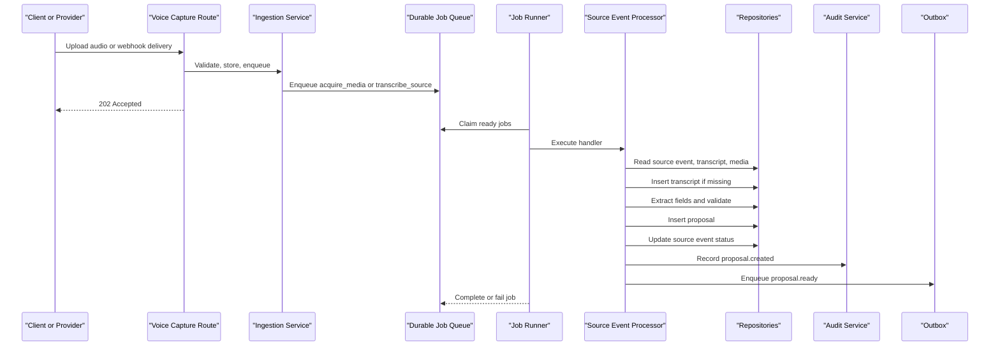
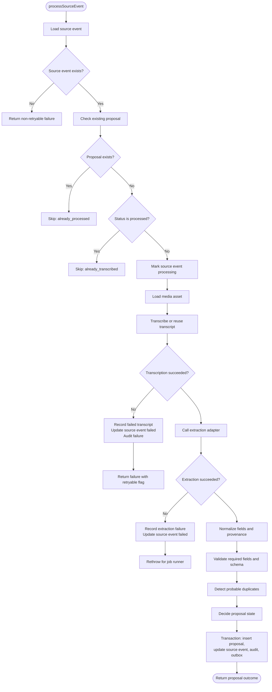
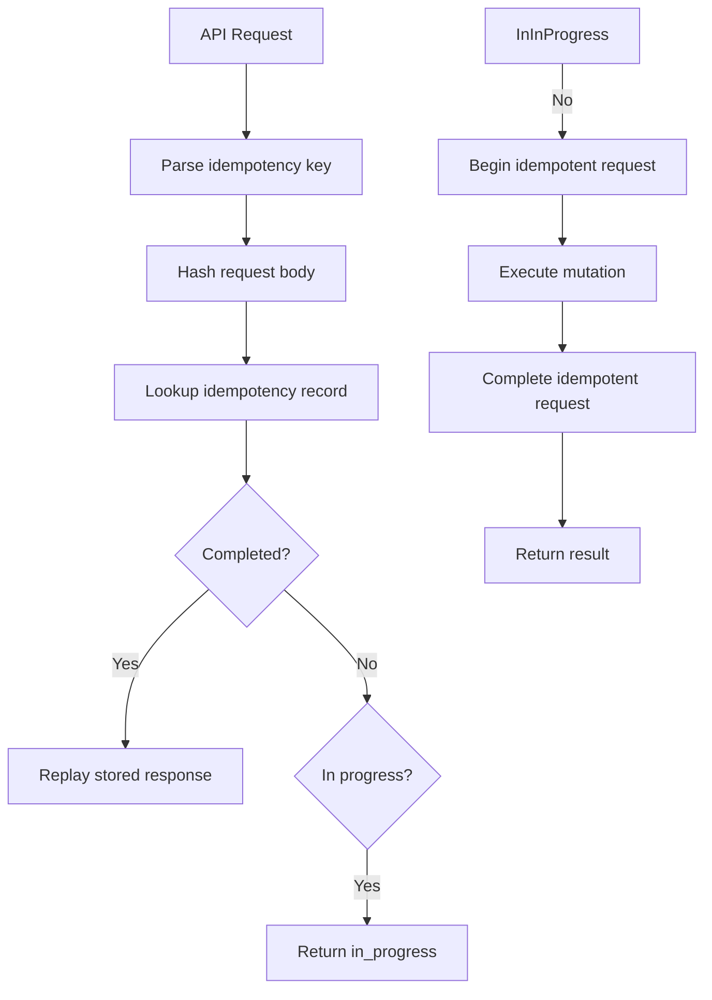
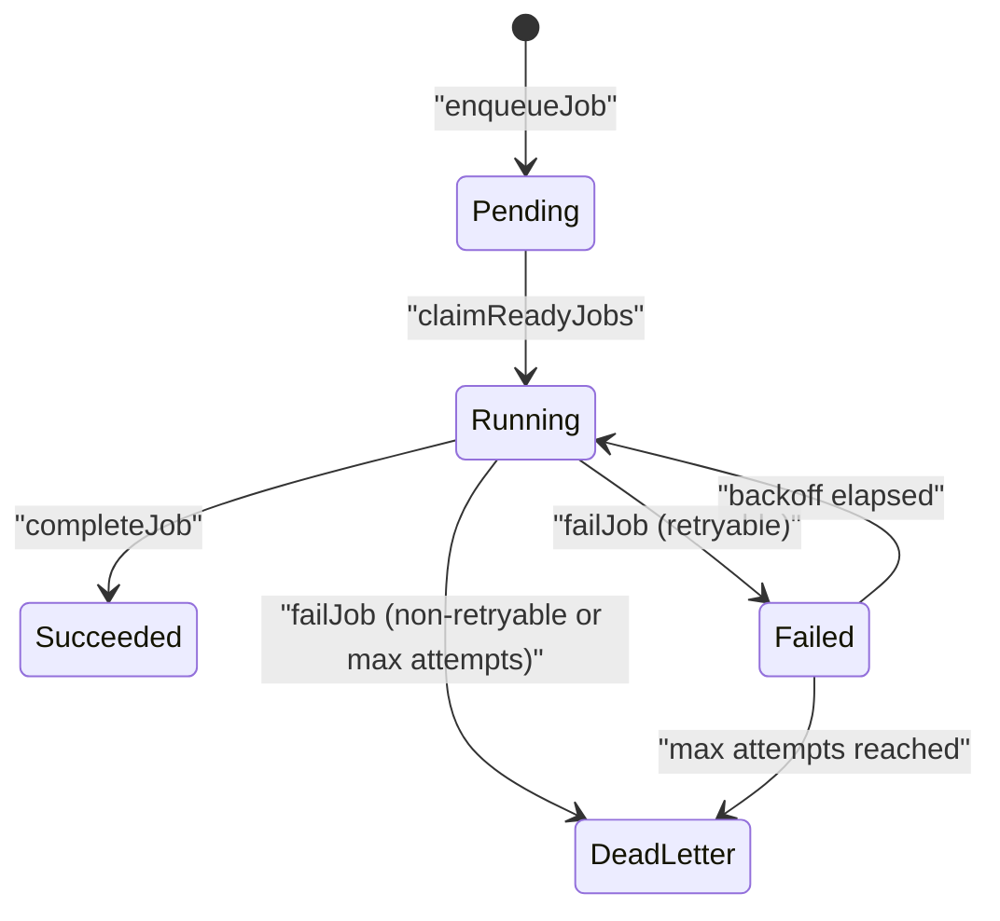
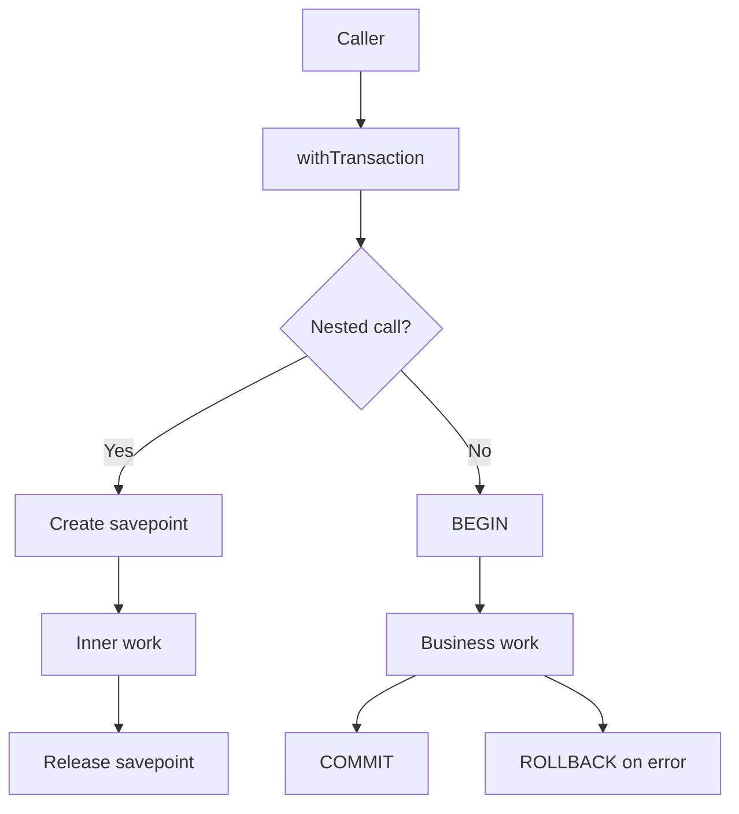
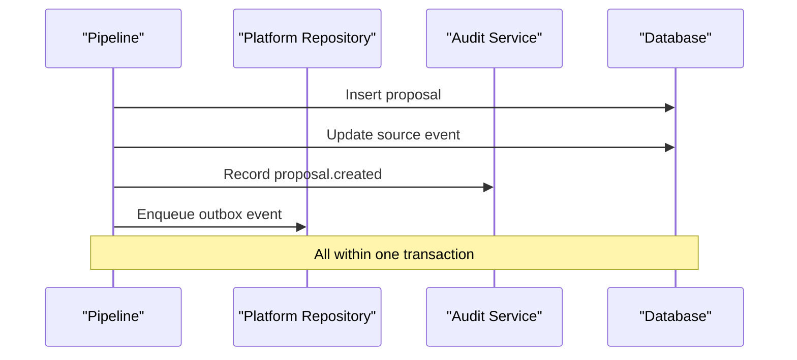
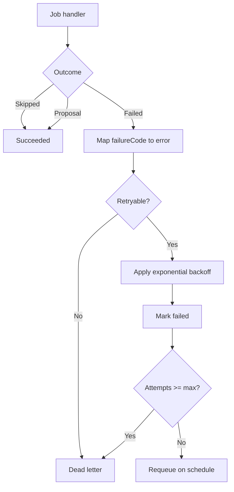
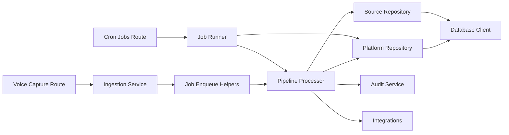

# Pipeline Orchestration & State Management

<cite>
**Referenced Files in This Document**
- [pipeline.ts](file://src/server/services/pipeline.ts)
- [jobs.ts](file://src/server/services/jobs.ts)
- [ingestion.ts](file://src/server/services/ingestion.ts)
- [idempotency.ts](file://src/server/services/idempotency.ts)
- [audit.ts](file://src/server/services/audit.ts)
- [client.ts](file://src/server/db/client.ts)
- [platform.repository.ts](file://src/server/repositories/platform.repository.ts)
- [source.repository.ts](file://src/server/repositories/source.repository.ts)
- [types.ts](file://src/server/domain/types.ts)
- [proposal.ts](file://src/lib/validation/proposal.ts)
- [route.ts](file://src/app/api/v1/capture/voice/route.ts)
- [route.ts](file://src/app/api/cron/jobs/route.ts)
- [run-jobs.ts](file://scripts/run-jobs.ts)
- [pipeline.test.ts](file://tests/pipeline.test.ts)
</cite>

## Table of Contents
1. [Introduction](#introduction)
2. [Project Structure](#project-structure)
3. [Core Components](#core-components)
4. [Architecture Overview](#architecture-overview)
5. [Detailed Component Analysis](#detailed-component-analysis)
6. [Dependency Analysis](#dependency-analysis)
7. [Performance Considerations](#performance-considerations)
8. [Troubleshooting Guide](#troubleshooting-guide)
9. [Conclusion](#conclusion)

## Introduction
This document explains the deterministic pipeline that turns a source event into a reviewable proposal without creating ledger records. The system is designed for reliability, idempotency, and auditability:

- Source events are accepted asynchronously so provider webhooks and UI uploads never block on transcription or extraction.
- Processing is stateful and deterministic: each source event can produce at most one transcript and one proposal.
- Provider failures are classified as retryable or permanent, with exponential backoff and dead-lettering.
- All durable changes are wrapped in database transactions; outbox events and audit entries provide reliable publishing and an immutable trail.
- The queue is durable and claim-based, allowing multiple workers to coordinate safely.

The pipeline stops at a proposal because actual accounting postings require human confirmation elsewhere.

## Project Structure
The orchestration spans HTTP entry points, ingestion, job execution, domain services, repositories, and shared infrastructure:

```mermaid
graph TB
subgraph "HTTP Entry Points"
VoiceRoute["Voice Capture Route"]
CronRoute["Scheduled Jobs Route"]
end
subgraph "Ingestion"
Ingestion["WhatsApp Ingestion Service"]
end
subgraph "Job System"
JobRunner["Durable Job Runner"]
Queue["Durable Job Queue"]
end
subgraph "Pipeline"
Pipeline["Source Event Processor"]
Validation["Proposal Validation"]
end
subgraph "Persistence"
SourceRepo["Source Repository"]
PlatformRepo["Platform Repository"]
DB["Database"]
end
VoiceRoute --> Ingestion
CronRoute --> JobRunner
Ingestion --> Queue
JobRunner --> Pipeline
Pipeline --> SourceRepo
Pipeline --> PlatformRepo
JobRunner --> PlatformRepo
SourceRepo --> DB
PlatformRepo --> DB
```

**Diagram sources**
- [route.ts:33-83](file://src/app/api/v1/capture/voice/route.ts#L33-L83)
- [route.ts:28-47](file://src/app/api/cron/jobs/route.ts#L28-L47)
- [ingestion.ts:66-207](file://src/server/services/ingestion.ts#L66-L207)
- [jobs.ts:51-140](file://src/server/services/jobs.ts#L51-L140)
- [pipeline.ts:354-503](file://src/server/services/pipeline.ts#L354-L503)
- [platform.repository.ts:197-302](file://src/server/repositories/platform.repository.ts#L197-L302)
- [source.repository.ts:127-210](file://src/server/repositories/source.repository.ts#L127-L210)

**Section sources**
- [route.ts:33-83](file://src/app/api/v1/capture/voice/route.ts#L33-L83)
- [route.ts:28-47](file://src/app/api/cron/jobs/route.ts#L28-L47)
- [ingestion.ts:1-217](file://src/server/services/ingestion.ts#L1-L217)
- [jobs.ts:1-241](file://src/server/services/jobs.ts#L1-L241)
- [pipeline.ts:1-506](file://src/server/services/pipeline.ts#L1-L506)

## Core Components
- **Ingestion service**: authenticates provider deliveries, deduplicates by provider event, persists a redacted source event, stores or references media, and enqueues the next stage.
- **Job runner**: claims due jobs atomically, executes typed handlers, records attempts, applies exponential backoff, and marks exhausted jobs as dead letters.
- **Pipeline processor**: orchestrates transcript lookup or creation, provider transcription, extraction, validation, duplicate detection, proposal insertion, source event finalization, audit recording, and outbox publication.
- **Idempotency service**: protects mutating API calls from duplicate retries using scoped keys and request hashes.
- **Audit service**: appends tamper-evident audit events and wraps business writes when needed.
- **Database client**: abstracts SQLite and PostgreSQL, provides parameterized queries, and implements nested transaction/savepoint semantics.
- **Repositories**: encapsulate tenant-scoped persistence for source events, transcripts, proposals, jobs, outbox events, and idempotency records.
- **Domain types and schemas**: define record types, proposal states, job types, audit actions, and strict Zod schemas for untrusted model output.

**Section sources**
- [ingestion.ts:1-217](file://src/server/services/ingestion.ts#L1-L217)
- [jobs.ts:1-241](file://src/server/services/jobs.ts#L1-L241)
- [pipeline.ts:1-506](file://src/server/services/pipeline.ts#L1-L506)
- [idempotency.ts:1-100](file://src/server/services/idempotency.ts#L1-L100)
- [audit.ts:1-79](file://src/server/services/audit.ts#L1-L79)
- [client.ts:1-350](file://src/server/db/client.ts#L1-L350)
- [platform.repository.ts:1-491](file://src/server/repositories/platform.repository.ts#L1-L491)
- [source.repository.ts:1-771](file://src/server/repositories/source.repository.ts#L1-L771)
- [types.ts:1-217](file://src/server/domain/types.ts#L1-L217)
- [proposal.ts:1-312](file://src/lib/validation/proposal.ts#L1-L312)

## Architecture Overview
The end-to-end flow separates acceptance from processing:



**Diagram sources**
- [route.ts:33-83](file://src/app/api/v1/capture/voice/route.ts#L33-L83)
- [ingestion.ts:66-207](file://src/server/services/ingestion.ts#L66-L207)
- [jobs.ts:51-140](file://src/server/services/jobs.ts#L51-L140)
- [pipeline.ts:354-503](file://src/server/services/pipeline.ts#L354-L503)
- [platform.repository.ts:143-170](file://src/server/repositories/platform.repository.ts#L143-L170)

## Detailed Component Analysis

### Deterministic Source Event Pipeline
The pipeline guarantees that one source event produces at most one transcript and one proposal. It also ensures that transient provider failures do not corrupt the queue.

Key behaviors:
- If no source event exists, the outcome is a non-retryable failure.
- If a proposal already exists for the source event, processing is skipped.
- If the source event is already processed, processing is skipped.
- The source event is moved to `processing` before transcription begins.
- Existing transcripts are reused when available.
- Provider transcription failures update the source event to `failed`, record a failed transcript row, write an audit event, and return a retryable or non-retryable failure.
- Extraction failures after transcription are caught, recorded, and rethrown so the job runner can apply backoff.
- Proposal creation, source event finalization, audit recording, and outbox publication occur inside a single transaction.



**Diagram sources**
- [pipeline.ts:354-503](file://src/server/services/pipeline.ts#L354-L503)
- [source.repository.ts:188-210](file://src/server/repositories/source.repository.ts#L188-L210)
- [source.repository.ts:385-408](file://src/server/repositories/source.repository.ts#L385-L408)
- [platform.repository.ts:143-170](file://src/server/repositories/platform.repository.ts#L143-L170)

**Section sources**
- [pipeline.ts:52-58](file://src/server/services/pipeline.ts#L52-L58)
- [pipeline.ts:287-346](file://src/server/services/pipeline.ts#L287-L346)
- [pipeline.ts:354-503](file://src/server/services/pipeline.ts#L354-L503)
- [source.repository.ts:385-408](file://src/server/repositories/source.repository.ts#L385-L408)

### Idempotent Processing Design
Idempotency operates at two levels:

1. **Request-level idempotency**: Mutating API endpoints use scoped idempotency keys and request body hashes. A completed request replays its stored response; an in-progress request returns a controlled signal rather than executing again.
2. **Entity-level idempotency**: The pipeline itself is idempotent per source event. Duplicate runs skip when a proposal already exists or when the source event is already processed. Job enqueuing uses idempotency keys such as `transcribe:{sourceEventId}` and `acquire:{sourceEventId}`.



**Diagram sources**
- [idempotency.ts:45-84](file://src/server/services/idempotency.ts#L45-L84)
- [platform.repository.ts:361-394](file://src/server/repositories/platform.repository.ts#L361-L394)
- [jobs.ts:209-240](file://src/server/services/jobs.ts#L209-L240)
- [pipeline.ts:365-371](file://src/server/services/pipeline.ts#L365-L371)

**Section sources**
- [idempotency.ts:1-100](file://src/server/services/idempotency.ts#L1-L100)
- [jobs.ts:209-240](file://src/server/services/jobs.ts#L209-L240)
- [pipeline.ts:365-371](file://src/server/services/pipeline.ts#L365-L371)

### Job Queue Integration and Worker Coordination
The durable job queue supports asynchronous work across multiple workers:

- Jobs are enqueued with an idempotency key to prevent duplicate scheduling.
- Workers claim jobs by selecting candidates whose `next_attempt_at` has passed and atomically flipping their status to `running`.
- Each job run is recorded with attempt number, timestamps, duration, and error code.
- Failed jobs receive exponential backoff capped at a short interval.
- Exhausted or non-retryable jobs move to `dead_letter`.
- Successful jobs are marked `succeeded` and cleared of last error codes.



**Diagram sources**
- [platform.repository.ts:197-302](file://src/server/repositories/platform.repository.ts#L197-L302)
- [jobs.ts:143-207](file://src/server/services/jobs.ts#L143-L207)

**Section sources**
- [jobs.ts:1-241](file://src/server/services/jobs.ts#L1-L241)
- [platform.repository.ts:174-302](file://src/server/repositories/platform.repository.ts#L174-L302)

### Transaction Boundaries and Database Locking
Transactions are used to preserve consistency between related entities:

- The database client supports both SQLite and PostgreSQL.
- SQLite uses explicit `BEGIN IMMEDIATE` / `COMMIT` / `ROLLBACK`.
- PostgreSQL uses top-level transactions and nested savepoints for nested calls.
- The pipeline wraps proposal insertion, source event finalization, audit recording, and outbox publication in one transaction.
- Idempotent API mutations wrap request begin, work, and completion in one transaction so a crash cannot leave a write without its replayable response.
- Tenant scoping is enforced through repository queries that include `business_id`.



**Diagram sources**
- [client.ts:291-333](file://src/server/db/client.ts#L291-L333)
- [pipeline.ts:456-493](file://src/server/services/pipeline.ts#L456-L493)
- [idempotency.ts:77-83](file://src/server/services/idempotency.ts#L77-L83)

**Section sources**
- [client.ts:288-339](file://src/server/db/client.ts#L288-L339)
- [pipeline.ts:456-493](file://src/server/services/pipeline.ts#L456-L493)
- [idempotency.ts:77-83](file://src/server/services/idempotency.ts#L77-L83)

### Outbox Pattern and Audit Trail
The outbox pattern ensures that external events are published only after the primary database change commits:

- After a proposal is created, an outbox event is inserted with topic `proposal.ready`.
- The outbox event includes entity type, entity id, and a small payload describing the record type and proposal state.
- Audit events are appended with tamper-evident chaining via integrity hashes.
- Audit recording failures are logged but do not roll back the business change they describe.



**Diagram sources**
- [pipeline.ts:456-493](file://src/server/services/pipeline.ts#L456-L493)
- [platform.repository.ts:143-170](file://src/server/repositories/platform.repository.ts#L143-L170)
- [platform.repository.ts:52-103](file://src/server/repositories/platform.repository.ts#L52-L103)
- [audit.ts:54-66](file://src/server/services/audit.ts#L54-L66)

**Section sources**
- [pipeline.ts:456-493](file://src/server/services/pipeline.ts#L456-L493)
- [platform.repository.ts:52-103](file://src/server/repositories/platform.repository.ts#L52-L103)
- [platform.repository.ts:143-170](file://src/server/repositories/platform.repository.ts#L143-L170)
- [audit.ts:1-79](file://src/server/services/audit.ts#L1-L79)

### Error Recovery and Retry Logic
Error handling distinguishes between transient and permanent failures:

- Provider errors carry a code and a retryable flag.
- Transcription failures update the source event to `failed`, record a failed transcript once per source event, and return a structured failure.
- Extraction failures after transcription are caught, recorded, and rethrown so the job runner can decide retry behavior.
- The job runner converts pipeline outcomes into errors with `code` and `retryable`.
- Exponential backoff is applied based on attempt count.
- Non-retryable errors and exhausted retries become dead letters.



**Diagram sources**
- [pipeline.ts:376-436](file://src/server/services/pipeline.ts#L376-L436)
- [jobs.ts:35-49](file://src/server/services/jobs.ts#L35-L49)
- [jobs.ts:143-193](file://src/server/services/jobs.ts#L143-L193)
- [platform.repository.ts:287-302](file://src/server/repositories/platform.repository.ts#L287-L302)

**Section sources**
- [pipeline.ts:376-436](file://src/server/services/pipeline.ts#L376-L436)
- [jobs.ts:35-49](file://src/server/services/jobs.ts#L35-L49)
- [jobs.ts:143-193](file://src/server/services/jobs.ts#L143-L193)
- [platform.repository.ts:287-302](file://src/server/repositories/platform.repository.ts#L287-L302)

### Concurrent Request Handling and Tenant Isolation
Concurrency safety is achieved through database constraints and tenant-scoped queries:

- Job claiming uses conditional updates to ensure only one worker processes a given job row.
- Source event processing checks for existing proposals and processed status before writing.
- Failed transcript recording updates the latest failed transcript row instead of appending duplicates.
- All repository reads and writes filter by `business_id`, preventing cross-tenant data leakage.
- Tests assert that foreign tenants cannot see another tenant’s proposals.

**Section sources**
- [platform.repository.ts:252-274](file://src/server/repositories/platform.repository.ts#L252-L274)
- [pipeline.ts:365-371](file://src/server/services/pipeline.ts#L365-L371)
- [source.repository.ts:385-408](file://src/server/repositories/source.repository.ts#L385-L408)
- [source.repository.ts:181-186](file://src/server/repositories/source.repository.ts#L181-L186)
- [pipeline.test.ts:354-368](file://tests/pipeline.test.ts#L354-L368)

### Monitoring and Observability
Observability is built around structured logging and audit trails:

- The logger emits pipeline and job metrics, including proposal creation, job failures, and dead-letter counts.
- Audit events capture actor type, entity type, entity id, reason codes, and before/after snapshots where appropriate.
- Job runs record start time, finish time, duration, and error codes.
- The scheduled job endpoint reports processed and dead-lettered job counts.

Recommended monitoring signals:
- Count of pending and failed jobs.
- Number of open proposals by state.
- Failure codes from transcription and extraction.
- Dead-letter job volume.
- Audit event append failures.

**Section sources**
- [pipeline.ts:495-500](file://src/server/services/pipeline.ts#L495-L500)
- [jobs.ts:179-191](file://src/server/services/jobs.ts#L179-L191)
- [route.ts:40-46](file://src/app/api/cron/jobs/route.ts#L40-L46)
- [platform.repository.ts:304-334](file://src/server/repositories/platform.repository.ts#L304-L334)
- [audit.ts:54-66](file://src/server/services/audit.ts#L54-L66)

### Debugging Stuck or Failed Pipeline Executions
Use this checklist when a source event does not reach a proposal:

1. **Check the source event status**
   - `received`: waiting for job processing.
   - `processing`: currently being handled.
   - `processed`: successfully converted to a proposal.
   - `failed`: transcription or extraction failed.

2. **Inspect the job queue**
   - Look for jobs with status `pending`, `running`, `failed`, or `dead_letter`.
   - Check `attempts`, `max_attempts`, `next_attempt_at`, and `last_error_code`.
   - Confirm idempotency keys are unique per source event.

3. **Inspect transcripts**
   - Verify whether a transcript exists for the source event.
   - For repeated failures, confirm there is exactly one failed transcript row.
   - Check detected language, provider, model version, and quality metadata.

4. **Inspect proposals**
   - Confirm whether a proposal was created for the source event.
   - Review record type, state, missing fields, validation issues, and duplicate candidates.
   - Use confidence bands to prioritize low-confidence proposals.

5. **Review audit events**
   - Look for `source_event.received`, `transcript.failed`, `source_event.processing_failed`, and `proposal.created`.
   - Correlate audit events with job runs and failure codes.

6. **Reproduce locally**
   - Use the local job runner script to drain the queue and observe round-by-round results.
   - The voice capture route drains up to five jobs immediately after upload to speed up development feedback.

**Section sources**
- [source.repository.ts:188-210](file://src/server/repositories/source.repository.ts#L188-L210)
- [platform.repository.ts:252-302](file://src/server/repositories/platform.repository.ts#L252-L302)
- [source.repository.ts:385-408](file://src/server/repositories/source.repository.ts#L385-L408)
- [source.repository.ts:535-595](file://src/server/repositories/source.repository.ts#L535-L595)
- [run-jobs.ts:26-54](file://scripts/run-jobs.ts#L26-L54)
- [route.ts:68-76](file://src/app/api/v1/capture/voice/route.ts#L68-L76)

## Dependency Analysis
The main dependency relationships are:



**Diagram sources**
- [route.ts:33-83](file://src/app/api/v1/capture/voice/route.ts#L33-L83)
- [route.ts:28-47](file://src/app/api/cron/jobs/route.ts#L28-L47)
- [ingestion.ts:66-207](file://src/server/services/ingestion.ts#L66-L207)
- [jobs.ts:51-140](file://src/server/services/jobs.ts#L51-L140)
- [pipeline.ts:354-503](file://src/server/services/pipeline.ts#L354-L503)
- [platform.repository.ts:197-302](file://src/server/repositories/platform.repository.ts#L197-L302)
- [source.repository.ts:127-210](file://src/server/repositories/source.repository.ts#L127-L210)

**Section sources**
- [jobs.ts:51-140](file://src/server/services/jobs.ts#L51-L140)
- [pipeline.ts:354-503](file://src/server/services/pipeline.ts#L354-L503)
- [platform.repository.ts:197-302](file://src/server/repositories/platform.repository.ts#L197-L302)
- [source.repository.ts:127-210](file://src/server/repositories/source.repository.ts#L127-L210)

## Performance Considerations
- Keep webhook responses fast by persisting and queuing work instead of calling providers synchronously.
- Prefer transcript reuse: text messages and previously successful transcripts avoid redundant provider calls.
- Batch job draining with a bounded limit to avoid long-running cron invocations.
- Monitor open proposal counts and oldest open proposal timestamps to detect backlog growth.
- Avoid unnecessary JSON serialization by passing structured objects through internal APIs.
- Use tenant-scoped queries consistently to prevent accidental full-table scans across tenants.

[No sources needed since this section provides general guidance]

## Troubleshooting Guide
Common symptoms and resolutions:

| Symptom | Likely Cause | Action |
|---|---|---|
| Webhook accepted but no proposal appears | Job still pending or failed | Inspect job status, attempts, and error code |
| Multiple failed transcript rows for one event | Incorrect failure recording path | Verify `recordFailedTranscript` updates the latest failed row |
| Proposal created twice for same event | Missing idempotency guard | Check source event status and proposal lookup logic |
| Provider timeout keeps retrying | Retryable provider error | Wait for backoff or fix provider availability |
| Permanent codec error keeps failing | Non-retryable provider error | Move to dead letter and investigate input media |
| Cross-tenant data exposure | Missing tenant scope | Add `business_id` filters to repository queries |
| Audit event missing | Audit append failure | Check audit logs; business change remains valid |
| Local development feels slow | Jobs scheduled later | Drain queue manually after capture |

**Section sources**
- [pipeline.test.ts:234-352](file://tests/pipeline.test.ts#L234-L352)
- [source.repository.ts:385-408](file://src/server/repositories/source.repository.ts#L385-L408)
- [platform.repository.ts:287-302](file://src/server/repositories/platform.repository.ts#L287-L302)
- [audit.ts:54-66](file://src/server/services/audit.ts#L54-L66)

## Conclusion
The pipeline is a carefully bounded workflow that accepts source events asynchronously, processes them deterministically, and stops at a reviewable proposal. Its durability comes from:

- At-least-once queue delivery combined with idempotent handlers.
- Atomic job claiming and attempt tracking.
- Transactional boundaries around critical state transitions.
- Tenant-scoped persistence and strict validation of untrusted model output.
- An outbox-backed event publish path and a tamper-evident audit trail.

When debugging, focus on the lifecycle of the source event, the job queue, the transcript, the proposal, and the audit trail. These artifacts together form the complete story of how a message becomes a proposal.