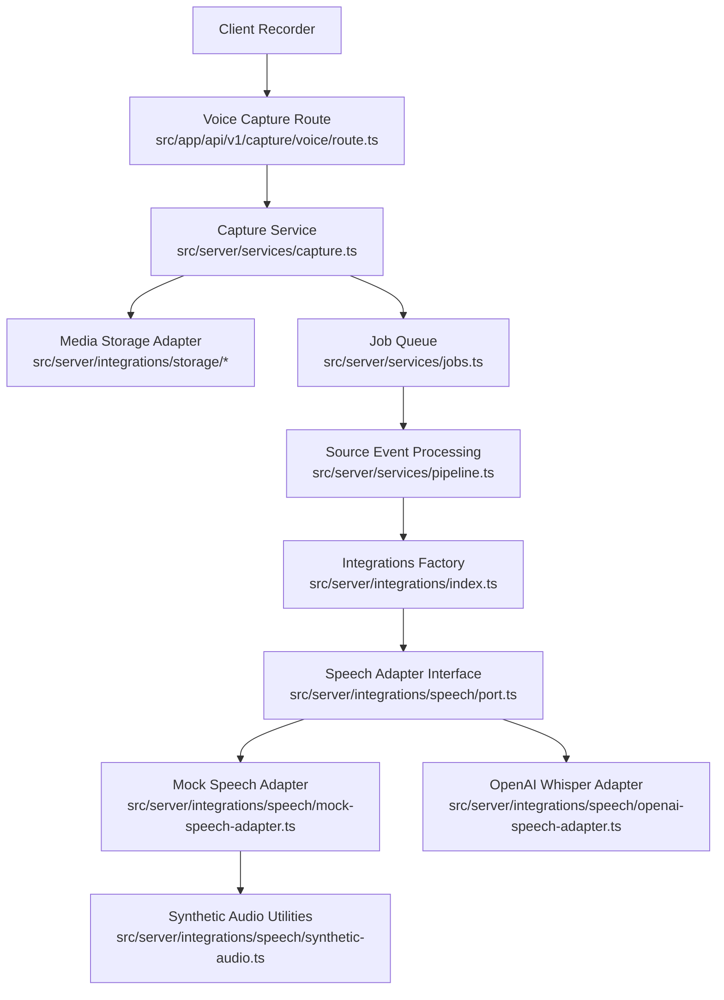
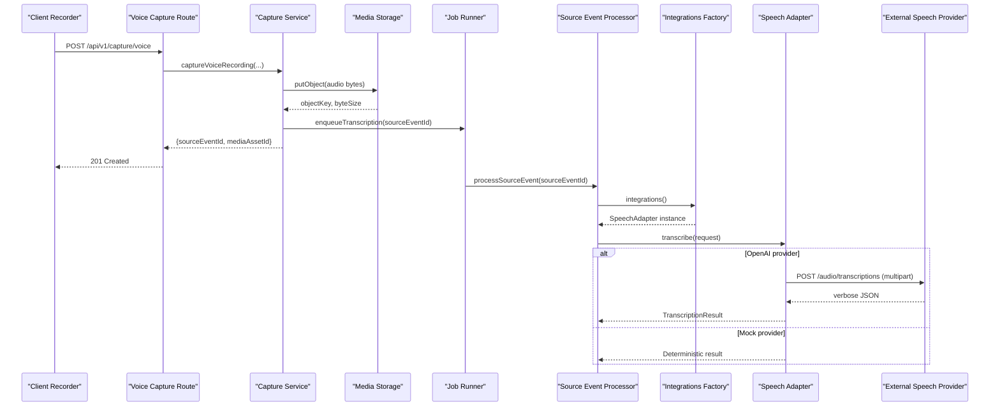
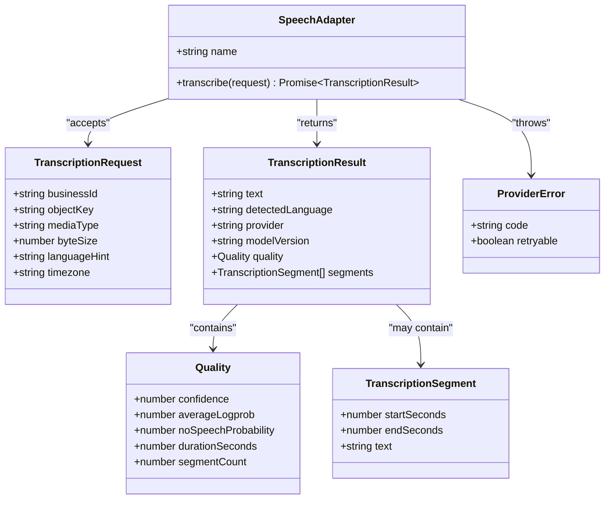
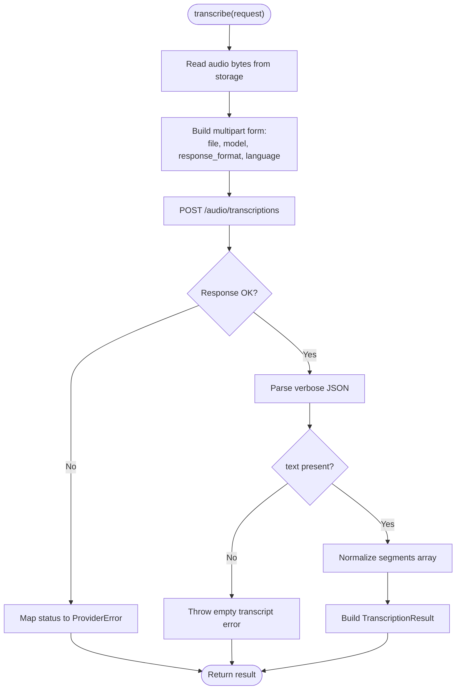
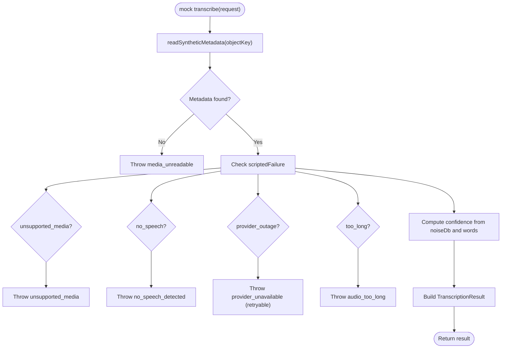
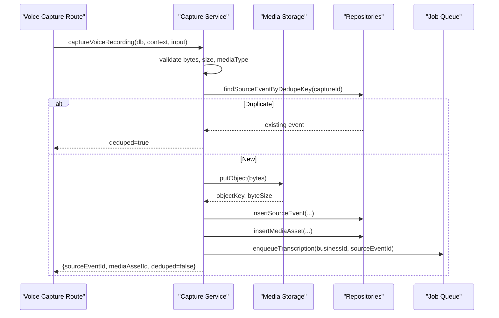
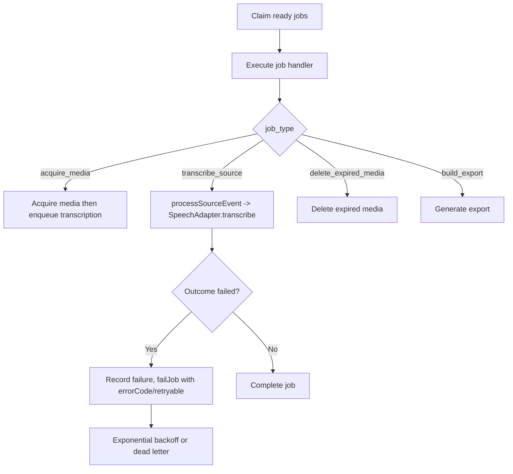
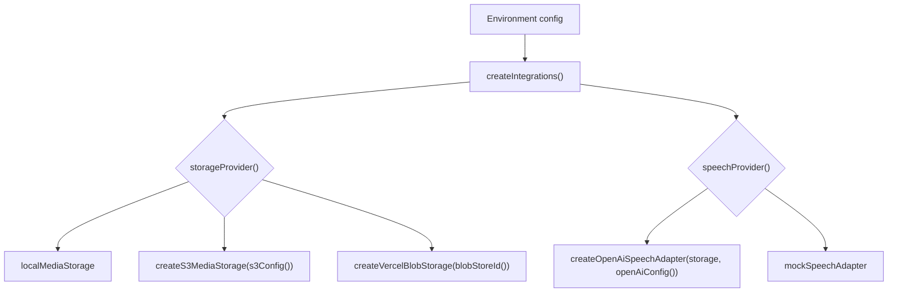
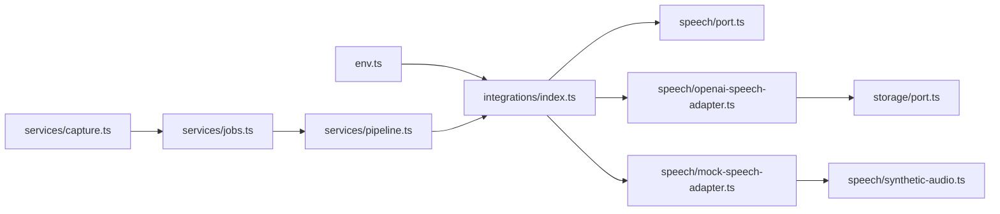

# Speech-to-Text Transcription

<cite>
**Referenced Files in This Document**
- [port.ts](file://src/server/integrations/speech/port.ts)
- [openai-speech-adapter.ts](file://src/server/integrations/speech/openai-speech-adapter.ts)
- [mock-speech-adapter.ts](file://src/server/integrations/speech/mock-speech-adapter.ts)
- [synthetic-audio.ts](file://src/server/integrations/speech/synthetic-audio.ts)
- [route.ts](file://src/app/api/v1/capture/voice/route.ts)
- [capture.ts](file://src/server/services/capture.ts)
- [jobs.ts](file://src/server/services/jobs.ts)
- [index.ts](file://src/server/integrations/index.ts)
- [env.ts](file://src/server/config/env.ts)
- [provider-error.ts](file://src/server/integrations/provider-error.ts)
</cite>

## Table of Contents
1. [Introduction](#introduction)
2. [Project Structure](#project-structure)
3. [Core Components](#core-components)
4. [Architecture Overview](#architecture-overview)
5. [Detailed Component Analysis](#detailed-component-analysis)
6. [Dependency Analysis](#dependency-analysis)
7. [Performance Considerations](#performance-considerations)
8. [Troubleshooting Guide](#troubleshooting-guide)
9. [Privacy and Data Retention](#privacy-and-data-retention)
10. [Configuration Reference](#configuration-reference)
11. [Conclusion](#conclusion)

## Introduction
This document explains the speech-to-text transcription service that converts voice notes into machine-readable text. The system accepts audio recordings, stores them privately, enqueues a durable transcription job, and uses an adapter pattern to support different speech recognition providers. The default development path uses a mock adapter with synthetic audio, while production can use OpenAI Whisper through a managed provider configuration.

The documentation covers:
- Adapter pattern design for pluggable speech providers
- Audio intake, validation, and private storage
- Language detection and transcript quality signals
- Provider integration, error handling, and retry behavior
- Mock adapter and synthetic audio generation for testing
- Privacy considerations and retention policy integration

## Project Structure
The transcription feature spans API routing, service orchestration, durable jobs, and provider adapters:

**Diagram sources**
- [route.ts:1-84](file://src/app/api/v1/capture/voice/route.ts#L1-L84)
- [capture.ts:1-147](file://src/server/services/capture.ts#L1-L147)
- [jobs.ts:1-241](file://src/server/services/jobs.ts#L1-L241)
- [index.ts:1-93](file://src/server/integrations/index.ts#L1-L93)
- [port.ts:1-45](file://src/server/integrations/speech/port.ts#L1-L45)
- [mock-speech-adapter.ts:1-69](file://src/server/integrations/speech/mock-speech-adapter.ts#L1-L69)
- [openai-speech-adapter.ts:1-102](file://src/server/integrations/speech/openai-speech-adapter.ts#L1-L102)
- [synthetic-audio.ts:1-101](file://src/server/integrations/speech/synthetic-audio.ts#L1-L101)

**Section sources**
- [route.ts:1-84](file://src/app/api/v1/capture/voice/route.ts#L1-L84)
- [capture.ts:1-147](file://src/server/services/capture.ts#L1-L147)
- [jobs.ts:1-241](file://src/server/services/jobs.ts#L1-L241)
- [index.ts:1-93](file://src/server/integrations/index.ts#L1-L93)

## Core Components
- Speech adapter interface defines the contract for transcription requests, results, segments, and errors.
- OpenAI Whisper adapter reads audio from private storage, uploads it as multipart form data, normalizes verbose JSON output, and maps provider errors to retryable or non-retryable failures.
- Mock speech adapter provides deterministic local transcription using synthetic metadata, including confidence scoring and segment simulation.
- Synthetic audio utilities generate valid WAV files and sidecar metadata for local testing without sending merchant audio externally.
- Voice capture route validates incoming audio, persists it privately, records source events, and enqueues transcription jobs.
- Job runner executes transcription jobs with idempotency keys and exponential backoff based on provider error classification.

**Section sources**
- [port.ts:1-45](file://src/server/integrations/speech/port.ts#L1-L45)
- [openai-speech-adapter.ts:1-102](file://src/server/integrations/speech/openai-speech-adapter.ts#L1-L102)
- [mock-speech-adapter.ts:1-69](file://src/server/integrations/speech/mock-speech-adapter.ts#L1-L69)
- [synthetic-audio.ts:1-101](file://src/server/integrations/speech/synthetic-audio.ts#L1-L101)
- [route.ts:1-84](file://src/app/api/v1/capture/voice/route.ts#L1-L84)
- [capture.ts:1-147](file://src/server/services/capture.ts#L1-L147)
- [jobs.ts:1-241](file://src/server/services/jobs.ts#L1-L241)

## Architecture Overview
The transcription pipeline separates HTTP intake from processing to keep responses fast and resilient:

**Diagram sources**
- [route.ts:33-83](file://src/app/api/v1/capture/voice/route.ts#L33-L83)
- [capture.ts:67-145](file://src/server/services/capture.ts#L67-L145)
- [jobs.ts:76-94](file://src/server/services/jobs.ts#L76-L94)
- [index.ts:41-70](file://src/server/integrations/index.ts#L41-L70)
- [openai-speech-adapter.ts:42-100](file://src/server/integrations/speech/openai-speech-adapter.ts#L42-L100)

## Detailed Component Analysis

### Speech Adapter Contract
The speech adapter contract defines:
- `TranscriptionRequest`: business context, stored object key, media type, size, optional language hint, and timezone.
- `TranscriptionResult`: normalized text, detected language, provider name, model version, quality metrics, and optional segments.
- `TranscriptionSegment`: start/end timestamps and text per segment.
- Error propagation via `ProviderError`, which carries a code and a retryable flag.

**Diagram sources**
- [port.ts:9-45](file://src/server/integrations/speech/port.ts#L9-L45)
- [provider-error.ts:1-19](file://src/server/integrations/provider-error.ts#L1-L19)

**Section sources**
- [port.ts:1-45](file://src/server/integrations/speech/port.ts#L1-L45)
- [provider-error.ts:1-19](file://src/server/integrations/provider-error.ts#L1-L19)

### OpenAI Whisper Adapter
Responsibilities:
- Reads audio bytes from private storage using the configured storage adapter.
- Uploads audio as multipart form data with model selection and verbose JSON response format.
- Normalizes provider response fields into the shared `TranscriptionResult` shape.
- Maps HTTP status codes and network errors to `ProviderError` with appropriate retryability.

Key behaviors:
- Language hint is trimmed to two characters and lowercased before being sent.
- Empty transcripts are rejected with a non-retryable error.
- Segments are validated and filtered; only well-formed entries are included.
- Quality metrics include duration and segment count; additional fields like confidence are not provided by this adapter.

**Diagram sources**
- [openai-speech-adapter.ts:42-100](file://src/server/integrations/speech/openai-speech-adapter.ts#L42-L100)

**Section sources**
- [openai-speech-adapter.ts:1-102](file://src/server/integrations/speech/openai-speech-adapter.ts#L1-L102)

### Mock Speech Adapter
Responsibilities:
- Provides deterministic local transcription for synthetic audio created by the simulator.
- Reads synthetic metadata from a sidecar file associated with the object key.
- Simulates failure modes such as unsupported media, no speech, provider outage, and too-long audio.
- Computes explainable confidence scores based on noise level and word count.

Quality signals:
- Confidence score is bounded between 0.35 and 0.97.
- No-speech probability is derived from confidence.
- Segment count is estimated from duration.

**Diagram sources**
- [mock-speech-adapter.ts:16-68](file://src/server/integrations/speech/mock-speech-adapter.ts#L16-L68)
- [synthetic-audio.ts:89-97](file://src/server/integrations/speech/synthetic-audio.ts#L89-L97)

**Section sources**
- [mock-speech-adapter.ts:1-69](file://src/server/integrations/speech/mock-speech-adapter.ts#L1-L69)
- [synthetic-audio.ts:1-101](file://src/server/integrations/speech/synthetic-audio.ts#L1-L101)

### Synthetic Audio Generation
Capabilities:
- Generates a short valid WAV file at a fixed sample rate.
- Stores audio bytes in private storage via the local storage adapter.
- Writes a sidecar metadata file containing transcript, language, duration, noise level, and optional scripted failure flags.
- Provides checksum utility for generated audio buffers.

Use cases:
- Enables local review screens to play real audio.
- Allows tests to simulate various transcription outcomes deterministically.

**Section sources**
- [synthetic-audio.ts:1-101](file://src/server/integrations/speech/synthetic-audio.ts#L1-L101)

### Voice Capture Route and Service
Route responsibilities:
- Validates multipart form fields and audio presence.
- Enforces maximum capture size.
- Parses optional recorded timestamp.
- Delegates to the capture service and optionally drains due jobs so drafts appear quickly.

Service responsibilities:
- Validates input bytes, size, and media type.
- Deduplicates captures per client-provided captureId.
- Persists audio to private storage before recording source events.
- Records source event and media asset metadata.
- Enqueues transcription job exactly once.

**Diagram sources**
- [route.ts:33-83](file://src/app/api/v1/capture/voice/route.ts#L33-L83)
- [capture.ts:67-145](file://src/server/services/capture.ts#L67-L145)

**Section sources**
- [route.ts:1-84](file://src/app/api/v1/capture/voice/route.ts#L1-L84)
- [capture.ts:1-147](file://src/server/services/capture.ts#L1-L147)

### Job Runner and Transcription Execution
Responsibilities:
- Claims ready jobs atomically and executes handlers with run records.
- Classifies errors as retryable or not using `ProviderError`.
- Applies exponential backoff and dead-lettering when retries are exhausted.
- Ensures transcription runs only after media is durably acquired.

Transcription flow:
- `enqueueTranscription` creates an idempotent job keyed by source event ID.
- `executeJob` dispatches to `processSourceEvent`, which resolves the active speech adapter and calls `transcribe`.

**Diagram sources**
- [jobs.ts:35-49](file://src/server/services/jobs.ts#L35-L49)
- [jobs.ts:51-139](file://src/server/services/jobs.ts#L51-L139)
- [jobs.ts:195-241](file://src/server/services/jobs.ts#L195-L241)

**Section sources**
- [jobs.ts:1-241](file://src/server/services/jobs.ts#L1-L241)

### Integrations Factory and Adapter Selection
Responsibilities:
- Selects storage, speech, extraction, and WhatsApp adapters based on environment configuration.
- Caches the integrations instance for the process lifetime.
- Exposes an override mechanism for tests to swap adapters.

Speech adapter selection:
- If `DAFTARI_SPEECH_PROVIDER=openai`, constructs OpenAI Whisper adapter with storage and config.
- Otherwise, uses the mock speech adapter.

**Diagram sources**
- [index.ts:41-70](file://src/server/integrations/index.ts#L41-L70)
- [env.ts:146-168](file://src/server/config/env.ts#L146-L168)

**Section sources**
- [index.ts:1-93](file://src/server/integrations/index.ts#L1-L93)
- [env.ts:134-168](file://src/server/config/env.ts#L134-L168)

## Dependency Analysis
The transcription subsystem depends on:
- Private media storage for secure audio persistence.
- Durable job queue for asynchronous processing.
- Environment configuration for provider selection and credentials.
- Provider error classification for retry strategy.

**Diagram sources**
- [env.ts:134-168](file://src/server/config/env.ts#L134-L168)
- [index.ts:1-93](file://src/server/integrations/index.ts#L1-L93)
- [openai-speech-adapter.ts:1-102](file://src/server/integrations/speech/openai-speech-adapter.ts#L1-L102)
- [mock-speech-adapter.ts:1-69](file://src/server/integrations/speech/mock-speech-adapter.ts#L1-L69)
- [synthetic-audio.ts:1-101](file://src/server/integrations/speech/synthetic-audio.ts#L1-L101)
- [capture.ts:1-147](file://src/server/services/capture.ts#L1-L147)
- [jobs.ts:1-241](file://src/server/services/jobs.ts#L1-L241)

**Section sources**
- [env.ts:134-168](file://src/server/config/env.ts#L134-L168)
- [index.ts:1-93](file://src/server/integrations/index.ts#L1-L93)
- [capture.ts:1-147](file://src/server/services/capture.ts#L1-L147)
- [jobs.ts:1-241](file://src/server/services/jobs.ts#L1-L241)

## Performance Considerations
- Keep HTTP intake synchronous and lightweight: store audio and enqueue jobs immediately.
- Use multipart upload directly to the provider to avoid unnecessary buffering beyond what is required.
- Prefer verbose JSON only when needed; it enables richer quality metrics but increases payload size.
- Limit concurrent transcription jobs through the job runner’s claim limit to control provider load.
- Tune model selection via configuration to balance accuracy and latency.
- Avoid logging sensitive audio content or object keys; rely on structured logs with redacted payloads.

[No sources needed since this section provides general guidance]

## Troubleshooting Guide
Common issues and resolutions:
- Authentication failures with OpenAI: check API key and base URL configuration; these map to non-retryable authentication errors.
- Rejected audio formats: ensure supported media types and sizes; the capture service enforces allowed MIME types and maximum bytes.
- Empty transcripts: the provider may return no speech; the adapter throws a non-retryable empty transcript error.
- Provider outages: transient HTTP statuses are classified as retryable; the job runner will retry with backoff.
- Mock adapter limitations: synthetic metadata must exist; otherwise, the adapter reports unreadable media.

Error classification:
- `ProviderError.code` identifies the failure category.
- `ProviderError.retryable` determines whether the job runner should retry or move to dead letter.

**Section sources**
- [openai-speech-adapter.ts:14-24](file://src/server/integrations/speech/openai-speech-adapter.ts#L14-L24)
- [capture.ts:27-49](file://src/server/services/capture.ts#L27-L49)
- [jobs.ts:35-49](file://src/server/services/jobs.ts#L35-L49)
- [mock-speech-adapter.ts:19-44](file://src/server/integrations/speech/mock-speech-adapter.ts#L19-L44)

## Privacy and Data Retention
- Audio is stored in private storage and never logged; object keys remain server-side.
- The OpenAI adapter sends audio bytes to the provider but does not log secrets or keys.
- Media retention deadlines are attached to media assets and processed by the retention job.
- Synthetic metadata is written with restrictive file permissions and is only read by the mock adapter.
- Reviewers complete proposals manually when extraction is disabled, avoiding model access to merchant transcripts.

**Section sources**
- [openai-speech-adapter.ts:1-7](file://src/server/integrations/speech/openai-speech-adapter.ts#L1-L7)
- [capture.ts:117-126](file://src/server/services/capture.ts#L117-L126)
- [synthetic-audio.ts:77-86](file://src/server/integrations/speech/synthetic-audio.ts#L77-L86)
- [env.ts:137-148](file://src/server/config/env.ts#L137-L148)

## Configuration Reference
Environment variables relevant to speech transcription:

- `DAFTARI_SPEECH_PROVIDER`: selects speech provider (`mock` or `openai`). Default is `mock`.
- `OPENAI_API_KEY`: required when using OpenAI speech or extraction provider.
- `OPENAI_BASE_URL`: base URL for OpenAI-compatible endpoints; defaults to the official API base.
- `OPENAI_TRANSCRIBE_MODEL`: model used for transcription; defaults to `whisper-1`.
- `OPENAI_EXTRACTION_MODEL`: model used for extraction; defaults to `gpt-4o-mini`.
- `DAFTARI_MEDIA_SIGNING_SECRET`: required for signed media links in managed deployments.
- `DAFTARI_STORAGE_PROVIDER`: selects storage backend (`local`, `s3`, `blob`).
- `S3_*` variables: configure S3 storage if selected.
- `BLOB_STORE_ID`: required for Vercel Blob storage.

Notes:
- Missing required variables fail fast during configuration loading.
- Provider selection is centralized in the integrations factory; feature code does not branch on environment flags.
- The default is always the offline/local adapter unless explicitly configured otherwise.

**Section sources**
- [env.ts:134-168](file://src/server/config/env.ts#L134-L168)
- [env.ts:87-132](file://src/server/config/env.ts#L87-L132)
- [index.ts:41-70](file://src/server/integrations/index.ts#L41-L70)

## Conclusion
The transcription service implements a robust adapter pattern that cleanly separates provider-specific logic from application code. It prioritizes privacy by storing audio privately, avoids logging sensitive data, and integrates with durable job processing for resilience. The mock adapter and synthetic audio utilities enable comprehensive local testing, while the OpenAI Whisper adapter supports production-grade transcription with clear error classification and retry semantics. Configuration is explicit and safe-by-default, ensuring that missing credentials fail fast and that the system remains under manual control until providers are intentionally enabled.