# Voice Recording & Processing Pipeline

<cite>
**Referenced Files in This Document**
- [route.ts](file://src/app/api/v1/webhooks/whatsapp/route.ts)
- [route.ts](file://src/app/api/v1/capture/voice/route.ts)
- [ingestion.ts](file://src/server/services/ingestion.ts)
- [capture.ts](file://src/server/services/capture.ts)
- [media-acquisition.ts](file://src/server/services/media-acquisition.ts)
- [pipeline.ts](file://src/server/services/pipeline.ts)
- [port.ts](file://src/server/integrations/speech/port.ts)
- [openai-speech-adapter.ts](file://src/server/integrations/speech/openai-speech-adapter.ts)
- [mock-speech-adapter.ts](file://src/server/integrations/speech/mock-speech-adapter.ts)
- [port.ts](file://src/server/integrations/extraction/port.ts)
- [openai-extraction-adapter.ts](file://src/server/integrations/extraction/openai-extraction-adapter.ts)
- [manual-draft-adapter.ts](file://src/server/integrations/extraction/manual-draft-adapter.ts)
- [port.ts](file://src/server/integrations/storage/port.ts)
- [s3-storage-adapter.ts](file://src/server/integrations/storage/s3-storage-adapter.ts)
- [local-storage-adapter.ts](file://src/server/integrations/storage/local-storage-adapter.ts)
- [vercel-blob-storage-adapter.ts](file://src/server/integrations/storage/vercel-blob-storage-adapter.ts)
</cite>

## Table of Contents
1. [Introduction](#introduction)
2. [Project Structure](#project-structure)
3. [Core Components](#core-components)
4. [Architecture Overview](#architecture-overview)
5. [Detailed Component Analysis](#detailed-component-analysis)
6. [Dependency Analysis](#dependency-analysis)
7. [Performance Considerations](#performance-considerations)
8. [Troubleshooting Guide](#troubleshooting-guide)
9. [Conclusion](#conclusion)

## Introduction
This document explains the end-to-end pipeline that turns WhatsApp voice notes and in-app voice recordings into business proposals. The system separates durable ingestion from asynchronous processing so webhook responses are fast, provider failures do not lose messages, and retries are safe.

The workflow is:
- Ingest a signed WhatsApp webhook or accept an in-app audio upload.
- Persist a redacted source event and either store media immediately or enqueue a separate acquisition job for provider-hosted references.
- Transcribe audio through a speech adapter or reuse text already provided by the platform.
- Extract structured business intent using an extraction adapter.
- Create a reviewable proposal with validation issues, missing fields, duplicate candidates, and field-level provenance.
- Emit an outbox event for downstream consumers.

The pipeline never posts directly to the ledger; it stops at a proposal that requires human confirmation.

## Project Structure
The voice recording and processing pipeline spans API routes, services, integration adapters, and storage backends:

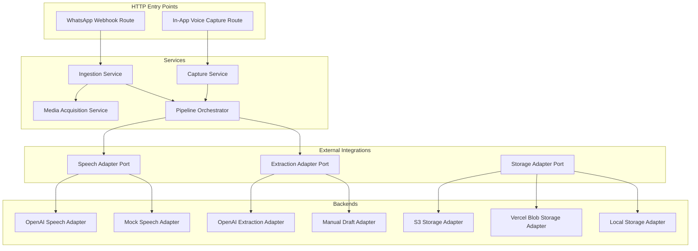

**Diagram sources**
- [route.ts:33-67](file://src/app/api/v1/webhooks/whatsapp/route.ts#L33-L67)
- [route.ts:33-82](file://src/app/api/v1/capture/voice/route.ts#L33-L82)
- [ingestion.ts:66-207](file://src/server/services/ingestion.ts#L66-L207)
- [capture.ts:67-145](file://src/server/services/capture.ts#L67-L145)
- [media-acquisition.ts:42-100](file://src/server/services/media-acquisition.ts#L42-L100)
- [pipeline.ts:354-503](file://src/server/services/pipeline.ts#L354-L503)
- [port.ts:42-44](file://src/server/integrations/speech/port.ts#L42-L44)
- [port.ts:34-37](file://src/server/integrations/extraction/port.ts#L34-L37)
- [port.ts:20-33](file://src/server/integrations/storage/port.ts#L20-L33)
- [openai-speech-adapter.ts:42-100](file://src/server/integrations/speech/openai-speech-adapter.ts#L42-L100)
- [mock-speech-adapter.ts:16-68](file://src/server/integrations/speech/mock-speech-adapter.ts#L16-L68)
- [openai-extraction-adapter.ts:131-221](file://src/server/integrations/extraction/openai-extraction-adapter.ts#L131-L221)
- [manual-draft-adapter.ts:23-49](file://src/server/integrations/extraction/manual-draft-adapter.ts#L23-L49)
- [s3-storage-adapter.ts:19-99](file://src/server/integrations/storage/s3-storage-adapter.ts#L19-L99)
- [vercel-blob-storage-adapter.ts:21-69](file://src/server/integrations/storage/vercel-blob-storage-adapter.ts#L21-L69)
- [local-storage-adapter.ts:26-65](file://src/server/integrations/storage/local-storage-adapter.ts#L26-L65)

**Section sources**
- [route.ts:33-67](file://src/app/api/v1/webhooks/whatsapp/route.ts#L33-L67)
- [route.ts:33-82](file://src/app/api/v1/capture/voice/route.ts#L33-L82)
- [ingestion.ts:1-13](file://src/server/services/ingestion.ts#L1-L13)
- [capture.ts:1-11](file://src/server/services/capture.ts#L1-L11)
- [media-acquisition.ts:1-12](file://src/server/services/media-acquisition.ts#L1-L12)
- [pipeline.ts:1-10](file://src/server/services/pipeline.ts#L1-L10)

## Core Components
- WhatsApp webhook route: authenticates provider signatures, reconstructs the public request URL, delegates to ingestion, and returns acceptance status.
- Ingestion service: verifies signature, parses the provider event, validates the connected WhatsApp account, deduplicates by provider event ID, persists a redacted source event, stores or links media, records audit events, and enqueues either media acquisition or transcription.
- In-app capture service: validates size and format, idempotently stores audio bytes, creates a source event and media asset, and enqueues transcription.
- Media acquisition service: downloads provider-hosted media into private storage, records the media asset, and remains idempotent per source event.
- Pipeline orchestrator: runs one source event through transcript lookup or transcription, AI extraction, validation, duplicate detection, proposal creation, state decision, audit logging, and outbox emission.

Key design principles:
- Acceptance is durable before processing begins.
- Provider calls are asynchronous.
- All critical writes are transactional where appropriate.
- Duplicate handling prevents double work.
- Audit trails record received, failed, and created states.

**Section sources**
- [route.ts:33-67](file://src/app/api/v1/webhooks/whatsapp/route.ts#L33-L67)
- [ingestion.ts:66-207](file://src/server/services/ingestion.ts#L66-L207)
- [capture.ts:67-145](file://src/server/services/capture.ts#L67-L145)
- [media-acquisition.ts:42-100](file://src/server/services/media-acquisition.ts#L42-L100)
- [pipeline.ts:354-503](file://src/server/services/pipeline.ts#L354-L503)

## Architecture Overview
The architecture isolates untrusted external input from business logic through strict authentication, parsing, and redaction. Audio bytes never appear in webhook payloads; only metadata and secure references are persisted.

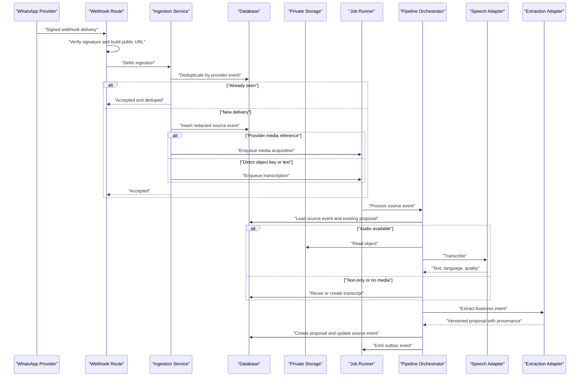

**Diagram sources**
- [route.ts:33-67](file://src/app/api/v1/webhooks/whatsapp/route.ts#L33-L67)
- [ingestion.ts:66-207](file://src/server/services/ingestion.ts#L66-L207)
- [media-acquisition.ts:42-100](file://src/server/services/media-acquisition.ts#L42-L100)
- [pipeline.ts:287-346](file://src/server/services/pipeline.ts#L287-L346)
- [pipeline.ts:354-503](file://src/server/services/pipeline.ts#L354-L503)
- [openai-speech-adapter.ts:52-99](file://src/server/integrations/speech/openai-speech-adapter.ts#L52-L99)
- [openai-extraction-adapter.ts:141-221](file://src/server/integrations/extraction/openai-extraction-adapter.ts#L141-L221)

## Detailed Component Analysis

### WhatsApp Webhook Ingestion
The webhook endpoint is public but defensive:
- It checks whether WhatsApp ingestion is enabled.
- It reads raw body, signature header, optional timestamp, and content type.
- It reconstructs the absolute URL used by providers such as Twilio.
- It delegates all business logic to the ingestion service.
- It logs acceptance and returns different HTTP statuses for new versus deduplicated deliveries.

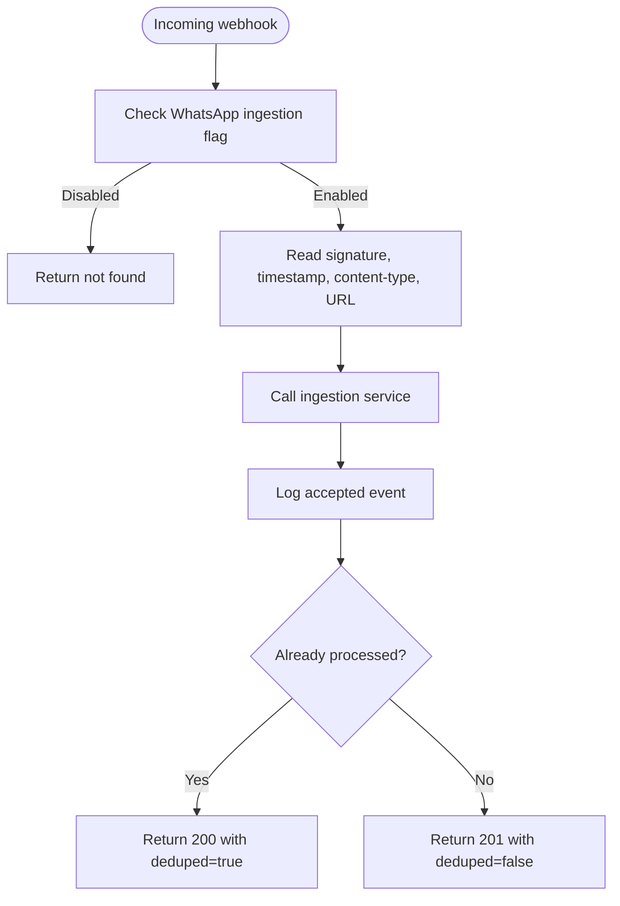

**Diagram sources**
- [route.ts:33-67](file://src/app/api/v1/webhooks/whatsapp/route.ts#L33-L67)

**Section sources**
- [route.ts:1-69](file://src/app/api/v1/webhooks/whatsapp/route.ts#L1-L69)

### Ingestion Service
The ingestion service is the security and durability boundary for WhatsApp deliveries:
- Signature verification rejects invalid requests.
- Event parsing converts raw provider data into a normalized message.
- Account lookup ensures the delivery belongs to a connected WhatsApp integration.
- Business lookup ensures the tenant is active.
- Deduplication uses the provider event ID so resubmissions are harmless.
- Redacted payload storage avoids persisting sensitive message bodies.
- Voice messages with provider-hosted media enqueue a media acquisition job; otherwise, transcription is queued.
- Text-only messages receive an immediate transcript row.
- Audit events record receipt, queue choice, sender, and media presence.

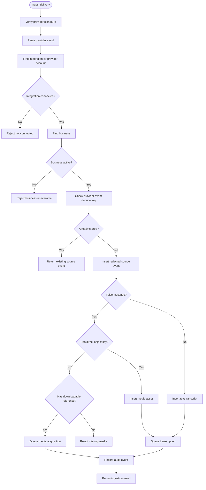

**Diagram sources**
- [ingestion.ts:66-207](file://src/server/services/ingestion.ts#L66-L207)

**Section sources**
- [ingestion.ts:1-217](file://src/server/services/ingestion.ts#L1-L217)

### In-App Voice Capture
The in-app capture endpoint accepts multipart audio uploads from the dashboard:
- It requires a tenant context and permission to capture records.
- It validates the file field, empty size, maximum size, and form fields.
- It delegates to the capture service.
- It attempts to run due jobs once so reviewers can see a draft quickly, but does not fail the capture if processing cannot start.

The capture service:
- Enforces maximum byte size and allowed MIME types.
- Uses a client-provided `captureId` for idempotency.
- Stores audio bytes first, then writes database rows inside a transaction.
- Records a source event and media asset.
- Enqueues transcription and audit events.

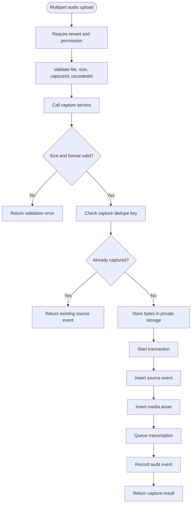

**Diagram sources**
- [route.ts:33-82](file://src/app/api/v1/capture/voice/route.ts#L33-L82)
- [capture.ts:67-145](file://src/server/services/capture.ts#L67-L145)

**Section sources**
- [route.ts:1-84](file://src/app/api/v1/capture/voice/route.ts#L1-L84)
- [capture.ts:1-147](file://src/server/services/capture.ts#L1-L147)

### Media Acquisition for Different Backends
When a provider sends only a temporary media reference, the acquisition service:
- Loads the source event and checks for an existing media asset.
- Reads the redacted payload for the provider media reference.
- Calls the WhatsApp adapter’s media fetch method.
- Stores the downloaded bytes in private storage.
- Inserts a media asset with retention deadline, checksum, duration, and metadata.
- Returns idempotent outcomes: acquired, already acquired, or failed with retryability.

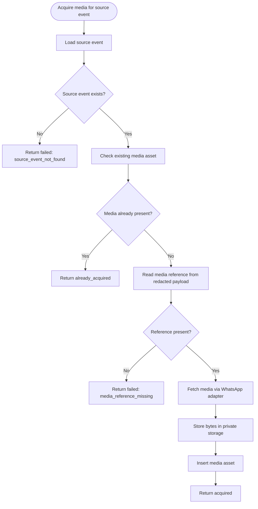

**Diagram sources**
- [media-acquisition.ts:42-100](file://src/server/services/media-acquisition.ts#L42-L100)

**Section sources**
- [media-acquisition.ts:1-102](file://src/server/services/media-acquisition.ts#L1-L102)

### Pipeline Orchestrator
The pipeline orchestrator is the single place that transforms merchant input into a reviewable proposal:
- It loads the source event and skips processing if a proposal already exists or the event is already processed.
- It marks the event as processing while working.
- It looks up or transcribes audio.
- It handles provider errors by recording failure details and marking the source event failed.
- It loads customer and item candidates for the extraction model.
- It calls the extraction adapter and catches managed-model failures.
- It maps extracted fields to normalized proposal fields with provenance.
- It computes missing fields, validation issues, duplicate candidates, and final proposal state.
- It inserts the proposal, updates the source event, records audit information, and emits an outbox event.

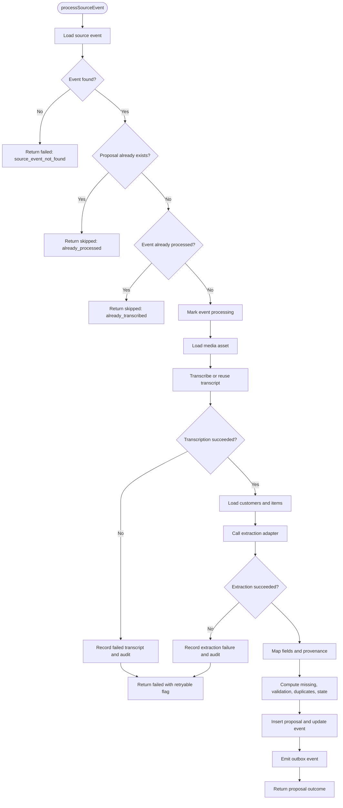

**Diagram sources**
- [pipeline.ts:354-503](file://src/server/services/pipeline.ts#L354-L503)
- [pipeline.ts:287-346](file://src/server/services/pipeline.ts#L287-L346)

**Section sources**
- [pipeline.ts:1-506](file://src/server/services/pipeline.ts#L1-L506)

### Speech Recognition Integration
The speech port defines the contract for transcription:
- Requests include business context, object key, media type, byte size, optional language hint, and timezone.
- Results include text, detected language, provider name, model version, quality metrics, and optional segments.
- Providers throw `ProviderError` with codes and retryability flags.

Implementations:
- OpenAI speech adapter reads audio from private storage, uploads it as multipart form data, normalizes verbose JSON output, and maps HTTP status codes to provider errors.
- Mock speech adapter supports deterministic development testing, including scripted failures for unsupported media, no speech, provider outage, and too-long audio.

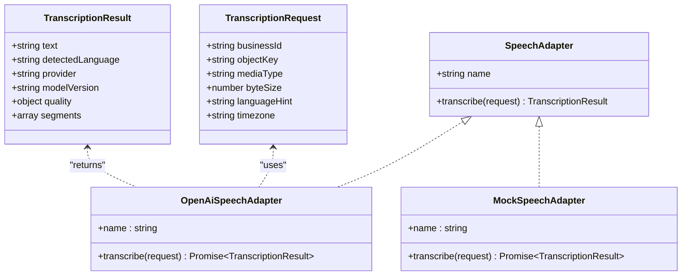

**Diagram sources**
- [port.ts:9-44](file://src/server/integrations/speech/port.ts#L9-L44)
- [openai-speech-adapter.ts:42-100](file://src/server/integrations/speech/openai-speech-adapter.ts#L42-L100)
- [mock-speech-adapter.ts:16-68](file://src/server/integrations/speech/mock-speech-adapter.ts#L16-L68)

**Section sources**
- [port.ts:1-45](file://src/server/integrations/speech/port.ts#L1-L45)
- [openai-speech-adapter.ts:1-102](file://src/server/integrations/speech/openai-speech-adapter.ts#L1-L102)
- [mock-speech-adapter.ts:1-69](file://src/server/integrations/speech/mock-speech-adapter.ts#L1-L69)

### AI Business Intent Extraction
The extraction port defines how transcripts become structured proposals:
- Requests carry transcript text, detected language, business currency and timezone, current time, candidate customers and items, and inventory capability.
- Responses are versioned proposals with intent, fields, missing fields, ambiguities, clarification requirements, and model version.
- Adapters must never post to the ledger.

Implementations:
- OpenAI extraction adapter builds a strict prompt, calls chat completions, parses and sanitizes the response, validates against the shared schema, and throws typed provider errors for auth, availability, malformed output, and validation failures.
- Manual draft adapter is used when structured extraction is disabled; it keeps the transcript as a note and forces the proposal into “needs details” so a human classifies it.

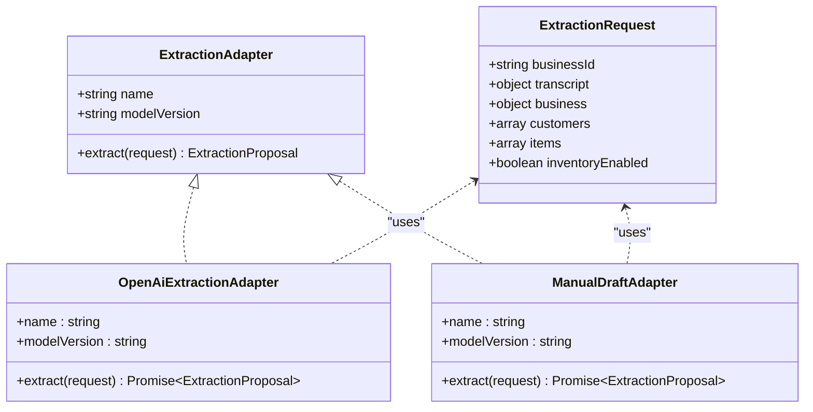

**Diagram sources**
- [port.ts:11-37](file://src/server/integrations/extraction/port.ts#L11-L37)
- [openai-extraction-adapter.ts:131-221](file://src/server/integrations/extraction/openai-extraction-adapter.ts#L131-L221)
- [manual-draft-adapter.ts:23-49](file://src/server/integrations/extraction/manual-draft-adapter.ts#L23-L49)

**Section sources**
- [port.ts:1-38](file://src/server/integrations/extraction/port.ts#L1-L38)
- [openai-extraction-adapter.ts:1-224](file://src/server/integrations/extraction/openai-extraction-adapter.ts#L1-L224)
- [manual-draft-adapter.ts:1-52](file://src/server/integrations/extraction/manual-draft-adapter.ts#L1-L52)

### Private Media Storage Backends
The storage port defines private media operations:
- Put, read, delete, signed link creation, signed link verification, and existence checks.
- Objects are never publicly exposed; access is authorized through short-lived signed links.

Backends:
- S3-compatible adapter lazily imports the AWS SDK, computes checksums, generates opaque keys, supports prefixes and server-side encryption, and delegates signed-link generation to shared logic.
- Vercel Blob adapter uses OIDC-backed credentials on Vercel, stores objects privately, and lazily imports the Blob SDK.
- Local filesystem adapter stores files under a private data directory with restrictive permissions and also provides helper functions for private exports.

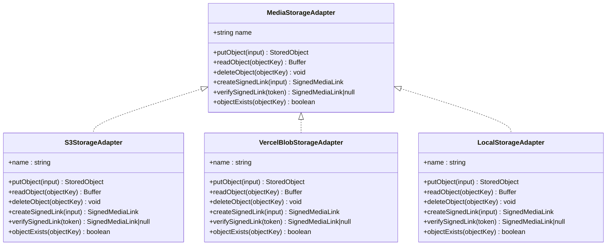

**Diagram sources**
- [port.ts:9-33](file://src/server/integrations/storage/port.ts#L9-L33)
- [s3-storage-adapter.ts:19-99](file://src/server/integrations/storage/s3-storage-adapter.ts#L19-L99)
- [vercel-blob-storage-adapter.ts:21-69](file://src/server/integrations/storage/vercel-blob-storage-adapter.ts#L21-L69)
- [local-storage-adapter.ts:26-65](file://src/server/integrations/storage/local-storage-adapter.ts#L26-L65)

**Section sources**
- [port.ts:1-34](file://src/server/integrations/storage/port.ts#L1-L34)
- [s3-storage-adapter.ts:1-101](file://src/server/integrations/storage/s3-storage-adapter.ts#L1-L101)
- [vercel-blob-storage-adapter.ts:1-72](file://src/server/integrations/storage/vercel-blob-storage-adapter.ts#L1-L72)
- [local-storage-adapter.ts:1-88](file://src/server/integrations/storage/local-storage-adapter.ts#L1-L88)

## Dependency Analysis
The pipeline depends on several layers:
- HTTP routes depend on services.
- Services depend on repositories, integrations, configuration, and observability.
- Integrations depend on external providers and storage backends.
- Storage backends are interchangeable through a common port.

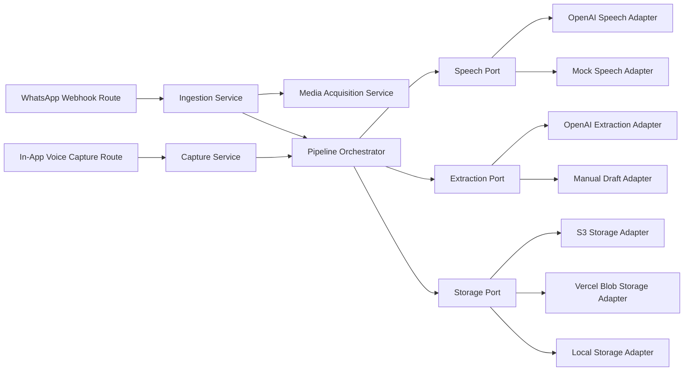

**Diagram sources**
- [route.ts:33-67](file://src/app/api/v1/webhooks/whatsapp/route.ts#L33-L67)
- [route.ts:33-82](file://src/app/api/v1/capture/voice/route.ts#L33-L82)
- [ingestion.ts:66-207](file://src/server/services/ingestion.ts#L66-L207)
- [capture.ts:67-145](file://src/server/services/capture.ts#L67-L145)
- [media-acquisition.ts:42-100](file://src/server/services/media-acquisition.ts#L42-L100)
- [pipeline.ts:354-503](file://src/server/services/pipeline.ts#L354-L503)
- [port.ts:42-44](file://src/server/integrations/speech/port.ts#L42-L44)
- [port.ts:34-37](file://src/server/integrations/extraction/port.ts#L34-L37)
- [port.ts:20-33](file://src/server/integrations/storage/port.ts#L20-L33)

**Section sources**
- [route.ts:33-67](file://src/app/api/v1/webhooks/whatsapp/route.ts#L33-L67)
- [route.ts:33-82](file://src/app/api/v1/capture/voice/route.ts#L33-L82)
- [ingestion.ts:66-207](file://src/server/services/ingestion.ts#L66-L207)
- [capture.ts:67-145](file://src/server/services/capture.ts#L67-L145)
- [media-acquisition.ts:42-100](file://src/server/services/media-acquisition.ts#L42-L100)
- [pipeline.ts:354-503](file://src/server/services/pipeline.ts#L354-L503)

## Performance Considerations
- Asynchronous processing: Webhook and capture endpoints return after durable persistence and job enqueueing, avoiding slow provider calls during ingestion.
- Concurrency safety: The pipeline is idempotent per source event; re-running it does not create duplicate transcripts or proposals.
- Transaction boundaries: Critical database writes use transactions to avoid partial state after storage or provider failures.
- Provider error classification: Transient HTTP statuses map to retryable failures so the job runner can apply backoff without losing progress.
- Storage backend selection: Lazy imports keep cold-start costs low for processes that do not use heavy SDKs.
- Media retention: Retention deadlines are computed from business settings to bound storage growth.
- Candidate loading: Customer and item lists are loaded once per pipeline run to reduce repeated queries.
- Immediate job drain in capture: The capture endpoint tries to run due jobs once to speed up reviewer visibility, but does not block on processing.

[No sources needed since this section provides general guidance]

## Troubleshooting Guide
Common processing states and their meanings:
- Skipped because already processed: A proposal already exists for the source event.
- Skipped because already transcribed: The source event was previously marked processed.
- Failed with provider error: Speech or extraction provider returned a non-retryable or retryable error; the source event is marked failed and audit entries are recorded.
- Needs details: Required fields are missing or the extraction model requested clarification.
- Duplicate: Probable duplicates were found based on amount, date, and description.
- Needs review: Fields passed validation and no duplicates were detected.

Error handling strategies:
- Invalid webhook signature: Rejected early with a signature-invalid error.
- Missing or inactive integration/business: Rejected with not-found or conflict errors.
- Missing media reference: Acquisition fails with a non-retryable code.
- Unsupported media download: Acquisition fails when the WhatsApp adapter does not support fetching media.
- Empty or rejected audio: Speech adapter throws typed provider errors indicating authentication, rejection, empty transcript, or transient unavailability.
- Malformed or invalid extraction output: Extraction adapter throws typed provider errors for auth, availability, malformed JSON, or schema validation failure.

Monitoring approaches:
- Webhook acceptance logs include source event ID, business ID, and deduplication status.
- Pipeline logs record proposal creation with business ID, proposal ID, record type, and state.
- Audit trail records source event receipt, failed transcription, processing failure, and proposal creation.
- Outbox events emit `proposal.ready` with record type and state for downstream consumers.

**Section sources**
- [route.ts:59-67](file://src/app/api/v1/webhooks/whatsapp/route.ts#L59-L67)
- [ingestion.ts:72-104](file://src/server/services/ingestion.ts#L72-L104)
- [ingestion.ts:139-185](file://src/server/services/ingestion.ts#L139-L185)
- [media-acquisition.ts:48-79](file://src/server/services/media-acquisition.ts#L48-L79)
- [pipeline.ts:354-493](file://src/server/services/pipeline.ts#L354-L493)
- [openai-speech-adapter.ts:16-24](file://src/server/integrations/speech/openai-speech-adapter.ts#L16-L24)
- [openai-extraction-adapter.ts:171-218](file://src/server/integrations/extraction/openai-extraction-adapter.ts#L171-L218)

## Conclusion
The voice recording and processing pipeline provides a secure, durable, and extensible path from WhatsApp voice notes and in-app recordings to business proposals. By separating ingestion, media acquisition, transcription, extraction, and proposal creation, the system remains responsive under load, resilient to provider failures, and auditable across every step. Storage backends and AI providers are pluggable through ports, allowing production deployments to use OpenAI and cloud storage while development and testing rely on mock implementations.

[No sources needed since this section summarizes without analyzing specific files]