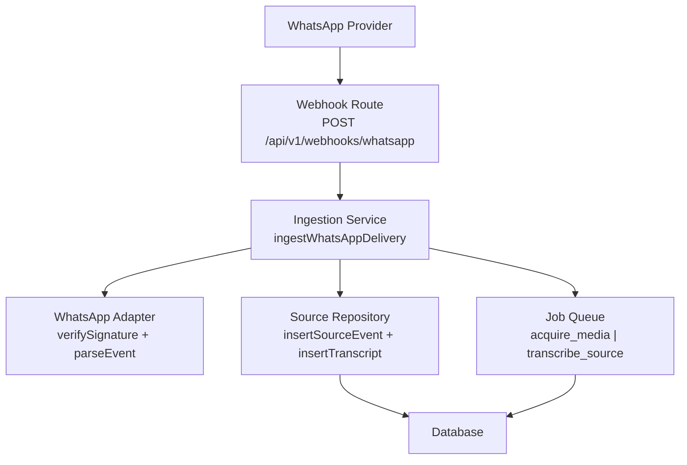
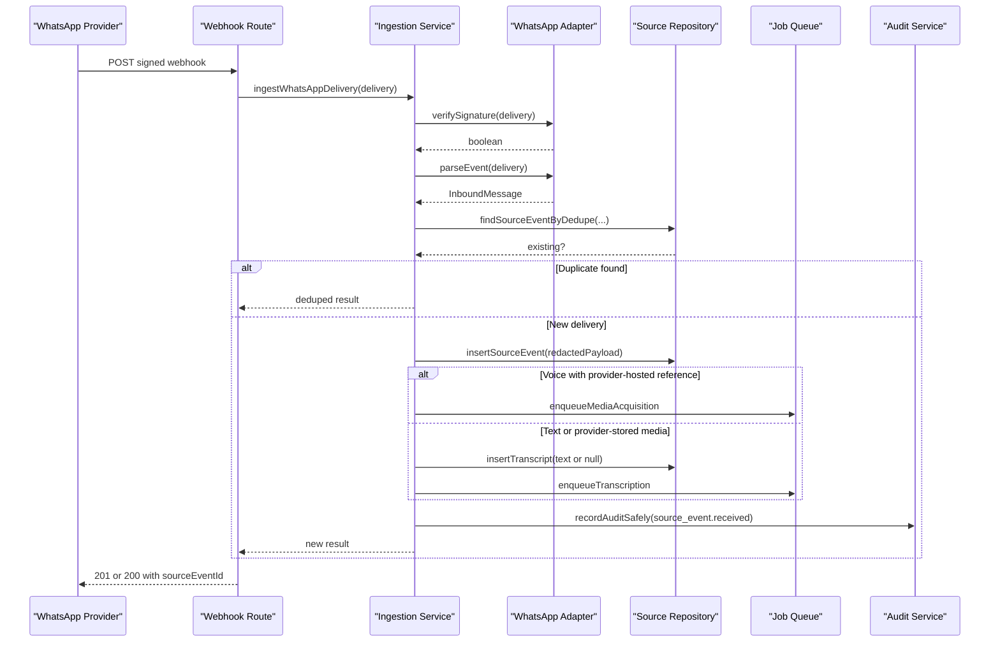
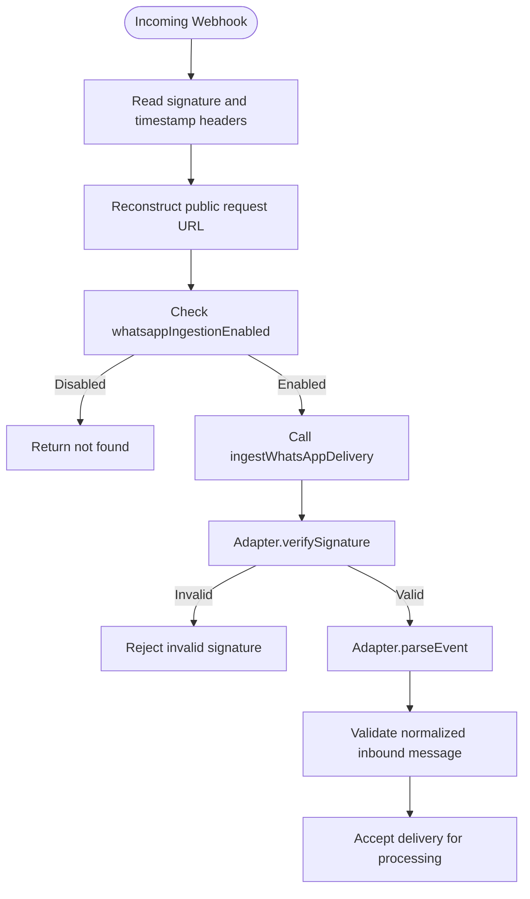
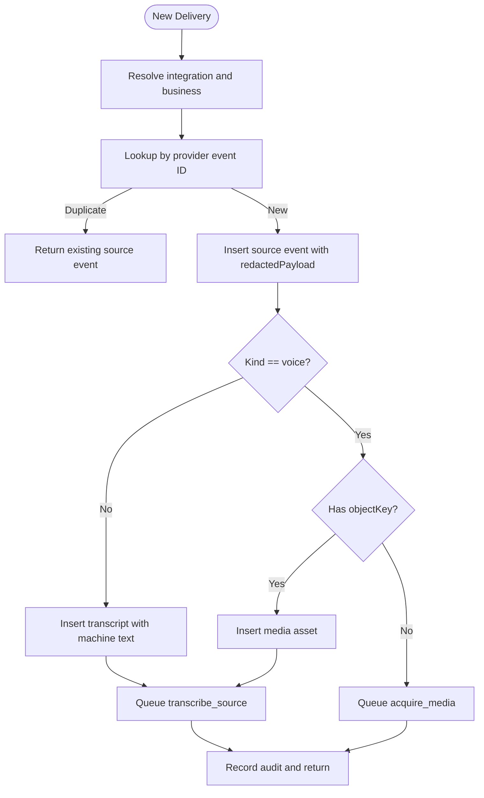
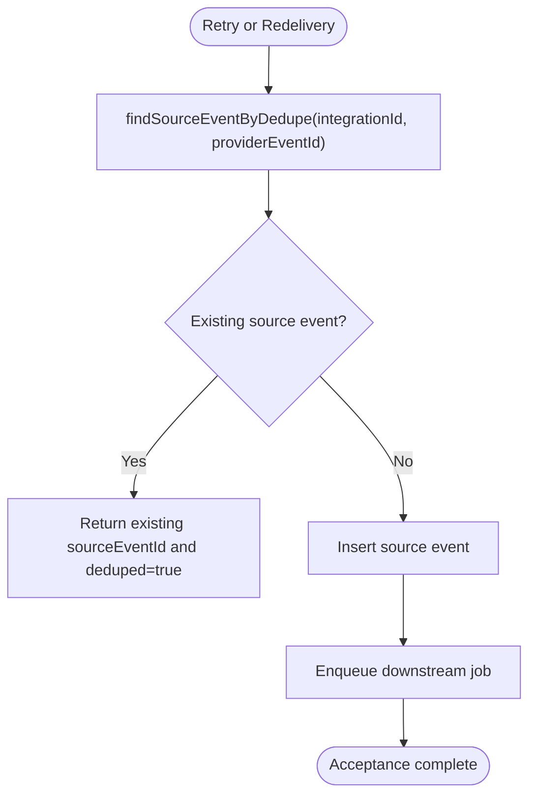
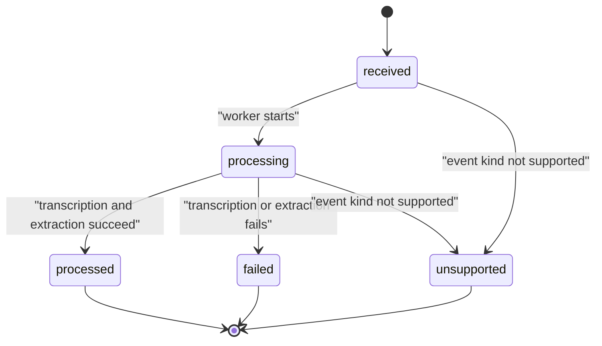
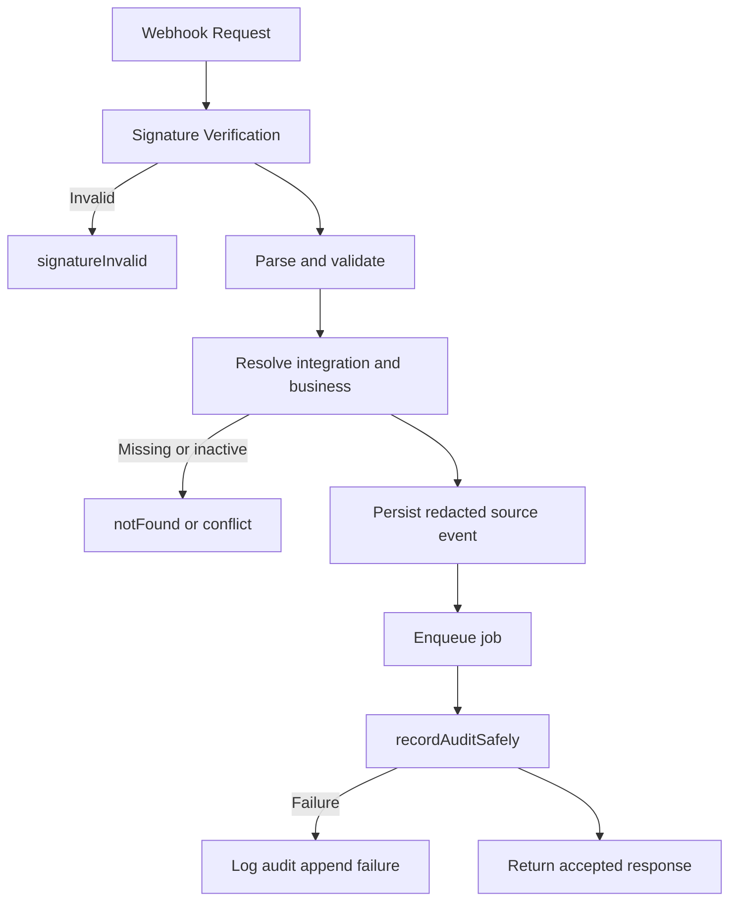
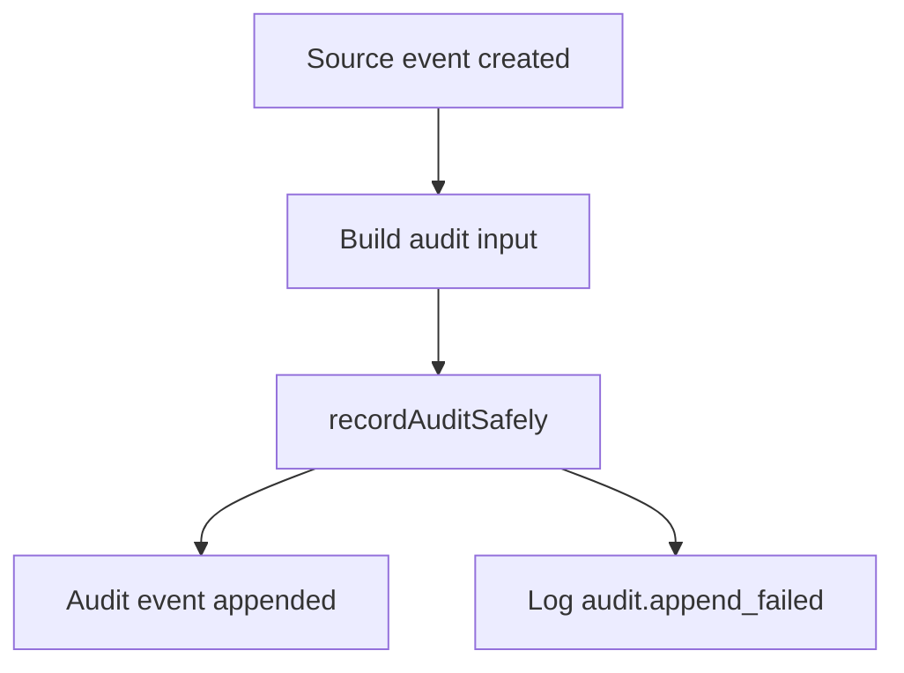
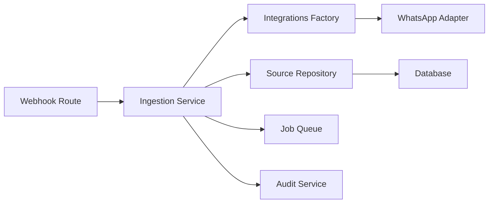

# Webhook Ingestion & Source Events

<cite>
**Referenced Files in This Document**
- [route.ts](file://src/app/api/v1/webhooks/whatsapp/route.ts)
- [ingestion.ts](file://src/server/services/ingestion.ts)
- [source.repository.ts](file://src/server/repositories/source.repository.ts)
- [port.ts](file://src/server/integrations/whatsapp/port.ts)
- [twilio-whatsapp-adapter.ts](file://src/server/integrations/whatsapp/twilio-whatsapp-adapter.ts)
- [types.ts](file://src/server/domain/types.ts)
- [audit.ts](file://src/server/services/audit.ts)
- [logger.ts](file://src/server/observability/logger.ts)
</cite>

## Table of Contents
1. [Introduction](#introduction)
2. [Project Structure](#project-structure)
3. [Core Components](#core-components)
4. [Architecture Overview](#architecture-overview)
5. [Detailed Component Analysis](#detailed-component-analysis)
6. [Dependency Analysis](#dependency-analysis)
7. [Performance Considerations](#performance-considerations)
8. [Troubleshooting Guide](#troubleshooting-guide)
9. [Conclusion](#conclusion)

## Introduction
This document explains the webhook ingestion system for incoming WhatsApp messages and voice notes. It covers how requests are authenticated, validated, deduplicated, stored with redacted metadata, and enqueued for asynchronous processing. It also documents source event lifecycle states, idempotent retry behavior, audit trail maintenance, and monitoring signals.

The design intentionally separates delivery acceptance from processing success: a webhook returns quickly once the delivery is durably stored, while transcription, media acquisition, extraction, and proposal creation run as background jobs.

## Project Structure
The webhook ingestion path spans four layers:

- HTTP route: receives the provider request, validates feature flags, reconstructs the signed URL, and delegates to ingestion.
- Ingestion service: authenticates the delivery, resolves the business account, deduplicates by provider event ID, persists a redacted source event, stores or links media, updates integration metrics, and enqueues downstream jobs.
- Repository layer: persists source events, transcripts, and media assets; provides tenant-scoped queries and status transitions.
- WhatsApp adapter port and implementation: normalizes provider payloads and verifies provider signatures.

**Diagram sources**
- [route.ts:33-68](file://src/app/api/v1/webhooks/whatsapp/route.ts#L33-L68)
- [ingestion.ts:66-207](file://src/server/services/ingestion.ts#L66-L207)
- [port.ts:71-80](file://src/server/integrations/whatsapp/port.ts#L71-L80)
- [twilio-whatsapp-adapter.ts:56-96](file://src/server/integrations/whatsapp/twilio-whatsapp-adapter.ts#L56-L96)
- [source.repository.ts:127-166](file://src/server/repositories/source.repository.ts#L127-L166)

**Section sources**
- [route.ts:1-68](file://src/app/api/v1/webhooks/whatsapp/route.ts#L1-L68)
- [ingestion.ts:1-207](file://src/server/services/ingestion.ts#L1-L207)
- [source.repository.ts:1-166](file://src/server/repositories/source.repository.ts#L1-L166)
- [port.ts:1-91](file://src/server/integrations/whatsapp/port.ts#L1-L91)
- [twilio-whatsapp-adapter.ts:1-122](file://src/server/integrations/whatsapp/twilio-whatsapp-adapter.ts#L1-L122)

## Core Components
- **Webhook route**: Validates that WhatsApp ingestion is enabled, reads signature headers, reconstructs the public request URL, and calls the ingestion service. It logs acceptance and returns either `201 Created` for new deliveries or `200 OK` when the delivery was already known.
- **Ingestion service**: Verifies the provider signature, parses the normalized inbound message, resolves the connected WhatsApp integration and its business, checks for duplicates, inserts a redacted source event, handles text vs voice paths, records integration webhook activity, enqueues jobs, and writes an audit record.
- **Source repository**: Persists source events, transcripts, and media assets. It exposes deduplication lookups, status transitions, and tenant-scoped queries.
- **WhatsApp adapter port and Twilio implementation**: Define the contract for signature verification, event parsing, and optional media fetching. The Twilio adapter supports form-encoded bodies, HMAC-SHA1 signature verification over the signed URL plus sorted parameters, and Basic-auth media downloads.
- **Audit service**: Records auditable actions with explicit tenant context and safe error handling so audit failures do not roll back the primary state change.
- **Domain types**: Define allowed source event statuses, kinds, job types, and audit actions.

**Section sources**
- [route.ts:33-68](file://src/app/api/v1/webhooks/whatsapp/route.ts#L33-L68)
- [ingestion.ts:66-207](file://src/server/services/ingestion.ts#L66-L207)
- [source.repository.ts:110-210](file://src/server/repositories/source.repository.ts#L110-L210)
- [port.ts:71-91](file://src/server/integrations/whatsapp/port.ts#L71-L91)
- [twilio-whatsapp-adapter.ts:56-122](file://src/server/integrations/whatsapp/twilio-whatsapp-adapter.ts#L56-L122)
- [audit.ts:32-79](file://src/server/services/audit.ts#L32-L79)
- [types.ts:49-62](file://src/server/domain/types.ts#L49-L62)

## Architecture Overview
The ingestion pipeline is designed for durability and idempotency:

1. The provider posts a signed webhook.
2. The route validates configuration and extracts transport metadata.
3. The ingestion service verifies the provider signature using the adapter.
4. The adapter parses the delivery into a normalized inbound message.
5. The system resolves the connected WhatsApp integration and business.
6. A duplicate check prevents reprocessing the same provider event.
7. A redacted source event is persisted inside a transaction.
8. For text messages, a transcript row is created immediately.
9. For voice messages, either a media asset is linked or a media acquisition job is queued.
10. A transcription job is queued unless media acquisition must run first.
11. Integration webhook metrics and an audit record are updated.
12. The route responds with accepted status and whether the delivery was deduplicated.

**Diagram sources**
- [route.ts:33-68](file://src/app/api/v1/webhooks/whatsapp/route.ts#L33-L68)
- [ingestion.ts:66-207](file://src/server/services/ingestion.ts#L66-L207)
- [twilio-whatsapp-adapter.ts:56-96](file://src/server/integrations/whatsapp/twilio-whatsapp-adapter.ts#L56-L96)
- [source.repository.ts:110-166](file://src/server/repositories/source.repository.ts#L110-L166)
- [audit.ts:54-66](file://src/server/services/audit.ts#L54-L66)

## Detailed Component Analysis

### Webhook Authentication and Request Validation
The webhook endpoint is public but protected by provider signature verification:

- The route reads multiple signature header variants to support different providers and local simulators.
- It reconstructs the absolute URL used by providers that sign the request URL, preferring forwarded protocol and host headers where available.
- If WhatsApp ingestion is disabled, the endpoint returns a not-found response so probes cannot distinguish a disabled endpoint from an unconfigured one.
- Signature verification is delegated to the WhatsApp adapter, which uses constant-time comparison to avoid timing attacks.

**Diagram sources**
- [route.ts:24-57](file://src/app/api/v1/webhooks/whatsapp/route.ts#L24-L57)
- [twilio-whatsapp-adapter.ts:56-69](file://src/server/integrations/whatsapp/twilio-whatsapp-adapter.ts#L56-L69)
- [port.ts:12-36](file://src/server/integrations/whatsapp/port.ts#L12-L36)

**Section sources**
- [route.ts:17-57](file://src/app/api/v1/webhooks/whatsapp/route.ts#L17-L57)
- [twilio-whatsapp-adapter.ts:34-69](file://src/server/integrations/whatsapp/twilio-whatsapp-adapter.ts#L34-L69)
- [port.ts:40-54](file://src/server/integrations/whatsapp/port.ts#L40-L54)

### Source Event Creation and Redaction
When a delivery passes authentication and validation, the ingestion service creates a source event with carefully redacted metadata:

- The raw body is never stored in the redacted payload.
- For text messages, the actual message text is stored in a transcript row rather than the delivery payload.
- For voice messages, only minimal media metadata is stored. If the provider supplies a downloadable reference, the ingestion service queues media acquisition instead of storing audio bytes synchronously.
- The source event includes provider identifiers, sender references, timestamps, event type, and a deduplication key.

**Diagram sources**
- [ingestion.ts:106-207](file://src/server/services/ingestion.ts#L106-L207)
- [source.repository.ts:127-166](file://src/server/repositories/source.repository.ts#L127-L166)

**Section sources**
- [ingestion.ts:106-207](file://src/server/services/ingestion.ts#L106-L207)
- [source.repository.ts:127-166](file://src/server/repositories/source.repository.ts#L127-L166)

### Duplicate Prevention and Idempotent Processing
Duplicate prevention operates at two levels:

1. **Provider event deduplication**: The ingestion service computes a deduplication key from the provider event ID and looks up an existing source event before inserting a new one. If found, it returns the existing source event with `deduped: true`.
2. **Request-level idempotency**: The platform includes a general-purpose idempotency utility for mutating endpoints. While the WhatsApp webhook does not use `Idempotency-Key`, the pattern demonstrates how retries can be made replay-safe by hashing the request body and storing completed responses within a transaction.

**Diagram sources**
- [ingestion.ts:90-99](file://src/server/services/ingestion.ts#L90-L99)
- [source.repository.ts:110-125](file://src/server/repositories/source.repository.ts#L110-L125)

**Section sources**
- [ingestion.ts:90-99](file://src/server/services/ingestion.ts#L90-L99)
- [source.repository.ts:110-125](file://src/server/repositories/source.repository.ts#L110-L125)
- [idempotency.ts:45-84](file://src/server/services/idempotency.ts#L45-L84)

### Source Event Lifecycle States
The domain defines the following source event statuses:

- `received`: Initial state after successful ingestion.
- `processing`: State when a worker begins processing the event.
- `processed`: Final successful state.
- `failed`: Final failure state with an associated failure code.
- `unsupported`: Used for events that cannot be processed.

The repository increments `processing_attempts` when transitioning to `processing`, clears previous failure codes on retry, and allows final states to record failure codes.

**Diagram sources**
- [types.ts:49-56](file://src/server/domain/types.ts#L49-L56)
- [source.repository.ts:188-210](file://src/server/repositories/source.repository.ts#L188-L210)

**Section sources**
- [types.ts:49-56](file://src/server/domain/types.ts#L49-L56)
- [source.repository.ts:188-210](file://src/server/repositories/source.repository.ts#L188-L210)

### Error Handling Patterns
Error handling follows clear boundaries:

- Invalid provider signatures throw a signature-invalid error.
- Missing or inactive WhatsApp integrations throw not-found or conflict errors.
- Missing business accounts throw not-found errors.
- Voice messages without media raise a validation conflict.
- Audit recording failures are caught and logged without rolling back the primary state change.
- The logger applies structured redaction to prevent sensitive values such as transcripts, URLs, tokens, phone numbers, and raw payloads from reaching log sinks.

**Diagram sources**
- [ingestion.ts:72-104](file://src/server/services/ingestion.ts#L72-L104)
- [ingestion.ts:154-163](file://src/server/services/ingestion.ts#L154-L163)
- [audit.ts:54-66](file://src/server/services/audit.ts#L54-L66)
- [logger.ts:26-37](file://src/server/observability/logger.ts#L26-L37)

**Section sources**
- [ingestion.ts:72-104](file://src/server/services/ingestion.ts#L72-L104)
- [ingestion.ts:154-163](file://src/server/services/ingestion.ts#L154-L163)
- [audit.ts:49-66](file://src/server/services/audit.ts#L49-L66)
- [logger.ts:1-37](file://src/server/observability/logger.ts#L1-L37)

### Message Types and Source Event Structures

#### Text Messages
A text message is parsed as a non-voice event. The ingestion service:

- Creates a source event with event type `whatsapp_text`.
- Stores the message text in a transcript row rather than the redacted delivery payload.
- Queues transcription directly because no external media download is required.

Expected source event fields include:

- `businessId`: Tenant identifier.
- `integrationId`: Connected WhatsApp integration.
- `providerEventId`: Provider-supplied event identifier.
- `eventType`: `whatsapp_text`.
- `senderRef`: Normalized sender address.
- `receivedAt`: Server-side receipt time.
- `providerSentAt`: Provider timestamp when available.
- `dedupeKey`: Provider-scoped deduplication key.
- `redactedPayload.kind`: `text`.
- `redactedPayload.providerEventId` and `providerSentAt`.
- Transcript contains `machineText` derived from the message body.

#### Voice Notes
A voice note is parsed as a voice event. Two paths exist:

- **Provider-stored media**: When the normalized message includes an object key, the ingestion service inserts a media asset and queues transcription.
- **Provider-hosted reference**: When only a media reference is present, the ingestion service queues media acquisition to download the bytes later.

Expected source event fields include:

- `eventType`: `whatsapp_voice`.
- `redactedPayload.kind`: `voice`.
- `redactedPayload.mediaType` and/or `mediaMimeType`.
- `redactedPayload.durationSeconds` when available.
- `redactedPayload.mediaRef` and `mediaMimeType` when the provider only supplies a downloadable reference.
- Transcript may be absent until media acquisition completes, depending on the queue path.

#### Images
The current WhatsApp adapter distinguishes only between text and voice based on whether the provider supplies an audio media reference. Image handling is not explicitly modeled in the adapter’s normalization logic shown here. If an image arrives, the adapter’s media detection will determine whether it is treated as audio; otherwise, it would fall through to the text path or require adapter-specific handling.

**Section sources**
- [ingestion.ts:108-178](file://src/server/services/ingestion.ts#L108-L178)
- [twilio-whatsapp-adapter.ts:71-96](file://src/server/integrations/whatsapp/twilio-whatsapp-adapter.ts#L71-L96)
- [source.repository.ts:324-361](file://src/server/repositories/source.repository.ts#L324-L361)

### Audit Trail Maintenance
Every source event reception is recorded through the audit service:

- The action is `source_event.received`.
- The entity type is `source_event`.
- The actor is marked as `system`.
- The source is marked as `webhook`.
- The audit payload includes the event kind, sender reference, whether media is present, and the queued job type.
- Audit failures are logged rather than thrown, preserving the primary state change as the source of truth.

**Diagram sources**
- [ingestion.ts:186-199](file://src/server/services/ingestion.ts#L186-L199)
- [audit.ts:32-66](file://src/server/services/audit.ts#L32-L66)

**Section sources**
- [ingestion.ts:186-199](file://src/server/services/ingestion.ts#L186-L199)
- [audit.ts:32-66](file://src/server/services/audit.ts#L32-L66)
- [types.ts:135-179](file://src/server/domain/types.ts#L135-L179)

### Monitoring Approaches for Webhook Health
Monitoring relies on structured logging and analytics events:

- The webhook route logs `webhook.accepted` with the source event ID, business ID, and deduplication flag.
- The logger redacts sensitive keys automatically, ensuring logs remain safe for operational review.
- Analytics events include `source_received`, which can be used for high-level throughput tracking when analytics are enabled.
- Integration webhook metrics are updated per integration, enabling health checks around recent webhook activity.

Recommended monitoring signals:

- Count of `webhook.accepted` logs over time.
- Ratio of deduplicated to new deliveries.
- Number of source events in `received` or `processing` states over time.
- Integration webhook update frequency.
- Audit append failures.

**Section sources**
- [route.ts:59-63](file://src/app/api/v1/webhooks/whatsapp/route.ts#L59-L63)
- [logger.ts:26-37](file://src/server/observability/logger.ts#L26-L37)
- [logger.ts:78-98](file://src/server/observability/logger.ts#L78-L98)
- [ingestion.ts:180-185](file://src/server/services/ingestion.ts#L180-L185)

## Dependency Analysis
The ingestion system has clear separation of concerns:

- The route depends on environment configuration, database access, HTTP helpers, and the ingestion service.
- The ingestion service depends on the integration factory, repositories, job queue, media acquisition settings, and audit service.
- The WhatsApp adapter port defines the contract; the Twilio implementation provides concrete signature verification, event parsing, and media fetching.
- The source repository encapsulates all persistence operations for source events, transcripts, and media assets.

**Diagram sources**
- [route.ts:10-15](file://src/app/api/v1/webhooks/whatsapp/route.ts#L10-L15)
- [ingestion.ts:15-36](file://src/server/services/ingestion.ts#L15-L36)
- [port.ts:71-80](file://src/server/integrations/whatsapp/port.ts#L71-L80)
- [source.repository.ts:1-25](file://src/server/repositories/source.repository.ts#L1-L25)

**Section sources**
- [route.ts:10-15](file://src/app/api/v1/webhooks/whatsapp/route.ts#L10-L15)
- [ingestion.ts:15-36](file://src/server/services/ingestion.ts#L15-L36)
- [port.ts:71-80](file://src/server/integrations/whatsapp/port.ts#L71-L80)
- [source.repository.ts:1-25](file://src/server/repositories/source.repository.ts#L1-L25)

## Performance Considerations
- The webhook response is fast because heavy work runs asynchronously.
- Signature verification uses constant-time comparison to mitigate timing attacks.
- Deduplication avoids redundant database writes and downstream processing.
- Voice media acquisition is decoupled from transcription to prevent slow provider downloads from blocking message acceptance.
- Structured logging reduces risk of accidental sensitive data exposure while retaining useful operational context.

[No sources needed since this section provides general guidance]

## Troubleshooting Guide
Common issues and their likely causes:

- **Invalid signature**: The provider signature could not be verified. Check provider configuration, forwarded headers, and secret values.
- **No connected WhatsApp account**: The delivery does not match any connected integration.
- **Account not connected**: The integration exists but is not in the expected active state.
- **Business not available**: The business linked to the integration is missing or inactive.
- **Voice message without media**: A voice event arrived without a usable media reference or object key.
- **Audit append failure**: The audit write failed, but the primary state change still occurred; inspect logs for `audit.append_failed`.

Operational checks:

- Inspect `webhook.accepted` logs for accepted deliveries and deduplication rate.
- Query source events by business and status to detect stuck `received` or `processing` events.
- Review integration webhook update timestamps to confirm recent provider activity.
- Use analytics events like `source_received` for high-level ingestion trends when analytics are enabled.

**Section sources**
- [ingestion.ts:72-104](file://src/server/services/ingestion.ts#L72-L104)
- [ingestion.ts:154-163](file://src/server/services/ingestion.ts#L154-L163)
- [audit.ts:54-66](file://src/server/services/audit.ts#L54-L66)
- [route.ts:59-63](file://src/app/api/v1/webhooks/whatsapp/route.ts#L59-L63)

## Conclusion
The WhatsApp webhook ingestion system prioritizes security, durability, and clarity:

- Provider signatures are verified before any business logic runs.
- Deliveries are deduplicated by provider event ID.
- Sensitive data is excluded from persisted delivery payloads.
- Processing is asynchronous, preventing slow providers from causing duplicate deliveries.
- Source event lifecycle states provide clear visibility into ingestion progress.
- Audit trails capture important state changes safely.
- Structured logging and analytics enable monitoring without exposing sensitive content.

[No sources needed since this section summarizes without analyzing specific files]